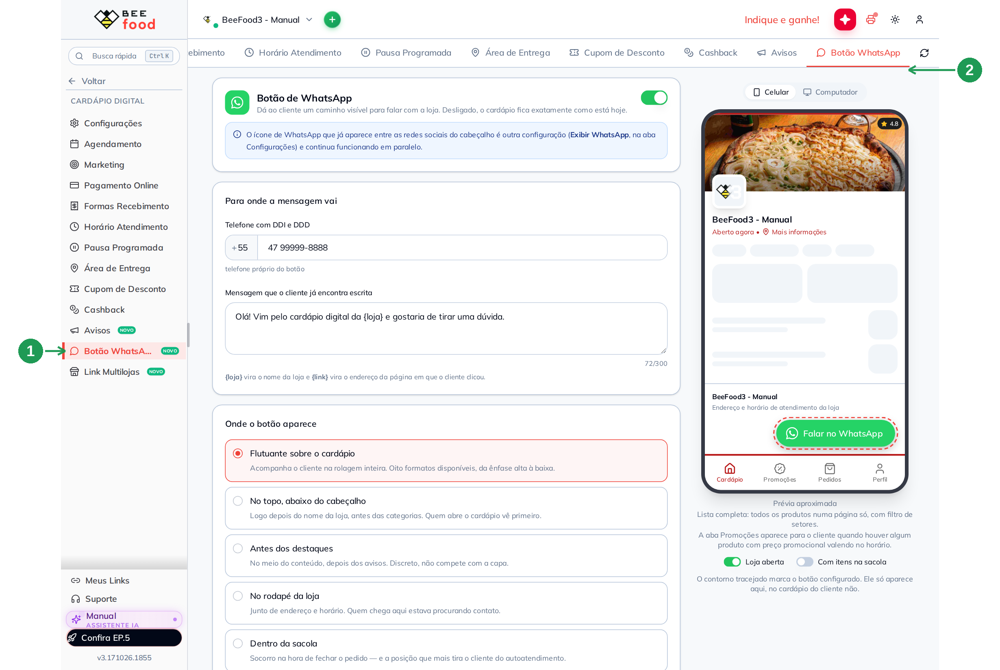
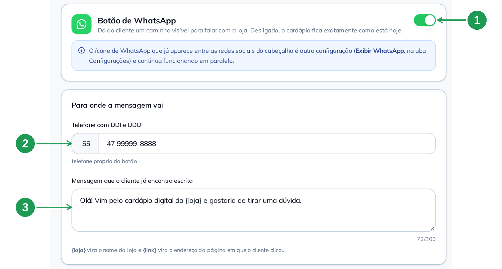
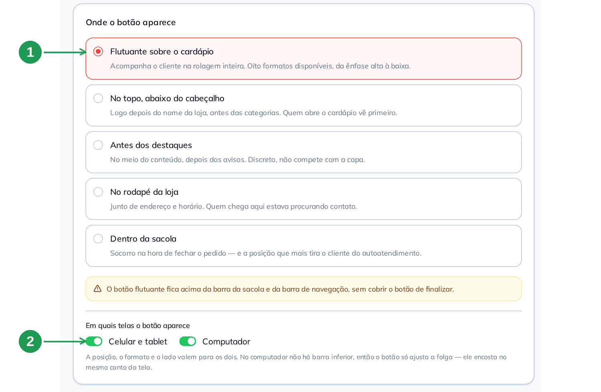
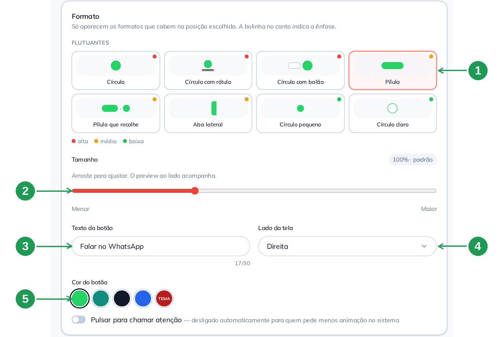
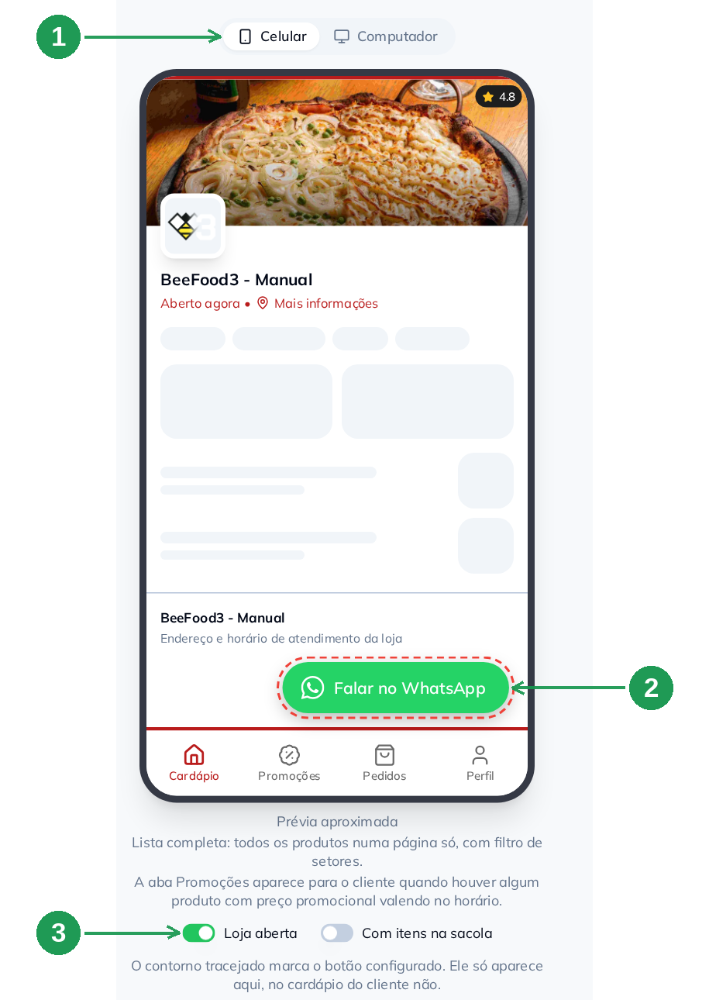
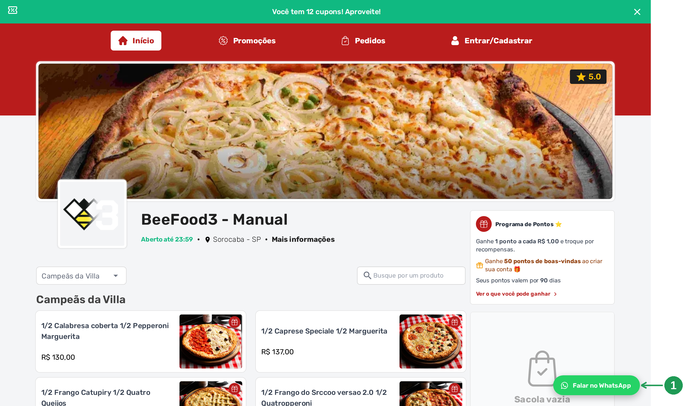
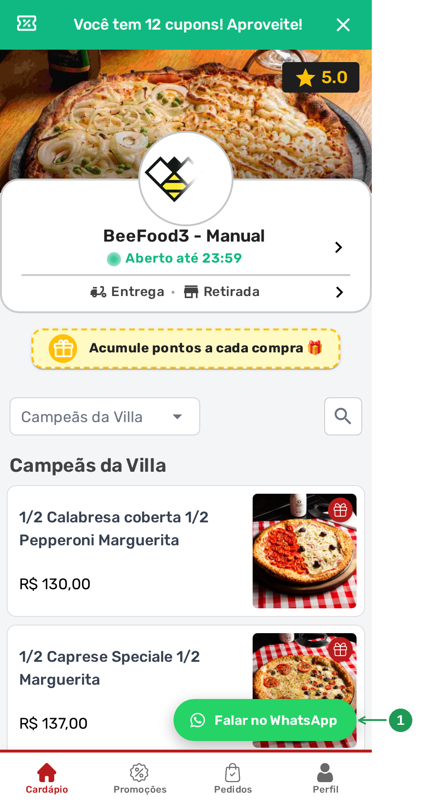

# Botão de WhatsApp no cardápio digital

Coloque um **botão de WhatsApp flutuando no canto do seu cardápio digital**: o cliente toca,
o WhatsApp abre com a mensagem já escrita e a conversa cai no número da loja. Serve para quem
tem dúvida no meio do pedido e, em vez de perguntar, desiste.

Este manual monta **uma** configuração — a mais comum: botão flutuante, no canto direito,
visível no celular e no computador. A tela tem muito mais (cinco posições, catorze formatos,
agenda por dia e por horário), e tudo isso fica explicado nela mesma, com um texto embaixo de
cada opção. Aqui você sai com o botão no ar em cinco passos.

> As imagens têm **marcações em verde** (setas e números) indicando onde clicar ou o que
> observar em cada tela.

---

## Antes de começar

1. Conta **BeeFood** com cardápio digital ativo.
2. A aba **Botão WhatsApp** visível em **Cardápio Digital**. Ela está em liberação por etapas:
   se não aparecer na sua conta, fale com o **suporte BeeFood**.
3. O **número de WhatsApp** que vai receber as mensagens. Se a filial já tem WhatsApp no
   cadastro, o botão usa esse número sem você digitar nada.

---

## Passo 1. Abrir Cardápio Digital → Botão WhatsApp

No menu, abra **Cardápio Digital** e clique em **Botão WhatsApp** (1). É a última aba da
linha, no alto da tela (2).

| Nº | O que fazer |
|----|-------------|
| 1 | **Botão WhatsApp**, no menu do Cardápio Digital. |
| 2 | A mesma aba na linha do topo, caso você já esteja dentro do Cardápio Digital. |

> **Esta tela salva sozinha.** Não existe botão Salvar: cada mudança é gravada em seguida, e
> aparece o aviso *Salvo automaticamente* no canto. Mexer aqui muda o cardápio do cliente.

## Passo 2. Ligar e dizer para onde a mensagem vai

Ligue a chave no alto do cartão **Botão de WhatsApp** (1). Em **Telefone com DDI e DDD** (2),
digite o número que vai atender — deixe em branco se quiser usar o WhatsApp do cadastro da
filial. Em **Mensagem que o cliente já encontra escrita** (3), escreva a frase que vem pronta
na conversa.

| Nº | Campo | O que fazer |
|----|-------|-------------|
| 1 | **Chave de ligar** | Liga o botão. Desligada, o cardápio fica exatamente como está hoje. |
| 2 | **Telefone com DDI e DDD** \* | O número que recebe as mensagens. O `+55` fica no campinho da esquerda e só muda para número de outro país. Vazio = usa o WhatsApp do cadastro da filial. |
| 3 | **Mensagem** | Até 300 caracteres. Use **`{loja}`** para o nome da loja e **`{link}`** para o endereço da página em que o cliente clicou — assim você já sabe de onde ele veio. |

> **Não é o mesmo WhatsApp do cabeçalho.** O ícone que já aparece entre as redes sociais da
> loja é a configuração **Exibir WhatsApp**, da aba *Configurações*, e continua funcionando
> em paralelo. Este botão é outro recurso, e os dois podem ficar ligados juntos.

## Passo 3. Escolher onde o botão aparece

Em **Onde o botão aparece**, escolha **Flutuante sobre o cardápio** (1): é a opção que
acompanha o cliente na rolagem inteira, e a que este manual configura. Em **Em quais telas**,
deixe **Celular e tablet** e **Computador** ligados (2).

| Nº | Campo | O que fazer |
|----|-------|-------------|
| 1 | **Flutuante sobre o cardápio** | Botão fixo no canto, visível em qualquer ponto do cardápio. O flutuante fica **acima** da barra da sacola, sem cobrir o botão de finalizar o pedido. |
| 2 | **Celular e tablet / Computador** | Deixe os dois ligados. A maior parte dos acessos ao cardápio vem do celular — desligar essa chave esconde o botão de quase todo mundo. |

## Passo 4. Escolher o formato, o lado e a cor

Em **Formato**, clique em **Pílula** (1): é o formato que mostra o ícone e o texto, e o
cliente entende sem precisar adivinhar. Deixe o **Tamanho** em 100% (2). Em **Texto do
botão** (3), escreva a chamada — *Falar no WhatsApp* funciona bem. Em **Lado da tela** (4),
escolha **Direita**. Em **Cor do botão** (5), o verde do WhatsApp é o mais reconhecível.

| Nº | Campo | O que fazer |
|----|-------|-------------|
| 1 | **Formato** | **Pílula**. A bolinha no canto de cada formato indica a ênfase — vermelha é alta, amarela é média, verde é baixa. Só aparecem os formatos que cabem na posição escolhida. |
| 2 | **Tamanho** | 100% é o padrão. Vai de 80% a 140%, se você quiser o botão menor ou maior. |
| 3 | **Texto do botão** | Até 30 caracteres. Em branco, volta para *Falar no WhatsApp*. |
| 4 | **Lado da tela** | **Direita** — o canto onde o cliente espera encontrar esse botão. *Esquerda* existe para quem tem outro elemento no canto direito. |
| 5 | **Cor do botão** | Verde do WhatsApp, verde escuro, preto, azul ou **TEMA** (a cor da sua loja). |

## Passo 5. Conferir na prévia, antes de o cliente ver

A prévia do lado direito da tela mostra o resultado na hora. Troque entre **Celular** e
**Computador** (1) e confira o botão no canto (2). As chaves **Loja aberta** e **Com itens na
sacola** (3) simulam as duas situações em que o botão muda de lugar.

| Nº | O que é |
|----|---------|
| 1 | **Celular / Computador** — a mesma configuração nos dois aparelhos. |
| 2 | O botão configurado, marcado com **contorno tracejado**. O contorno é só da prévia: no cardápio do cliente ele não aparece. |
| 3 | **Loja aberta** e **Com itens na sacola** — a prévia desenha o botão mesmo nas situações em que ele ficaria escondido, para você conseguir ver o que está editando. |

---

## Como fica no cardápio digital

Pronto: é só abrir o seu cardápio e olhar o canto. No **computador**, o botão fica a um
dedo da borda inferior direita (1) e acompanha a página inteira.

| Nº | O que observar |
|----|----------------|
| 1 | O botão **Falar no WhatsApp**, flutuando no canto inferior direito, sobre o conteúdo do cardápio. |

No **celular** ele fica no mesmo canto, logo acima da barra de navegação (1) — e sobe
sozinho quando a barra da sacola aparece, para não cobrir o botão de finalizar o pedido.

| Nº | O que observar |
|----|----------------|
| 1 | O mesmo botão no celular, acima da barra de navegação. |

Ao tocar, o cliente cai na conversa com a loja **com a mensagem já escrita** — com o nome da
loja e, se você usou `{link}`, o endereço da página em que ele estava.

---

## O que mais a tela oferece

Está tudo na própria tela, com explicação embaixo de cada opção. Em resumo:

- **Outras quatro posições:** no topo (abaixo do cabeçalho), antes dos destaques, no rodapé da
  loja e **dentro da sacola**. A posição muda a lista de formatos: as flutuantes são círculos,
  pílulas e aba lateral; as do corpo do cardápio são cartões, barras, selo e linha discreta.
- **Quando aparece:** sempre, **somente com a loja aberta** (para quem só atende no horário)
  ou **somente com a loja fechada** (para pegar o cliente que não consegue fechar pedido
  sozinho).
- **Dias da semana, faixa de horário e canais** (Delivery e Presencial): o botão aparece
  quando todas as condições valem ao mesmo tempo, pelo relógio do aparelho do cliente.
- **Subtítulo, pulsar para chamar atenção** e **tamanho** de 80% a 140%.

Vale experimentar com a prévia aberta: ela responde na hora, e a tela salva sozinha.

---

## Quando algo não funciona

| Sintoma | O que verificar |
|---------|-----------------|
| **Não encontro a aba Botão WhatsApp** | Ela está em liberação por etapas e ainda não está em todas as contas. Confirme com o **suporte BeeFood** e verifique se o seu grupo de acesso libera o item **Botão WhatsApp** do Cardápio Digital. |
| **Liguei e o botão não aparece no cardápio** | Três causas, nesta ordem: a configuração ainda não chegou ao cardápio (recarregue a página depois de alguns minutos — o cardápio guarda cache); o aparelho que você está usando está desligado em **Em quais telas**; ou a regra de **Quando aparece**, de dias ou de horário está excluindo este momento. |
| **O botão não aparece no celular, só no computador** | Ligue **Celular e tablet** em *Em quais telas*. |
| **A tela não salva** | Procure um campo em vermelho: horário inicial maior que o final, telefone incompleto ou mensagem acima de 300 caracteres **impedem a gravação** até serem corrigidos. |
| **Diz que a filial não tem WhatsApp no cadastro** | Você ligou o botão sem telefone próprio e a filial não tem WhatsApp cadastrado. Digite o número no campo **Telefone com DDI e DDD**. |
| **A mensagem chega com `{loja}` escrito** | Escreva a variável exatamente como ela aparece na dica, entre chaves e em minúsculas: `{loja}` e `{link}`. |
| **Tenho duas lojas e só uma tem o botão** | A configuração é **por filial**. Troque a filial no alto da tela e repita os passos. |
| **O botão cobre o botão de finalizar o pedido** | Não cobre: o flutuante sobe quando a barra da sacola aparece. Se estiver atrapalhando mesmo assim, troque o **Lado da tela** ou escolha um formato menor. |

---

## Perguntas frequentes

**Como coloco o WhatsApp no meu cardápio digital?**
Em **Cardápio Digital → Botão WhatsApp**, ligue a chave, informe o telefone e escolha a
posição. A tela salva sozinha e o botão passa a aparecer no cardápio dos seus clientes.

**Como ativar o botão de WhatsApp do cardápio digital?**
Mesma coisa: aba **Botão WhatsApp**, chave do cartão *Botão de WhatsApp* ligada. Não há botão
Salvar — a mudança grava sozinha.

**Como desativar / tirar o botão de WhatsApp do cardápio?**
Desligue a mesma chave. O cardápio volta a ficar exatamente como era antes, e a sua
configuração fica guardada para quando você quiser ligar de novo.

**Onde fica a configuração do botão de WhatsApp?**
Menu **Cardápio Digital**, aba **Botão WhatsApp** — a última da linha de abas.

**Como colocar um botão flutuante de WhatsApp no canto da tela?**
Em *Onde o botão aparece*, escolha **Flutuante sobre o cardápio**; em *Formato*, escolha um
dos flutuantes (Círculo, Pílula, Aba lateral…); em *Lado da tela*, **Direita** ou
**Esquerda**.

**O botão aparece no celular e no computador?**
Sim, e você decide: as chaves **Celular e tablet** e **Computador**, em *Em quais telas*,
ligam e desligam cada um. A posição, o formato e o lado valem para os dois.

**Dá para escolher o lado do botão? Posso deixar no canto esquerdo?**
Sim. O campo **Lado da tela** só aparece nos formatos flutuantes e aceita **Direita** ou
**Esquerda**.

**Posso mudar a cor e o texto do botão?**
Sim. **Cor do botão** tem verde do WhatsApp, verde escuro, preto, azul e **TEMA** (a cor
primária da sua loja). **Texto do botão** aceita até 30 caracteres.

**Qual número de WhatsApp o botão usa?**
O que você digitar no campo **Telefone com DDI e DDD**. Em branco, ele usa o WhatsApp do
cadastro da filial. Para número de fora do Brasil, troque o `+55`.

**Como mudar a mensagem que o cliente manda?**
No campo **Mensagem que o cliente já encontra escrita**, até 300 caracteres. É a frase que
aparece digitada quando a conversa abre — o cliente pode apagar e escrever outra.

**O que significa `{loja}` e `{link}` na mensagem?**
`{loja}` vira o nome da sua loja e `{link}` vira o endereço da página em que o cliente
clicou. Se ele estava vendo um produto, você recebe o link daquele produto.

**Preciso salvar depois de configurar?**
Não. A aba salva automaticamente, com o aviso *Salvo automaticamente*. Só não grava enquanto
houver campo inválido.

**Dá para o botão aparecer só fora do horário de funcionamento?**
Sim. Em *Quando aparece*, escolha **Somente com a loja fechada** — é a opção para quem quer
atender no WhatsApp justamente quando o cliente não consegue fechar o pedido sozinho.

**Dá para o botão aparecer só em alguns dias ou só à noite?**
Sim. **Dias da semana** liga e desliga cada dia, e desligar **Dia inteiro** abre os campos
*Das* e *Até*. As condições valem juntas.

**O botão do cardápio é o mesmo ícone de WhatsApp do cabeçalho da loja?**
Não. O ícone entre as redes sociais é a configuração **Exibir WhatsApp**, na aba
*Configurações*. Este botão é outro recurso, com posição, formato e mensagem próprios, e os
dois podem ficar ligados ao mesmo tempo.

**Já tenho o ícone de WhatsApp na loja. Preciso deste botão também?**
São coisas diferentes: o ícone do cabeçalho é um contato discreto no alto da página; este
botão acompanha o cliente enquanto ele navega e já abre a conversa com a mensagem escrita.

**Posso ver como fica antes de publicar?**
Sim, e é o recomendado. A prévia ao lado do formulário desenha o botão no cardápio, no
celular e no computador, enquanto você edita.

**Dá para saber quantos clientes clicaram no botão?**
O cardápio registra cada clique no Pixel do BeeFood, mas **não há hoje uma tela no painel que
mostre esse total separado**. Na prática, o que se acompanha é o movimento no próprio
WhatsApp da loja.

**Tenho mais de uma loja/filial. A configuração vale para todas?**
Não: ela é **por filial**. Configure uma, troque a filial no alto da tela e repita.

**O botão atrapalha quem está fechando o pedido?**
O flutuante fica acima da barra da sacola e não cobre o botão de finalizar. Se quiser ir além,
evite a posição **Dentro da sacola**, que é a que mais tira o cliente do autoatendimento — a
própria tela avisa isso.

---

## Precisa de ajuda?

Fale com o **suporte BeeFood** informando: nome da loja e **filial**, se a aba **Botão
WhatsApp** aparece para você, se a chave está ligada, a **posição** escolhida e em qual
aparelho o botão não apareceu (celular ou computador).

---

## Onde continuar

- **Avisos do cardápio digital:** recados em faixa, com dia e horário próprios.
- **Aparência e layout do cardápio digital:** cores, capa e logotipo — é de lá que vem a cor
  **TEMA**.
- **Pedidos pelo chat no WhatsApp** e **notificações de cada etapa:** o WhatsApp do outro
  lado, já com o pedido na mão.

---

*Última atualização: outubro/2026 — BeeFood · Cardápio Digital · Botão WhatsApp*
