# Importar cardápio — quatro caminhos para não cadastrar produto por produto

Cardápio novo não precisa ser digitado. O **BeeFood** tem **quatro caminhos** para trazer o seu
cardápio de onde ele já está: do **iFood**, de uma **foto ou PDF** do cardápio impresso, de uma
**planilha Excel** e de **outra empresa sua** que já usa o BeeFood.

Os quatro terminam no mesmo lugar — **Cardápio → Produtos** — e todos **somam** ao que já
existe: nenhum deles apaga o cardápio atual. Por isso a ordem importa, e o primeiro é o que
monta o cardápio inteiro.

> As imagens têm **marcações em verde** (setas e números) indicando onde clicar ou o que
> observar em cada tela.

---

## Qual caminho é o seu

| Você tem… | Use | Onde fica | O que ele traz |
|---|---|---|---|
| a loja no **iFood** | **Copiar do iFood** | Cardápio → Copiar do iFood | setores, produtos, fotos, complementos e opções — o cardápio inteiro |
| o cardápio em **papel, foto ou PDF** | **Copiar de Imagem** | Cardápio → Copiar de Imagem | o que estiver legível na imagem, revisado por você antes de cadastrar |
| o cardápio em **planilha** | **Importar** (Excel) | Cardápio → Produtos → Importar | nome, setor, código, preços, descritivo, NCM e CEST — **sem foto** |
| **outra empresa sua** já no BeeFood | **Clonar e importar** | Configuração → Clonar e importar | setores, produtos, grupos de opção e insumos da outra empresa |

**A combinação mais comum é a primeira com as outras.** Copie do iFood para ter o cardápio de
pé em poucos minutos e depois use a planilha ou a digitalização para o que não estava no iFood —
foi exatamente assim que as telas deste manual foram fotografadas.

**Nenhum dos caminhos confere se o produto já existe.** Importar duas vezes a mesma coisa
cadastra duas vezes. Vale importar primeiro, conferir, e só então importar o resto.

---

## Antes de começar

1. **Permissão no menu.** Cada caminho é um item de menu com permissão própria: *Copiar do
   iFood* e *Copiar de Imagem* ficam no submenu **Cardápio**; *Clonar e importar*, no submenu
   **Configuração**. Se um deles não aparecer para você, peça ao usuário Principal da sua loja
   para liberar em **Configuração → Usuários**.
2. **Saiba qual cardápio vai receber.** Se a sua empresa tem mais de um cardápio (mais de uma
   filial), os caminhos perguntam para qual deles vai a importação. Com um só, eles já vêm
   preenchidos.
3. **Importou errado? A volta é manual.** Não existe "desfazer importação". Dá para apagar
   produto por produto, ou em lote por **Editar em Lote**, mas é trabalho. Daí a recomendação de
   começar com uma importação e conferir o resultado.
4. **Para o caminho do iFood, tenha o link da loja em mãos.** É o endereço da página do
   restaurante no site do iFood — o manual mostra o formato exato no Passo 2.

---

## Caminho 1 — Copiar do iFood

É o caminho mais completo, e o único que traz **fotos** e os **complementos** já montados em
grupos de opção. Você informa o link da loja no iFood e o BeeFood lê o cardápio público dela.

> **Dá para copiar de qualquer loja do iFood, inclusive a sua.** O uso esperado é copiar o
> **seu próprio** cardápio, para não redigitá-lo.

### Passo 1. Abrir Cardápio → Copiar do iFood

No menu lateral, no submenu **Cardápio**, clique em **Copiar do iFood** (1). Na primeira vez a
tela tem um botão só: **Copiar Cardápio do iFood** (2). Clique nele.

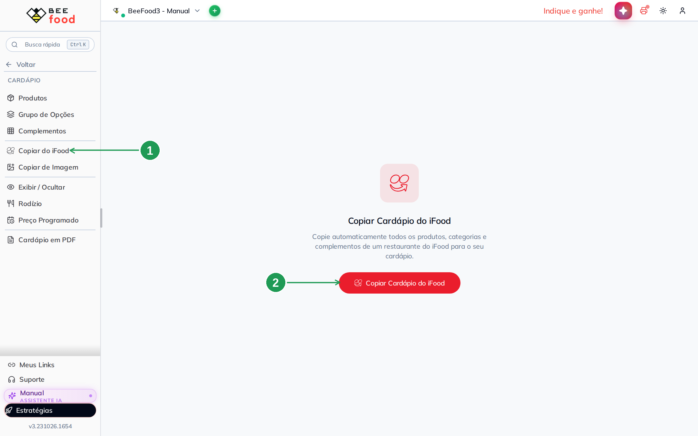

| Nº | O que fazer |
|----|-------------|
| 1 | **Copiar do iFood**, no submenu **Cardápio** do menu lateral. |
| 2 | **Copiar Cardápio do iFood** — abre o formulário. O mesmo botão continua no topo da tela depois, para importar de novo. |

> **Loja nova recebe o convite sozinha.** Empresa com menos de dez produtos cadastrados vê um
> convite para importar do iFood logo ao entrar no sistema. Ele é o mesmo caminho deste passo, e
> para de aparecer quando o cardápio passa de dez produtos.

### Passo 2. Informar o link da loja e o cardápio que vai receber

Cole em **URL do Restaurante no iFood** (1) o endereço da página da loja. O botão ao lado (2)
cola o que está na área de transferência — e, se você copiou o link antes de abrir a tela, o
campo **já vem preenchido**, com o aviso verde *URL do iFood detectada*. Confira o **Cardápio
Destino** (3) e clique em **CONFIRMAR (F2)** (4).

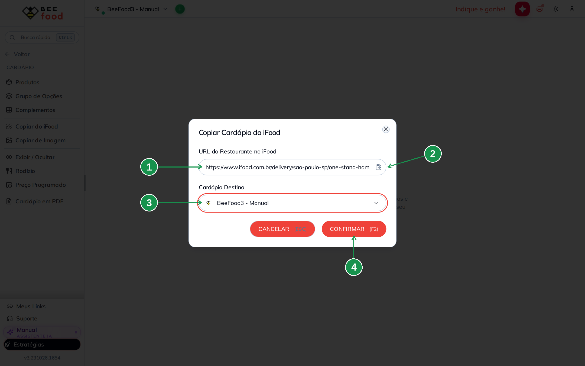

| Nº | Campo | O que fazer |
|----|-------|-------------|
| 1 | **URL do Restaurante no iFood** | Cole o endereço da loja. O sistema limpa sozinho o que vem depois de `?` e aceita o link sem `https://` ou sem `www`. |
| 2 | **Colar da área de transferência** | Cola e valida de uma vez. Útil quando o colar do teclado não funciona no navegador. |
| 3 | **Cardápio Destino** | Para onde vão os produtos. Com um cardápio só, já vem escolhido; com mais de um, escolha na lista. |
| 4 | **CONFIRMAR (F2)** | Põe a importação na fila. **CANCELAR (ESC)** desiste. |

**O formato que o sistema aceita** é o da página do restaurante, com o identificador no fim:

```
https://www.ifood.com.br/delivery/cidade-uf/nome-do-restaurante/00000000-0000-0000-0000-000000000000
```

Se o link não estiver nesse formato, o próprio campo avisa o que falta: *A URL deve começar com
https://www.ifood.com.br*, *A URL deve conter /delivery/* ou *A URL deve terminar com o ID do
restaurante (formato UUID)*. Link de **item** do cardápio, de **busca** ou do aplicativo não
serve — abra a loja no navegador e copie o endereço da barra.

### Passo 3. A fila

A importação entra numa fila e o cartão aparece como **Aguardando processamento…**, com o selo
**Na fila — posição N** (1). Quando é a próxima, o selo muda para *Próximo na fila…*. Enquanto
está na fila ou processando, existe o botão **Cancelar** (2).

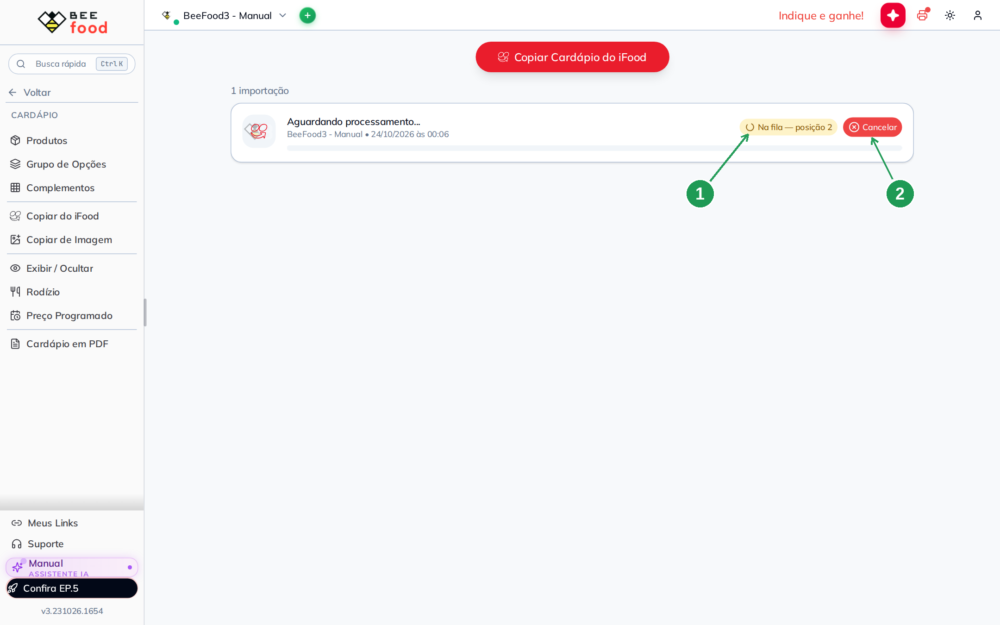

| Nº | Campo | O que observar |
|----|-------|----------------|
| 1 | **Na fila — posição N** | A sua posição. A fila é do sistema, não da sua loja: ela existe porque cada importação lê o cardápio no iFood. |
| 2 | **Cancelar** | Interrompe antes de cadastrar. Pede confirmação, e depois o cartão fica *Cancelado*, em cinza. |

> **Pode fechar a tela.** A importação roda no servidor, não no seu navegador. Dá para sair,
> atender um pedido e voltar depois — o cartão vai estar onde você deixou, mais adiante.

### Passo 4. A extração em andamento

A tela passa a mostrar o nome e a capa da loja, a mensagem do que está sendo feito (1), o
contador de **produtos processados** (2) e a porcentagem (3). A mensagem **gira** —
*Processando setores…*, *Processando fotos…*, *Organizando categorias…* — e isso é só informação:
o que diz o andamento de verdade são o contador e a barra.

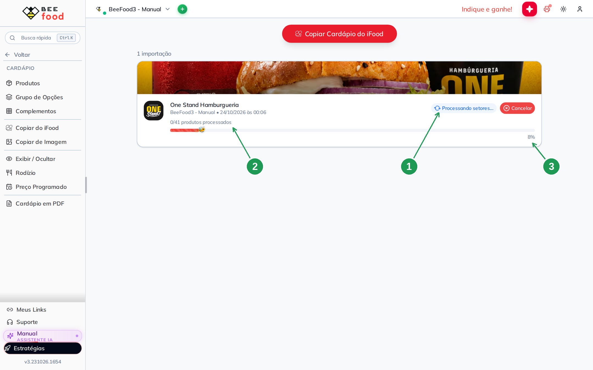

| Nº | Campo | O que observar |
|----|-------|----------------|
| 1 | Mensagem do andamento | Troca a cada dez segundos entre várias frases. Não indica etapa fixa. |
| 2 | **N/N produtos processados** | É o número que importa: quantos itens do cardápio do iFood já entraram. |
| 3 | **Porcentagem** | O mesmo da barra. Antes de o total ser conhecido, a barra corre solta, com a abelhinha. |

> **A tela se atualiza sozinha** enquanto há importação em andamento — não precisa recarregar a
> página.

### Passo 5. Concluído

O selo verde **Concluído** (1) e o contador igualado — *41/41 produtos processados* (2) —
fecham a importação. O cartão ganha um brilho verde e cai uma chuva de confete; o botão
**Cancelar** desaparece, porque não há mais o que cancelar.

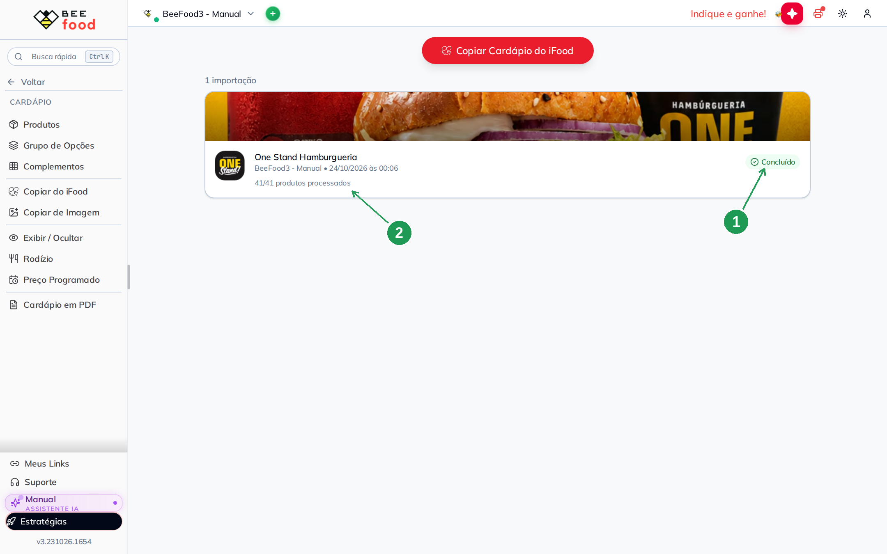

| Nº | Campo | O que observar |
|----|-------|----------------|
| 1 | Selo **Concluído** | É ele que autoriza ir conferir o cardápio. Enquanto estiver *Finalizando importação…*, ainda falta gravar coisa. |
| 2 | **N/N produtos processados** | Os dois números iguais: tudo o que a loja tinha foi processado. |

**Quanto tempo leva?** Na importação que gerou as imagens deste manual, uma loja com **41 itens**
levou **cerca de 1 minuto e 40 segundos** entre o CONFIRMAR e o Concluído. Cardápio maior leva
mais, e fila cheia atrasa o começo.

### Passo 6. Conferir o cardápio

Vá a **Cardápio → Produtos**. Os setores do iFood viraram setores do BeeFood, na mesma ordem,
com as fotos no lugar.

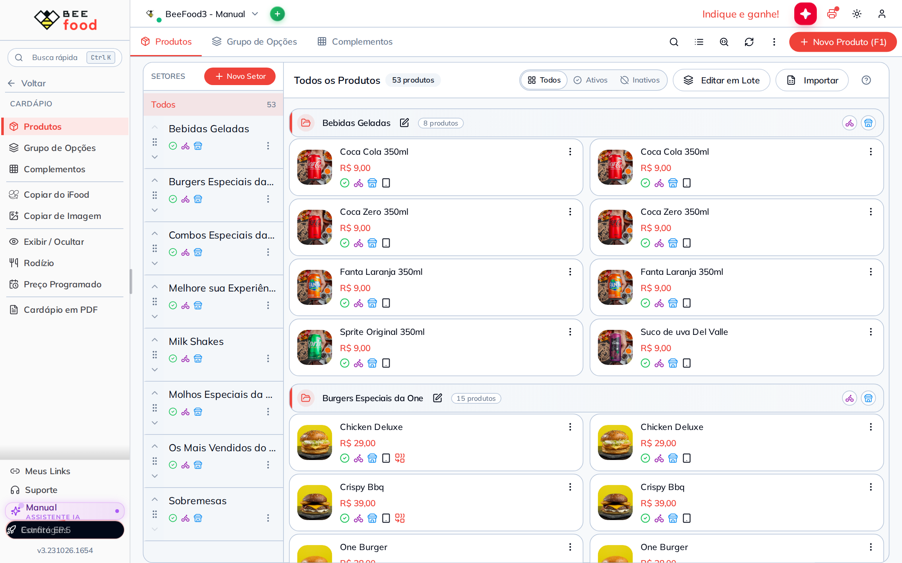

Em **Cardápio → Grupo de Opções** estão os complementos: cada grupo com o seu nome, as opções e
o preço de cada uma.

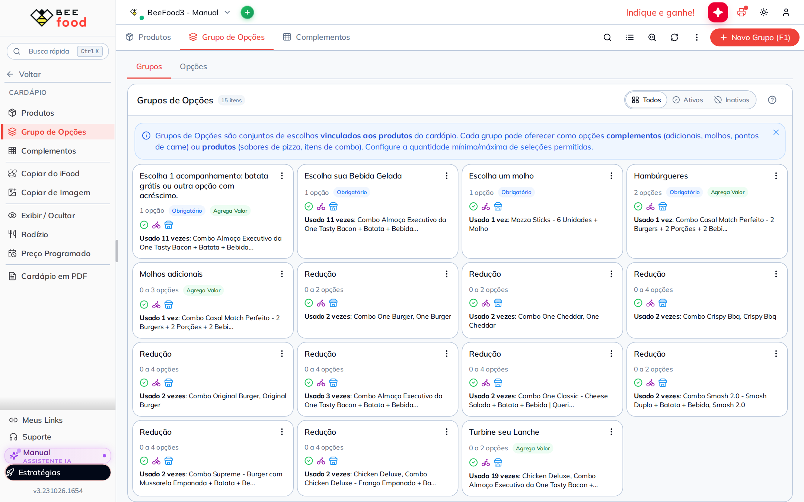

Na importação deste manual entraram **8 setores**, **84 produtos** e **15 grupos de opção** com
**61 opções** — e desses 84 produtos, 53 aparecem na lista de produtos. Os outros são **cadastros
de opção**: a próxima seção explica por que eles existem e por que não devem ser apagados.

---

## Caminho 2 — Copiar de Imagem (digitalizar o cardápio)

Aqui o insumo é uma **foto, um print ou um PDF** do cardápio. A inteligência artificial lê o
arquivo, devolve o cardápio em forma de lista para você **conferir e corrigir**, e só cadastra
depois que você confirma. É o caminho de quem tem cardápio impresso e não tem loja no iFood.

### Passo 7. Enviar o arquivo

Em **Cardápio → Copiar de Imagem**, arraste o arquivo ou clique para escolher. A tela aceita
**PNG, JPG, WEBP e PDF**, até **10 MB cada**, e vários arquivos de uma vez (1) — cardápio de
duas páginas pode ir junto. O arquivo escolhido aparece como miniatura (2).

O campo **Instruções adicionais (opcional)** (3) é o que mais muda o resultado: é ali que você
dá contexto à leitura — *"os preços estão em dólar, converta para real"*, *"ignore a seção de
bebidas"*, *"separe os combos em itens individuais"*. Clique em **Continuar** (4).

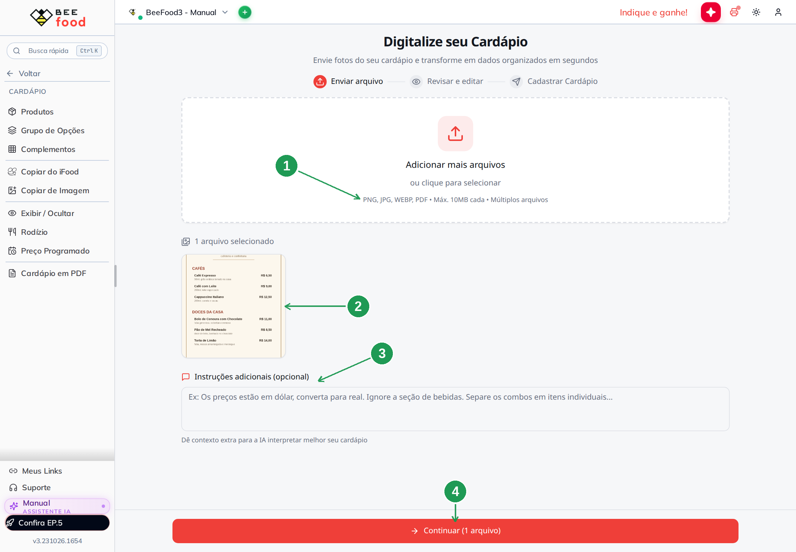

| Nº | Campo | O que fazer |
|----|-------|-------------|
| 1 | **Formatos e limite** | PNG, JPG, WEBP, PDF • máx. 10 MB cada • múltiplos arquivos. |
| 2 | **Miniatura do arquivo** | Confira se é a página certa antes de continuar. |
| 3 | **Instruções adicionais (opcional)** | Contexto para a leitura. Em branco também funciona. |
| 4 | **Continuar** | Começa a leitura. O botão mostra quantos arquivos vão. |

> **Foto boa importa mais que instrução boa.** Cardápio fotografado reto, com o preço legível e
> sem sombra, é lido quase inteiro. Foto torta ou escura perde item.

### Passo 8. Conferir o que a IA leu

A tela mostra o cardápio **extraído**, antes de virar cadastro: o nome do estabelecimento com o
total de itens e categorias (1), as categorias e os itens com descrição e preço (3). Os botões do
topo (2) levam o extraído para fora — copiar o texto, baixar, ou gerar um **Excel**.

Confira item por item. É agora que se vê preço trocado, item faltando ou descrição grudada na
seguinte. Quando estiver certo, clique em **Continuar** (4).

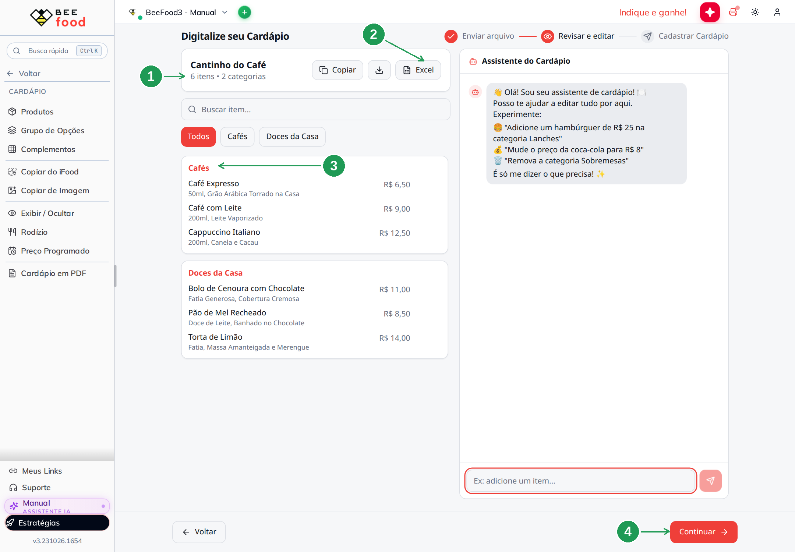

| Nº | Campo | O que observar |
|----|-------|----------------|
| 1 | **Nome, itens e categorias** | O primeiro teste: o número de itens tem de bater com o cardápio que você enviou. |
| 2 | **Copiar, baixar e Excel** | Guardam o que foi lido. O **Excel** serve para corrigir muita coisa na planilha e importar pelo Caminho 3. |
| 3 | **Categorias e itens** | Os setores e produtos como vão ser cadastrados. A busca e as abas de categoria, acima, ajudam em cardápio grande. |
| 4 | **Continuar** | Vai para a confirmação do cadastro. Nada foi gravado ainda. |

### Passo 9. Corrigir pelo assistente, em português

O **Assistente do Cardápio**, à direita, edita o que foi lido **por frase**. Escreva o que quer
no campo de conversa (1) — *"Mude o preço do Café Expresso para R$ 7,50"* — e ele responde (2) e
**altera a lista** (3). Ele também adiciona item, remove categoria e corrige descrição.

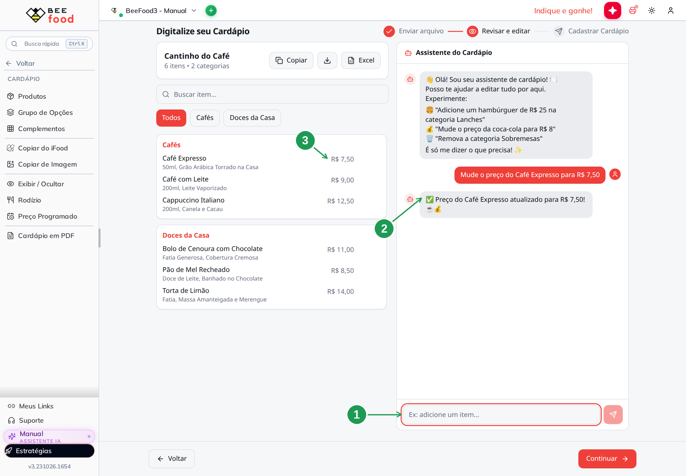

| Nº | Campo | O que fazer |
|----|-------|-------------|
| 1 | **Campo de conversa** | Escreva a correção em português, uma por mensagem. |
| 2 | **Resposta do assistente** | Confirma o que ele entendeu. Se entendeu errado, basta corrigir na mensagem seguinte. |
| 3 | **O item já corrigido** | A lista muda na hora — e é essa lista corrigida que vai para o cadastro. |

> **O que você corrige aqui é o que entra.** O preço alterado no assistente foi o que ficou
> gravado no produto depois do cadastro: corrigir aqui é mais rápido que corrigir produto por
> produto depois.

### Passo 10. Confirmar o envio

O aviso **Confirmar envio** — *"Tem certeza que deseja continuar? Os dados do cardápio serão
enviados para cadastro."* — é o **ponto sem volta** deste caminho. Clique em **Confirmar** (1)
só quando a lista estiver do jeito que você quer.

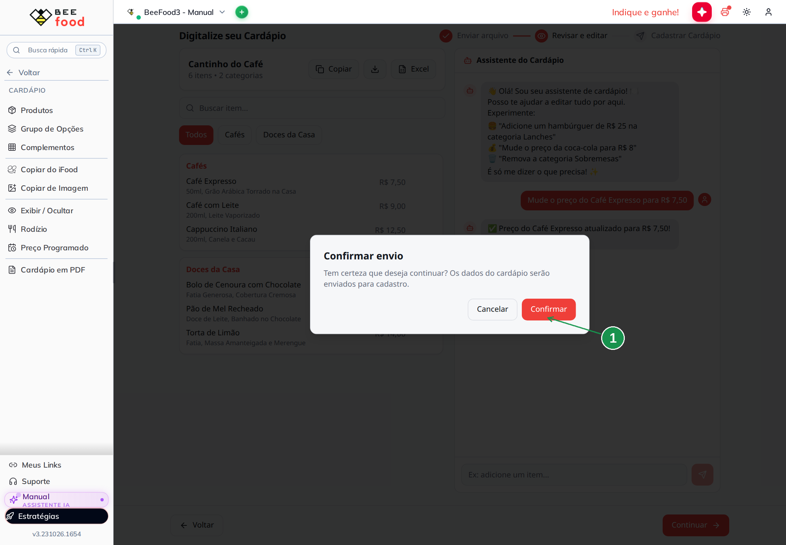

| Nº | Campo | O que fazer |
|----|-------|-------------|
| 1 | **Confirmar** | Cadastra o cardápio revisado. **Cancelar** volta para a revisão sem gravar nada. |

### Passo 11. O resultado

**Cardápio importado com sucesso!** e os cartões (1) com quantos **setores**, **produtos**,
**complementos**, **grupos** e **opções** entraram. Compare com o que a revisão mostrava no
Passo 8: os números têm de bater.

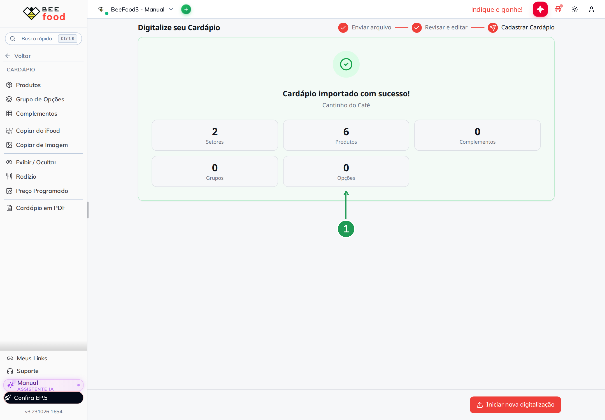

| Nº | Campo | O que observar |
|----|-------|----------------|
| 1 | **Setores, Produtos, Complementos, Grupos e Opções** | O que foi criado. Cardápio impresso sem complemento cadastra zero em complementos e grupos — é esperado. |

O botão **Iniciar nova digitalização** limpa a tela para a próxima página do cardápio.

> **Tem mais de um cardápio?** A tela pergunta qual vai receber antes de começar, e o cardápio
> escolhido fica no alto, com um **Editar** ao lado. Trocar de cardápio no meio **descarta** o
> que já foi lido — a tela avisa: *Os dados da importação serão perdidos, tem certeza?*

---

## Caminho 3 — Importar por planilha Excel

É o caminho para quem já tem o cardápio em planilha, ou para cadastrar muitos itens de uma vez.
Ele importa **texto e preço** — não importa foto nem complemento — e existe em dois lugares, com
a mesma tela: **Cardápio → Produtos** e **Cardápio → Complementos**.

### Passo 12. Abrir o Importar e baixar o template

Em **Cardápio → Produtos**, clique em **Importar** (1). Leia os dois avisos amarelos (2): só
entra item **com nome**, e colunas de **NCM** e **CEST** precisam estar formatadas como **texto**
no Excel, senão o Excel come os zeros à esquerda.

Arraste a planilha na área do meio (3) — `.xlsx`, `.xls` ou `.csv`. Se você ainda não tem
planilha, clique em **BAIXAR TEMPLATE** (4): ele vem com os cabeçalhos certos, em branco.

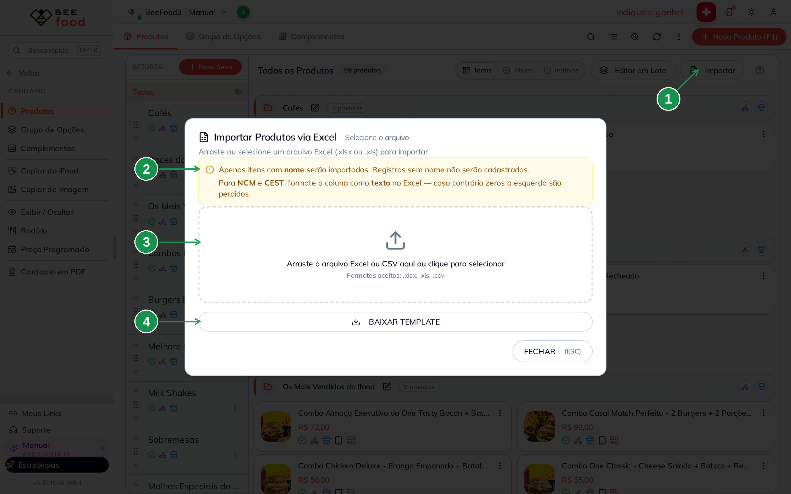

| Nº | Campo | O que fazer |
|----|-------|-------------|
| 1 | **Importar** | Abre o assistente. Em **Complementos** o botão é o mesmo, e a planilha vai sem a coluna *Setor*. |
| 2 | **Avisos** | Item sem nome é ignorado; NCM e CEST como **texto**. |
| 3 | **Área do arquivo** | Arraste ou clique para escolher. Aceita `.xlsx`, `.xls` e `.csv`. |
| 4 | **BAIXAR TEMPLATE** | Baixa `template_importacao_produtos.xlsx`, com as colunas na ordem que o sistema entende. |

**As colunas do template de produtos** são estas, e nenhuma além do nome é obrigatória:

| Coluna | Para que serve |
|---|---|
| **Setor** | O grupo do cardápio. Nome que não existe ainda **é criado** na importação. |
| **Descrição** | O **nome** do produto. É a única coluna obrigatória. |
| **Código** | O código interno (PDV, balança, controle próprio). |
| **Preço Venda** / **Preço Custo** | Valores. Aceitam vírgula ou ponto. |
| **Código de Barras** | EAN do item. |
| **Descritivo** | O texto que o cliente lê no cardápio. |
| **Unidade Medida** | UN, KG, L… |
| **Observação** | Anotação interna, não aparece para o cliente. |
| **NCM** / **CEST** | Classificação fiscal — formate como **texto**. |

O template de **complementos** é o mesmo, sem a coluna *Setor*.

### Passo 13. Conferir o mapeamento das colunas

A tela lê o cabeçalho da sua planilha e **já associa** cada coluna a um campo do sistema. O
resumo (1) mostra quantos registros ela achou e quantos campos foram mapeados; a tabela mostra a
**Coluna do Excel** (2), o **Campo do Sistema** escolhido (3) e um **Exemplo** tirado da primeira
linha (4). Linha verde é coluna mapeada; vermelha é coluna que vai ser ignorada.

Confira o **Exemplo** de cada linha — é o que prova que a coluna certa foi para o campo certo —
e clique em **IMPORTAR (F2)** (5).

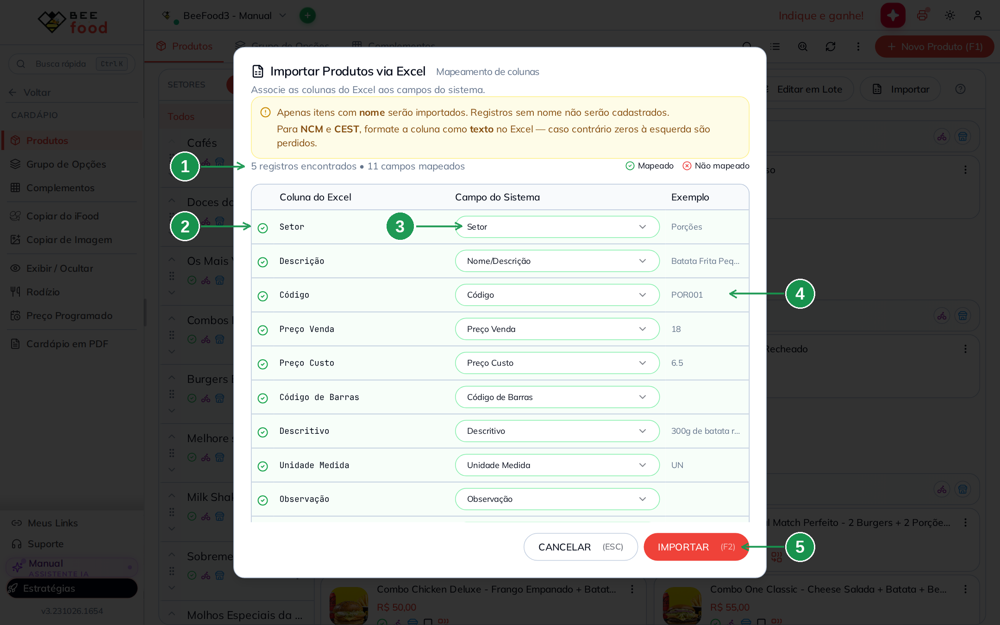

| Nº | Campo | O que fazer |
|----|-------|-------------|
| 1 | **N registros encontrados • N campos mapeados** | Se o número de registros não bate com a sua planilha, provavelmente há linha em branco ou cabeçalho fora da primeira linha. |
| 2 | **Coluna do Excel** | O cabeçalho como está na sua planilha. |
| 3 | **Campo do Sistema** | Troque na lista se o palpite estiver errado. **— Ignorar —** descarta a coluna. Cada campo só pode receber uma coluna. |
| 4 | **Exemplo** | O valor da primeira linha daquela coluna. É a conferência que pega troca de preço com custo. |
| 5 | **IMPORTAR (F2)** | Começa a importar. Fica desligado enquanto nenhuma coluna estiver mapeada. |

Mais abaixo, fora da foto, um **Preview** mostra as cinco primeiras linhas já no formato do
sistema, com linha vermelha para registro sem nome — que não vai ser cadastrado.

### Passo 14. O resultado, linha por linha

A tela importa em blocos e vai marcando cada linha: *Aguardando*, *Enviando…*, **Importado** ou o
erro. No fim, **Importação finalizada** e os três contadores (1): **Enviados**, **Sucesso** e
**Falhas** (2). Eles são **botões** — clique em *Falhas* para ver só o que não entrou.

A coluna **Status** (3) diz, linha por linha, o que aconteceu, com a mensagem de erro no lugar do
*Importado*. Depois de conferir, **FECHAR (ESC)** (4).

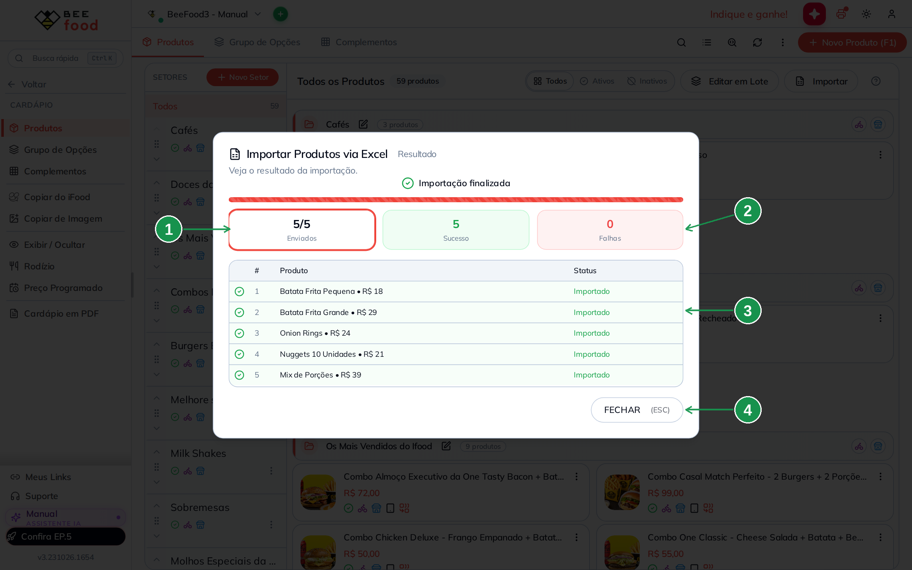

| Nº | Campo | O que observar |
|----|-------|----------------|
| 1 | **Enviados / Sucesso / Falhas** | Enviados mostra o andamento (`5/5`); os outros dois, o resultado. |
| 2 | **Falhas** | Clique para filtrar só as linhas com erro e corrigir a planilha. |
| 3 | **Status** | *Importado* ou a mensagem de erro daquela linha. |
| 4 | **FECHAR (ESC)** | Fecha o assistente. Volte a **Produtos** e atualize para ver os itens novos. |

> **Corrigir e reimportar só o que falhou.** Deixe na planilha apenas as linhas com erro e
> importe de novo. Reimportar a planilha inteira **cadastra outra vez** o que já tinha entrado.

> **O CANCELAR durante a importação** para os blocos que ainda não foram enviados — o que já foi
> cadastrado **fica**. As linhas restantes aparecem como *Cancelado*.

---

## Caminho 4 — Clonar e importar (de outra empresa sua)

Se você já tem outra empresa no BeeFood com o cardápio pronto — a primeira loja, a matriz, uma
franquia —, este caminho copia o cadastro de lá para cá: **setores, produtos, grupos de opção e
insumos**.

> **A origem tem de ser outra empresa.** Não é possível usar a própria empresa como origem: o
> sistema recusa com *"A empresa de origem é a mesma da empresa atual."* O subtítulo da tela fala
> em copiar *"entre cardápios desta empresa"*, e isso vale para a aba **Área de entrega**, que
> copia de um cardápio seu para outro — não para a aba do cardápio.

### Passo 15. Abrir Clonar e importar e informar as credenciais da origem

No menu lateral, submenu **Configuração**, clique em **Clonar e importar** (1). A tela abre na
aba **Cardápio de outra empresa** (2). Informe o **Usuário** (3) e a **Senha** (4) do **usuário
principal da empresa de origem** — a tela avisa que *as credenciais não ficam salvas* — e clique
em **Continuar** (5).

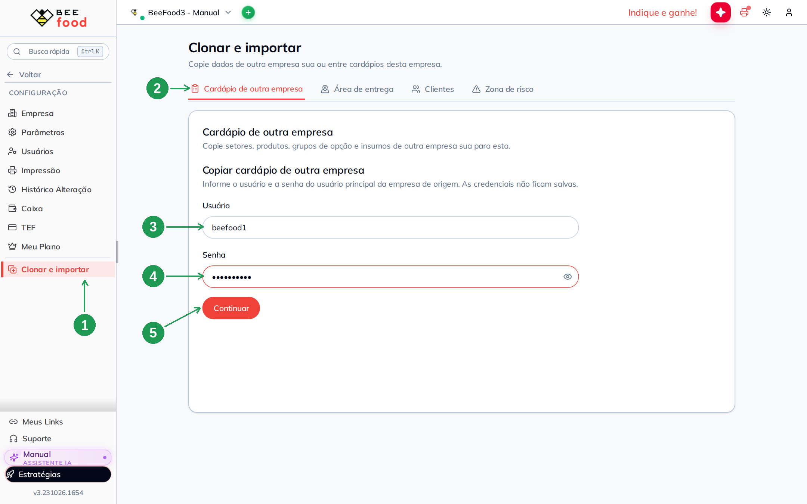

| Nº | Campo | O que fazer |
|----|-------|-------------|
| 1 | **Clonar e importar** | Submenu **Configuração** do menu lateral. |
| 2 | Aba **Cardápio de outra empresa** | Já vem selecionada. As outras abas copiam **área de entrega** e **clientes**. |
| 3 | **Usuário** | O login do usuário **principal** da empresa de origem. Usuário comum não vale. |
| 4 | **Senha** | A senha desse usuário. Ela é usada só para validar o acesso e não fica guardada. |
| 5 | **Continuar** | Valida o acesso e mostra a prévia. Nada é copiado ainda. |

> **Credencial é da outra empresa, não sua.** Se a outra empresa é de um sócio, peça a ele que
> faça este passo com você — ou que troque a senha depois.

### Passo 16. Conferir a prévia, e o aviso de duplicação

Com o acesso validado, a tela mostra o nome da **empresa de origem** (1) e **o que existe lá**:
setores, produtos, grupos de opção e insumos (2).

Se o cardápio **desta** empresa já tiver cadastro, aparece o aviso **Esta empresa já tem
cadastro** (3), com os números de cá e o recado que importa: *a cópia pode duplicar itens*. A
caixa **Copiar também a configuração de impostos dos produtos** (4) vem desmarcada — marque se as
duas empresas têm o mesmo regime fiscal. Clique em **Copiar cadastro** (5).

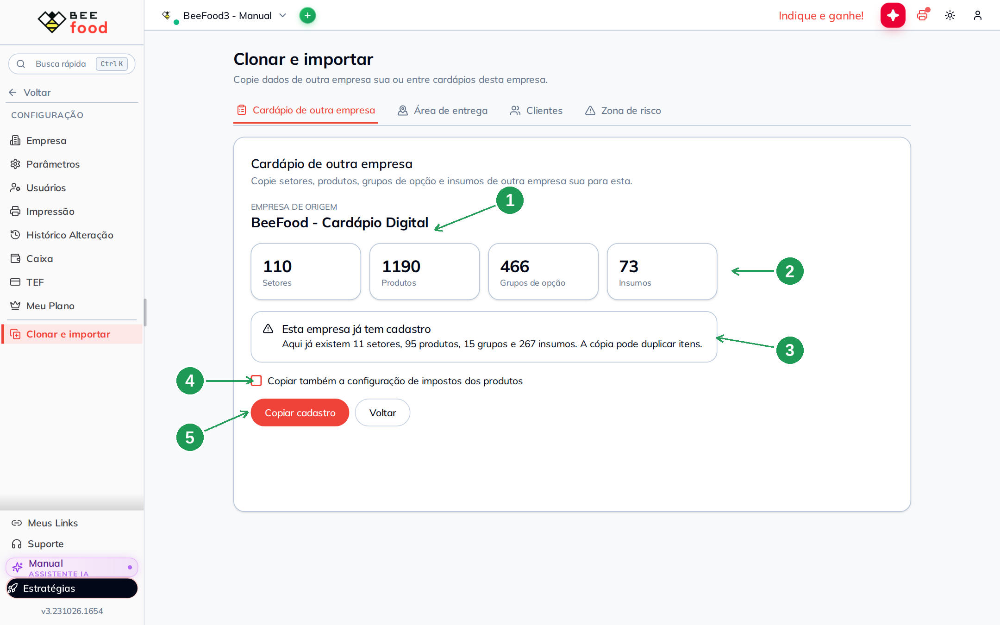

| Nº | Campo | O que observar |
|----|-------|----------------|
| 1 | **Empresa de origem** | O nome que veio com a credencial. É a confirmação de que você pegou a empresa certa. |
| 2 | **Setores, Produtos, Grupos de opção e Insumos** | O volume que vem de lá. Número grande merece uma segunda olhada antes de copiar. |
| 3 | **Esta empresa já tem cadastro** | O que já existe aqui. A cópia **soma**, e itens de mesmo nome ficam duplicados. |
| 4 | **Copiar também os impostos** | Marque só se o regime fiscal for o mesmo. Desmarcado, os produtos chegam sem configuração de imposto. |
| 5 | **Copiar cadastro** | Abre a confirmação do Passo 17. |

### Passo 17. Confirmar a cópia

O aviso **Copiar cadastro** repete o que vai acontecer — *"Copiar setores, produtos, grupos de
opção e insumos de \<empresa\> para esta empresa?"*. **COPIAR** (1) é o que grava.

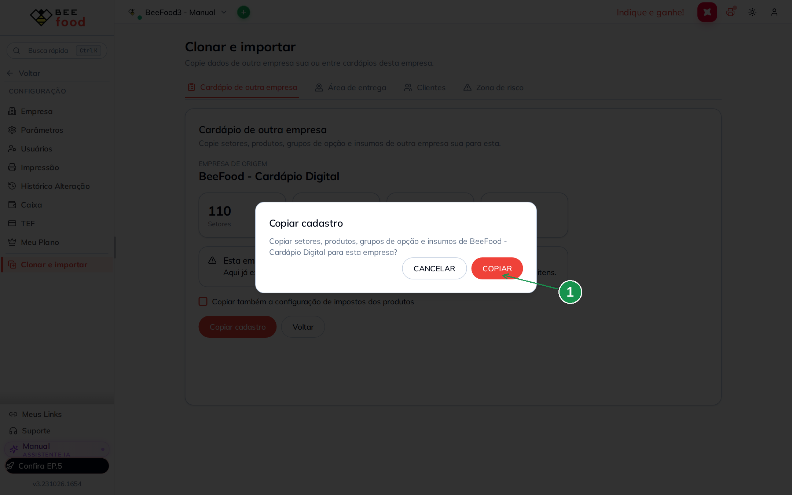

| Nº | Campo | O que fazer |
|----|-------|-------------|
| 1 | **COPIAR** | Executa a cópia. **CANCELAR** volta à prévia sem copiar nada. |

**Enquanto copia, não feche a página.** O botão vira *Copiando cadastro…*, as abas travam e o
navegador avisa se você tentar sair. No fim aparece **Cadastro copiado de \<empresa\>**, com os
cartões do que entrou, a linha *Impostos dos produtos: copiados / não copiados* e o atalho **Ir
para o cardápio**.

> **Se o destino já tiver cadastro**, o sistema pode voltar com uma segunda pergunta —
> **Copiar mesmo assim?** — avisando que itens podem ficar duplicados. **COPIAR MESMO ASSIM**
> segue; **CANCELAR** para ali.

---

## Depois de importar, confira isto

1. **Preço e disponibilidade.** Cardápio do iFood costuma ter preço diferente do balcão: o preço
   que entra é o do iFood. Confira antes de abrir o cardápio digital.
2. **Produto que aparece duas vezes é normal depois do iFood** — e não deve ser apagado no
   escuro. Importando a loja deste manual, 11 nomes vieram em duplicata, e em **todos** os casos
   um dos dois cadastros é o que está **ligado a um grupo de opção**: é o item como ele aparece
   dentro de um combo (*"escolha o seu burger"*), e o outro é o item vendido avulso. Apagar o
   cadastro errado deixa o combo sem opção. Antes de excluir um repetido, abra **Cardápio → Grupo
   de Opções** e veja qual dos dois está sendo usado.
3. **Setores na ordem do iFood.** Eles chegam na ordem da loja de origem. Para mudar, use
   **Cardápio → Reordenar**.
4. **Foto só vem do iFood.** Planilha e clonagem não trazem imagem; a digitalização também não.
5. **O que não entrou.** Horário de funcionamento, área de entrega, formas de pagamento, cupom e
   taxa de entrega **não** fazem parte de nenhuma importação de cardápio. Área de entrega tem a
   própria aba em **Clonar e importar**.
6. **Confira os complementos obrigatórios.** Grupo de opção importado do iFood vem com o mínimo e
   o máximo da loja de origem. Se o seu combo exige uma escolha, confirme que o mínimo é 1.

---

## Quando algo não funciona

| Sintoma | O que verificar |
|---|---|
| **Não encontro Copiar do iFood** no menu | Confirme a permissão do item **Copiar do iFood** no seu usuário (Configuração → Usuários). O item também pode estar temporariamente fora do ar para manutenção — nesse caso a tela avisa. |
| **A URL do iFood não é aceita** | Tem de ser a página da **loja**, com o identificador no fim. Link de item, de busca, encurtado ou copiado do aplicativo não serve. Abra a loja no navegador e copie o endereço da barra. |
| A importação ficou **Na fila** por muito tempo | A fila é compartilhada. Dá para fechar a tela e voltar depois; a importação continua no servidor. |
| **Erro na importação** | Clique em **Ver detalhes do erro** no cartão. Loja fora do ar, cardápio vazio no iFood ou loja fechada no momento da leitura são as causas comuns — tente de novo pelo botão do topo. |
| O cartão está em **Finalizando importação…** e não sai | Ainda falta gravar parte do cadastro. Espere: o selo só vira **Concluído** quando terminou. |
| **Produtos repetidos** depois do iFood | Veja o item 2 de *Depois de importar*: um dos dois cadastros é a opção de combo. Confira em **Grupo de Opções** antes de excluir. |
| A **digitalização não achou** itens que estão na foto | Foto torta, escura ou com preço pequeno. Fotografe reto, mais perto, e use **Instruções adicionais** para orientar a leitura. |
| A digitalização **leu o preço errado** | Corrija pelo **Assistente do Cardápio** (Passo 9) antes de confirmar — ou peça o **Excel** na revisão, corrija na planilha e importe pelo Caminho 3. |
| **Perdi o que a IA leu** ao trocar o cardápio | Trocar o cardápio destino descarta a leitura, e a tela avisa antes. Reenvie o arquivo. |
| A planilha importou **registros a mais ou a menos** | Confira o número em *N registros encontrados* (Passo 13). Linha em branco no meio, cabeçalho fora da primeira linha e aba errada do Excel são as causas comuns. |
| **Coluna foi para o campo errado** | Troque em **Campo do Sistema** (Passo 13). O **Exemplo** ao lado mostra o valor real da sua planilha. |
| **NCM e CEST perderam o zero da frente** | A coluna estava como número no Excel. Formate como **texto** e importe essas linhas de novo. |
| Linhas com **falha** na planilha | Clique no cartão **Falhas** para filtrar, leia a mensagem na coluna *Status*, corrija e reimporte **só** essas linhas. |
| A clonagem recusa com **"A empresa de origem é a mesma da empresa atual"** | A origem tem de ser **outra** empresa. Para copiar entre cardápios da mesma empresa, use as telas de cardápio. |
| A clonagem **não aceita o usuário** | Tem de ser o usuário **principal** da empresa de origem, com a senha dele. |
| A clonagem avisou **Copiar mesmo assim?** | O cardápio de destino já tem cadastro. Continuar é permitido e pode duplicar itens. |
| **Importei errado e quero voltar** | Não há desfazer. Apague em **Cardápio → Produtos**, item a item ou por **Editar em Lote**, e confira os grupos de opção que ficaram sem produto. |

---

## Perguntas frequentes

**Quais são as formas de importar cardápio no BeeFood?**
Quatro: **Copiar do iFood**, **Copiar de Imagem** (foto ou PDF), **Importar por planilha Excel**
e **Clonar e importar** de outra empresa sua. As três primeiras ficam no submenu **Cardápio**; a
última, em **Configuração**.

**Como copio o meu cardápio do iFood para o BeeFood?**
Em **Cardápio → Copiar do iFood**, clique em **Copiar Cardápio do iFood**, cole o link da loja no
iFood e confirme. O cardápio inteiro — setores, produtos, fotos, complementos e opções — entra
sozinho.

**Qual link do iFood eu uso?**
O da **página da loja**, aquele que termina com o identificador do restaurante
(`.../delivery/cidade-uf/nome-da-loja/00000000-...`). Link de produto, de busca ou do aplicativo
não é aceito.

**Posso copiar o cardápio de qualquer restaurante do iFood?**
A tela aceita qualquer loja pública. O uso esperado é copiar o **seu próprio** cardápio.

**Quanto tempo leva a importação do iFood?**
Depende do tamanho do cardápio e da fila. Uma loja com 41 itens levou cerca de **1 minuto e 40
segundos** no teste deste manual.

**Preciso ficar com a tela aberta durante a importação?**
Não. Ela roda no servidor. Pode fechar e voltar depois — o cartão mostra em que ponto está.

**Dá para cancelar uma importação do iFood?**
Sim, enquanto ela estiver na fila ou processando: botão **Cancelar** no cartão, com confirmação.
Depois de concluída, não.

**A importação do iFood apaga o meu cardápio atual?**
Não. Ela **soma** ao que existe. Por isso importar duas vezes a mesma loja cria produtos
repetidos.

**Importei do iFood e alguns produtos vieram duplicados. Posso apagar?**
Só depois de conferir. Um dos dois cadastros normalmente é o item **usado como opção de combo**,
em **Cardápio → Grupo de Opções**; apagá-lo deixa o combo sem escolha. Veja qual dos dois está
ligado a um grupo antes de excluir.

**As fotos dos produtos vêm também?**
Na importação do iFood, sim. Planilha, digitalização e clonagem não trazem imagem.

**Como importo um cardápio impresso, de papel?**
Fotografe ou escaneie e use **Cardápio → Copiar de Imagem**. A IA lê, você confere e corrige, e
só então o cardápio é cadastrado.

**Quais arquivos a digitalização aceita?**
**PNG, JPG, WEBP e PDF**, até **10 MB cada**, e vários de uma vez — cardápio de duas páginas vai
junto.

**Para que serve o campo Instruções adicionais?**
Para dar contexto à leitura: converter moeda, ignorar uma seção, separar combos em itens. É
opcional, e é o que mais muda o resultado em cardápio fora do padrão.

**O que é o Assistente do Cardápio?**
O chat ao lado da revisão. Você escreve a correção em português — *"mude o preço do Café Expresso
para R$ 7,50"*, *"remova a categoria Sobremesas"* — e ele altera a lista antes do cadastro.

**A digitalização cadastra na hora?**
Não. Ela só cadastra depois que você clica em **Continuar** e confirma em **Confirmar envio**.
Até ali nada foi gravado.

**Como importo produtos por planilha Excel?**
Em **Cardápio → Produtos**, clique em **Importar**, baixe o **template**, preencha e envie. O
assistente mapeia as colunas, você confere e clica em **IMPORTAR**.

**Quais formatos de planilha o sistema aceita?**
`.xlsx`, `.xls` e `.csv`.

**Quais colunas a planilha precisa ter?**
Só **Descrição** (o nome) é obrigatória. As demais do template são opcionais: Setor, Código,
Preço Venda, Preço Custo, Código de Barras, Descritivo, Unidade Medida, Observação, NCM e CEST.

**O setor da planilha precisa existir antes?**
Não. Nome de setor que ainda não existe **é criado** na importação.

**Por que o NCM perdeu os zeros da frente?**
Porque a coluna estava formatada como número no Excel. Formate como **texto** antes de salvar — o
próprio assistente avisa isso.

**Dá para importar complementos por planilha?**
Sim, em **Cardápio → Complementos**, pelo mesmo botão **Importar**. A planilha é a mesma, sem a
coluna *Setor*.

**A planilha importa foto, complemento ou grupo de opção?**
Não. Ela importa texto e preço do item. Complementos têm a sua própria importação, em
**Complementos**.

**Posso parar uma importação de planilha no meio?**
Sim, pelo **CANCELAR**. O que já foi enviado fica cadastrado; o resto aparece como *Cancelado*.

**Como copio o cardápio de outra empresa minha?**
Em **Configuração → Clonar e importar**, aba **Cardápio de outra empresa**: informe o usuário e a
senha do usuário **principal** da empresa de origem, confira a prévia e clique em **Copiar
cadastro**.

**A clonagem copia o quê, exatamente?**
**Setores, produtos, grupos de opção e insumos**. Os impostos dos produtos só vão se você marcar
a caixa. Área de entrega e clientes têm abas próprias nessa mesma tela.

**A minha senha fica guardada na clonagem?**
Não. A tela informa que as credenciais não ficam salvas — elas são usadas só para validar o
acesso à empresa de origem.

**Posso usar a própria empresa como origem da clonagem?**
Não. O sistema recusa: *"A empresa de origem é a mesma da empresa atual."*

**Importei errado. Como desfaço?**
Não existe desfazer. Apague os produtos em **Cardápio → Produtos**, item a item ou por **Editar
em Lote**, e confira se algum grupo de opção ficou sem produto.

**A importação traz horário, área de entrega e formas de pagamento?**
Não. Nenhuma das quatro. Elas trazem só o cadastro do cardápio.

---

## Precisa de ajuda?

Fale com o **suporte BeeFood** informando: qual dos quatro caminhos você usou, o **nome da loja**
e o **CNPJ**, o **cardápio de destino** e o horário da tentativa. Para o caminho do iFood, mande
também o **link da loja** e o que apareceu em *Ver detalhes do erro*. Para o da planilha, anexe o
arquivo e diga a mensagem que apareceu na coluna *Status*.

---

## Onde continuar

- **Cardápio → Produtos:** cadastrar e editar item a item, e o **Editar em Lote** para mudar
  muitos de uma vez.
- **Cardápio → Grupo de Opções:** conferir e montar os complementos que vieram na importação.
- **Cardápio → Reordenar:** mudar a ordem dos setores e dos produtos.
- **Configuração → Clonar e importar:** as abas de **área de entrega** e de **clientes**.

---

*Última atualização: outubro/2026 — BeeFood · Cardápio · importação de cardápio*
