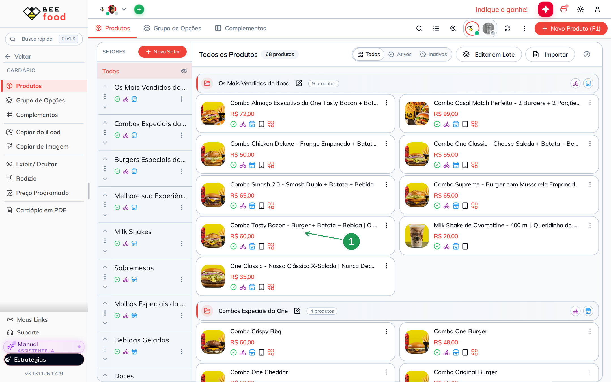
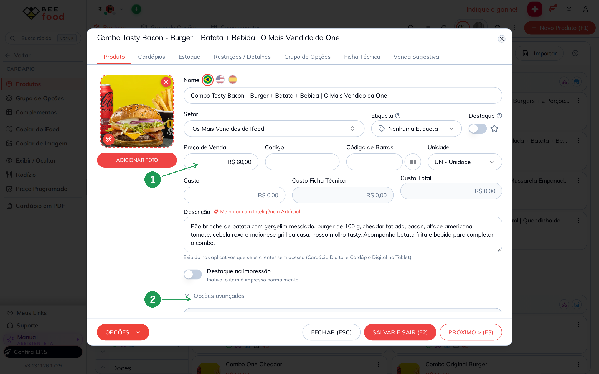
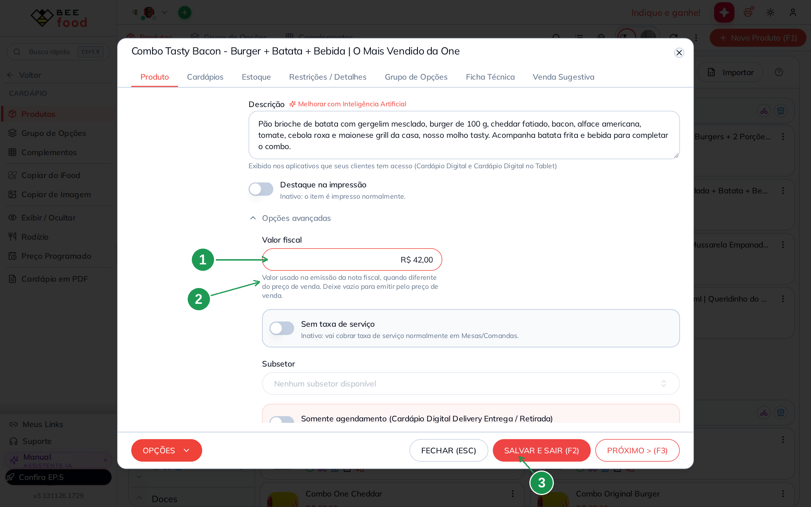
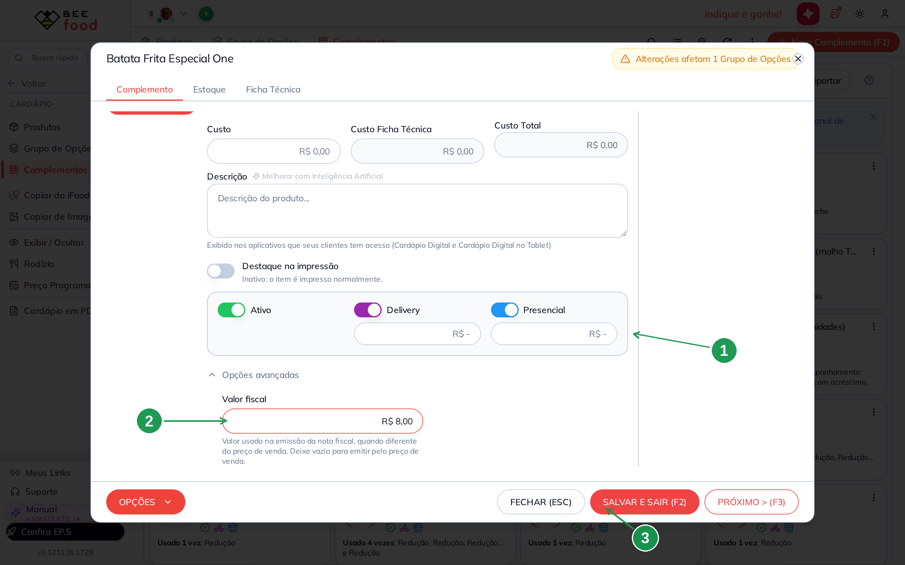
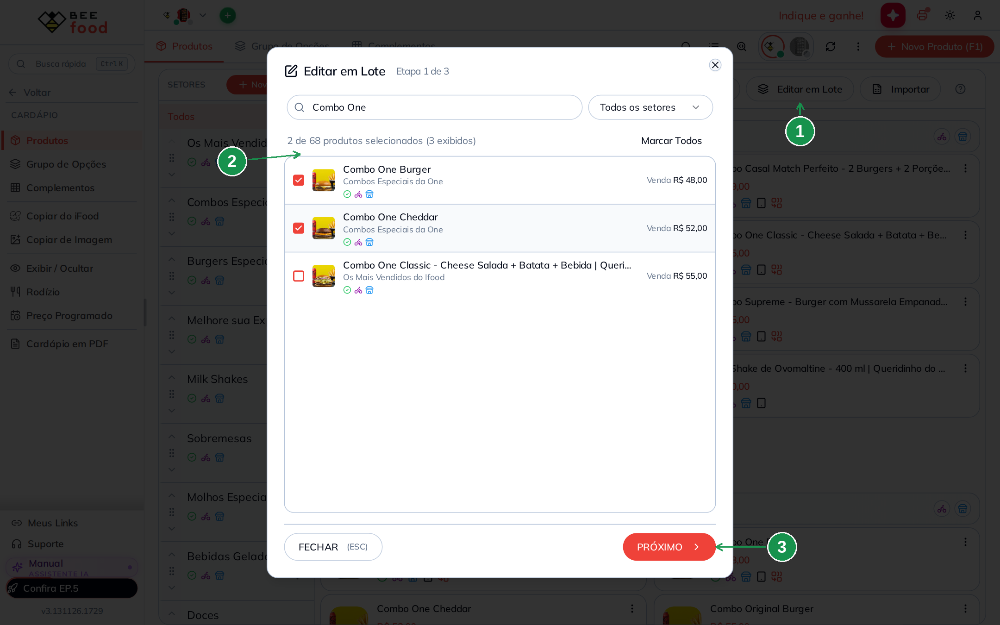
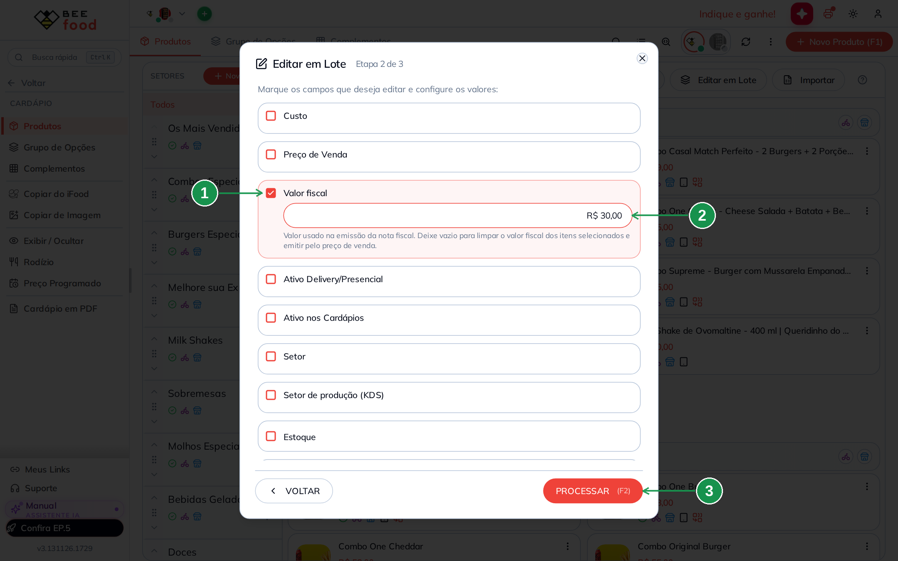
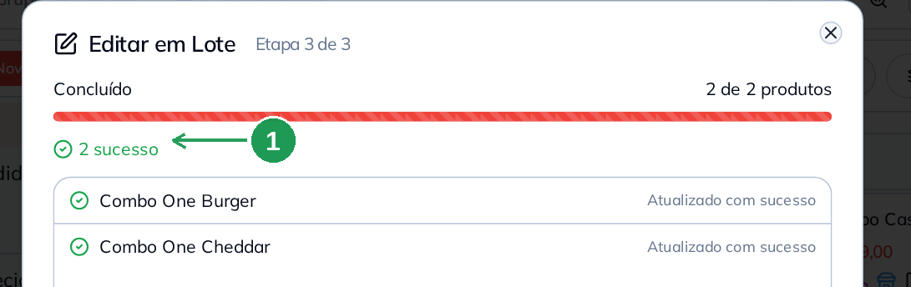

# Valor fiscal por produto: o que vai para a nota quando não é o preço de venda

Em combo e em promoção o cliente paga **um preço fechado**, mas a nota precisa declarar
**cada item com o seu valor**. O campo **Valor fiscal** é onde você diz quanto cada produto
representa dentro desse total.

É ele que resolve o caso mais comum: o **brinde do combo**. A batata e o refrigerante que
saem de cortesia valem R$ 0,00 na venda e, por isso, não apareciam na nota. Com um valor
fiscal preenchido, **eles passam a aparecer** — e esse valor vem de dentro do item pago, sem
mudar um centavo do total.

O campo fica em **Cardápio → Produtos → (produto) → Opções avançadas**, existe também no
cadastro de **complementos** e aceita edição de vários itens de uma vez. Ele **não muda o
preço de venda** nem o que o cliente paga: muda só o que é declarado na nota.

> As imagens têm **marcações em verde** (setas e números) indicando onde clicar ou o que
> observar em cada tela.

---

## Antes de começar

1. A loja precisa estar com o **fiscal ativo** (emissão de nota configurada em alguma
   filial). Sem isso o campo **Valor fiscal** não aparece na tela.
2. Conta BeeFood com permissão de **editar o cardápio**. Não é preciso ter permissão de
   preço.
3. Tenha em mãos a **conta pronta**: quanto cada item do combo deve valer na nota, somando
   exatamente o preço que o cliente paga.

---

## O que o campo é — e o que ele não é

| | **Preço de Venda** | **Valor fiscal** |
|---|---|---|
| Para que serve | o que o cliente paga | o que é declarado na nota |
| Aparece para o cliente | sim, no cardápio e no cupom | não |
| Muda o total do pedido | sim | **não** |
| Se ficar vazio | o item não tem preço | a nota sai **pelo preço de venda** |

Guarde esta frase, porque ela responde quase tudo: **o total da nota é sempre igual ao que o
cliente pagou.** O valor fiscal só reparte esse total entre os itens — ele nunca aumenta nem
diminui a nota.

---

## Passo 1. Abrir o produto no cardápio

No menu, abra **Cardápio → Produtos**. Clique no **nome do produto** (1) para abrir o
cadastro. No exemplo deste manual, o *Combo Tasty Bacon*, vendido a R$ 60,00.

| Nº | O que é |
|----|---------|
| 1 | O **nome do produto** no cartão. O clique no nome abre o cadastro direto na aba *Produto*. |

## Passo 2. Abrir as Opções avançadas

O cadastro abre na aba **Produto**, com o **Preço de Venda** (1) no alto — este continua
sendo o preço que o cliente paga, e não se mexe nele. Role até o fim da aba e clique em
**Opções avançadas** (2): o bloco vem **fechado**, e é dentro dele que o campo mora.

| Nº | O que é |
|----|---------|
| 1 | **Preço de Venda** — R$ 60,00 no exemplo. O valor fiscal não substitui este campo. |
| 2 | **Opções avançadas**, no fim da aba *Produto*. Clique para abrir. |

## Passo 3. Preencher o Valor fiscal e salvar

Digite no campo **Valor fiscal** (1) quanto este produto deve valer na nota — R$ 42,00 no
exemplo, porque a batata e o refrigerante do combo vão ficar com os R$ 18,00 restantes. O
texto abaixo do campo (2) repete a regra: vazio significa emitir pelo preço de venda. Clique
em **SALVAR E SAIR (F2)** (3).

| Nº | O que é |
|----|---------|
| 1 | O campo **Valor fiscal**, com R$ 42,00. Aceita centavos e só aceita valor **positivo**. |
| 2 | O aviso **"Valor usado na emissão da nota fiscal, quando diferente do preço de venda. Deixe vazio para emitir pelo preço de venda."** |
| 3 | **SALVAR E SAIR (F2)**. Enquanto você não salva, nada muda nas notas. |

> **R$ 0,00 é o mesmo que vazio.** Não existe valor fiscal zero: digitar zero limpa o campo e
> o produto volta a ser emitido pelo preço de venda.

## Passo 4. Preencher também o brinde

Agora o item que sai de cortesia. Abra **Cardápio → Complementos** e clique no complemento —
no exemplo, a *Batata Frita Especial One*, que é a opção sem acréscimo do combo e por isso
não tem preço nenhum (1). Abra as **Opções avançadas**, preencha o **Valor fiscal** (2) com
R$ 8,00 e salve (3).

| Nº | O que é |
|----|---------|
| 1 | Os preços de *Delivery* e *Presencial* **vazios**: é um complemento de cortesia, que não soma nada ao pedido. |
| 2 | O **Valor fiscal** do brinde — R$ 8,00. É o que faz ele aparecer na nota. |
| 3 | **SALVAR E SAIR (F2)**. |

Repita no refrigerante — no exemplo, o *Sprite 350ml*, com R$ 10,00. No cadastro de
complemento, o bloco **Opções avançadas** existe **só** por causa deste campo: se a loja não
tem fiscal, o bloco não aparece.

## Passo 5. Conferir a conta

Feito isso, a conta do combo fica assim:

| Item | Preço de venda | Valor fiscal |
|---|---|---|
| Combo Tasty Bacon | R$ 60,00 | R$ 42,00 |
| Batata Frita Especial One (brinde) | — | R$ 8,00 |
| Sprite 350ml (brinde) | — | R$ 10,00 |
| **Total** | **R$ 60,00** | **R$ 60,00** |

As duas colunas fecham no mesmo número, e é isso que se procura: o cliente paga R$ 60,00, a
nota sai com R$ 60,00, e os três itens aparecem nela com o valor que você definiu.

---

## Vários produtos de uma vez

Para uma linha inteira de combos, não precisa abrir um por um. Na aba **Produtos**, clique em
**Editar em Lote** (1). A etapa 1 abre com **todos** os produtos marcados — use *Marcar
Todos* para zerar a seleção, a busca para filtrar e o clique no nome para marcar só o que
interessa (2). Depois, **PRÓXIMO** (3).

| Nº | O que é |
|----|---------|
| 1 | O botão **Editar em Lote**, na aba *Produtos*. |
| 2 | O contador de **selecionados**. Confira este número antes de seguir: o lote vale para todos eles. |
| 3 | **PRÓXIMO**, para a etapa de campos. |

Na etapa 2, marque a caixinha **Valor fiscal** (1) — só então o campo aparece — digite o
valor (2) e clique em **PROCESSAR (F2)** (3). Os campos que você **não** marcar ficam como
estão.

| Nº | O que é |
|----|---------|
| 1 | A caixinha **Valor fiscal**. Sem marcar, o campo nem aparece — e o lote não mexe nele. |
| 2 | O valor que vai para **todos** os itens selecionados. Marcar a caixinha e deixar o campo **vazio** é como se **limpa** o valor fiscal em massa. |
| 3 | **PROCESSAR (F2)**. |

A etapa 3 mostra o resultado item por item (1). É aqui que se confere se todos foram
atualizados.

| Nº | O que é |
|----|---------|
| 1 | O resumo **sucesso / erro**, com uma linha por produto. |

> **O mesmo lote existe na aba Complementos**, com a mesma caixinha — é por ali que se
> configuram os brindes em bloco.

---

## Mais exemplos

### Combo com dois brindes (o caso mais comum)

Combo de **R$ 70,00**: lanche, batata e refrigerante, os dois últimos de cortesia.

| Item | Valor fiscal |
|---|---|
| Lanche (o item pago) | R$ 52,00 |
| Batata (brinde) | R$ 8,00 |
| Refrigerante (brinde) | R$ 10,00 |
| **Soma** | **R$ 70,00** |

Os R$ 18,00 dos brindes **saem de dentro** dos R$ 70,00 do item pago. A nota continua de
R$ 70,00, agora com os três itens dentro dela.

### Promoção "2 lanches por R$ 50,00"

O cliente paga R$ 50,00 pelos dois. Preencha o valor fiscal de cada um de modo que a soma
feche nos R$ 50,00 — por exemplo R$ 27,00 e R$ 23,00, se um lanche vale mais que o outro, ou
R$ 25,00 em cada.

### Quando a soma passa do que o cliente pagou

Suponha um combo de **R$ 60,00** com os valores fiscais mal distribuídos: R$ 50,00 no lanche,
R$ 8,00 na batata e R$ 10,00 no refrigerante — soma de R$ 68,00. O sistema **não** emite
R$ 68,00: ele ajusta os itens configurados **proporcionalmente** para fechar nos R$ 60,00 que
o cliente pagou. Na prática, cada valor cai na mesma proporção (perto de R$ 44,12 / R$ 7,06 /
R$ 8,82; os centavos dependem do arredondamento).

Ninguém emite nota errada por causa disso, mas o valor que você configurou deixa de valer. O
jeito de ter na nota exatamente o que você planejou é **fazer a soma fechar** com o preço
pago.

### Produto comum, sem combo

Deixe o campo **vazio**. É o estado normal do cardápio: a nota sai pelo preço de venda, como
sempre saiu. O campo só existe para o caso em que os dois números são diferentes.

### Pedido com desconto ou cupom

O total da nota acompanha o que o cliente pagou. Se o desconto derrubar o total abaixo da
soma dos valores fiscais, cai na regra anterior: o sistema ajusta proporcionalmente.

### Taxa de serviço

**Fica fora desta conta.** A taxa de serviço de mesas e comandas não entra na divisão dos
valores fiscais.

---

## Como isso aparece na nota

⚠️ **Exemplo fictício, apenas para entendimento.** Os valores abaixo ilustram a divisão; a
nota de verdade depende dos seus dados fiscais, do seu regime e do que a sua loja vende.

Antes, o combo de R$ 60,00 saía como **um item só**, e o brinde não existia na nota:

| Item na nota | Valor |
|---|---|
| Combo Tasty Bacon | R$ 60,00 |
| **Total** | **R$ 60,00** |

Com o valor fiscal preenchido nos três, a mesma venda sai com os três itens:

| Item na nota | Valor |
|---|---|
| Combo Tasty Bacon | R$ 42,00 |
| Batata Frita Especial One | R$ 8,00 |
| Sprite 350ml | R$ 10,00 |
| **Total** | **R$ 60,00** |

O que mudou foi o **detalhamento**, não o total.

---

## Quando algo não funciona

| Sintoma | O que verificar |
|---------|-----------------|
| **Não encontro o campo Valor fiscal** | Ele aparece só para loja com **fiscal ativo**. Se a sua loja ainda não emite nota pelo BeeFood, fale com o suporte. |
| **Não encontro o campo no complemento** | É o mesmo motivo: sem fiscal ativo, o complemento não tem nem o bloco *Opções avançadas*. |
| **Achei o bloco, mas não o campo** | Confira se você está na aba **Produto** do cadastro, e role o bloco *Opções avançadas* até o começo — o *Valor fiscal* é o primeiro item dele. |
| **O campo está cinza, não deixa digitar** | Falta permissão de **editar cardápio** para o seu usuário. Quem administra a conta resolve em *Configuração → Grupos de Acesso*. |
| **Digitei R$ 0,00 e o campo ficou vazio** | É o comportamento correto: zero e vazio são a mesma coisa, e os dois significam "emitir pelo preço de venda". |
| **O brinde continua fora da nota** | O valor fiscal tem de estar no **cadastro do brinde** — o complemento, não o combo. E só vale para venda emitida **depois** de salvar. |
| **A nota saiu com valor diferente do que configurei** | Quase sempre a soma dos valores fiscais passou do total pago, e o sistema ajustou proporcionalmente. Refaça a conta para fechar no preço de venda. |
| **O total da nota mudou depois de configurar** | Não muda. O total da nota é sempre o que o cliente pagou; o valor fiscal só reparte esse total. |
| **Preenchi e a nota antiga não mudou** | O valor vale para as próximas emissões. Nota já emitida não é recalculada. |
| **O preço no cardápio mudou** | Não pode ter mudado por causa deste campo. Confira o **Preço de Venda**: é provável que ele tenha sido editado por engano. |
| **Quero limpar o valor de muitos produtos** | Use **Editar em Lote**, marque *Valor fiscal* e deixe o campo **vazio**. |

---

## Perguntas frequentes

**O que é o campo Valor fiscal?**
É quanto o produto vale **na nota fiscal**, quando esse número é diferente do preço de venda.
Serve para repartir o total de um combo ou de uma promoção entre os itens.

**O que é "venda fiscal"?**
É o nome técnico do mesmo campo (`vendaFiscal`, na API). Na tela ele se chama **Valor
fiscal**.

**Onde fica o campo Valor fiscal?**
Em **Cardápio → Produtos**, abra o produto e clique em **Opções avançadas**, no fim da aba
*Produto*. O mesmo caminho vale em **Cardápio → Complementos**.

**O valor fiscal muda o preço que o cliente paga?**
Não. O cliente paga o **Preço de Venda**. O valor fiscal aparece só na nota.

**O valor fiscal muda o total da nota?**
Não. O total da nota é sempre igual ao que o cliente pagou. O campo só divide esse total
entre os itens.

**Por que o brinde do combo não aparecia na nota?**
Porque ele valia R$ 0,00 na venda. Com um valor fiscal preenchido ele passa a aparecer, e
esse valor sai de dentro do item pago.

**Como fazer a batata e o refrigerante de cortesia saírem na nota?**
Preencha o **Valor fiscal** no cadastro de cada um (eles são complementos) e ajuste o valor
fiscal do combo para que a soma feche no preço que o cliente paga.

**E se eu esquecer de ajustar o combo?**
A soma passa do total pago e o sistema ajusta os itens configurados proporcionalmente. A nota
sai certa, mas não com os valores que você planejou.

**O que acontece se eu deixar o campo vazio?**
O produto é emitido **pelo preço de venda** — é o comportamento de sempre.

**Posso colocar R$ 0,00 para o item não sair na nota?**
Não. Zero é tratado como vazio, e vazio quer dizer "emitir pelo preço de venda".

**Posso colocar um valor maior que o preço de venda?**
A tela aceita, mas não serve para aumentar a nota: o total continua sendo o que o cliente
pagou, e os valores configurados são ajustados para caber nele.

**O valor fiscal vale para todas as filiais?**
Ele é do **produto**, como o preço de custo. Se a sua operação tem valores diferentes por
filial, fale com o suporte antes de configurar.

**Preciso preencher em todos os produtos do cardápio?**
Não. Só onde o valor da nota é diferente do preço de venda — tipicamente combos, promoções e
brindes. O resto fica vazio.

**Como configurar vários produtos de uma vez?**
Em **Cardápio → Produtos → Editar em Lote**, marque **Valor fiscal**, digite o valor e clique
em *PROCESSAR*. Existe o mesmo lote na aba **Complementos**.

**Como limpar o valor fiscal de vários itens?**
No **Editar em Lote**, marque a caixinha **Valor fiscal** e deixe o campo **vazio**. Isso
limpa o valor dos itens selecionados.

**A taxa de serviço entra nessa conta?**
Não. Ela fica fora da divisão dos valores fiscais.

**Vale para NFC-e e para NF-e?**
O campo é da emissão da nota, qualquer que seja o modelo que a sua loja emite. O que muda é
o documento, não a regra do campo.

**Vale para pedido de iFood e dos outros marketplaces?**
Sim. O valor é do **produto**, então vale para qualquer venda dele.

**Preciso de permissão especial para preencher?**
Não. Basta a permissão de **editar o cardápio** — a mesma de mudar nome e descrição. Não é
preciso ter permissão de preço.

**Por que o campo não aparece na minha tela?**
Porque a loja não está com o **fiscal ativo**. O campo só é exibido para quem emite nota pelo
BeeFood.

**Existe uma coluna de valor fiscal na lista do cardápio?**
Não. Para conferir, abra o produto e veja em *Opções avançadas*.

**Mudei o valor fiscal. As notas antigas mudam?**
Não. Valem para as próximas emissões.

**Preciso emitir nota de novo depois de configurar?**
Não. A configuração entra nas vendas seguintes.

**Dá para configurar pelo celular?**
Sim. O cadastro de produto do aplicativo tem o mesmo bloco **Opções avançadas** com o campo
**Valor fiscal**.

---

## Precisa de ajuda?

Fale com o **suporte BeeFood** informando: nome da loja e **filial**, o **produto** e os
**complementos** envolvidos, o valor fiscal que você preencheu em cada um, o preço de venda do
combo e o **número da nota** que saiu diferente do esperado.

---

## Onde continuar

- **Cardápio: fundamentos** — como montar combo, grupo de opções e brinde.
- **Reforma tributária: IBS e CBS no cadastro** — os outros campos fiscais do produto.
- **Fechamento fiscal** — onde conferir as notas emitidas no período.

---

*Última atualização: novembro/2026 — BeeFood · Cardápio · Fiscal · valor fiscal · venda
fiscal · combo · brinde na nota*
