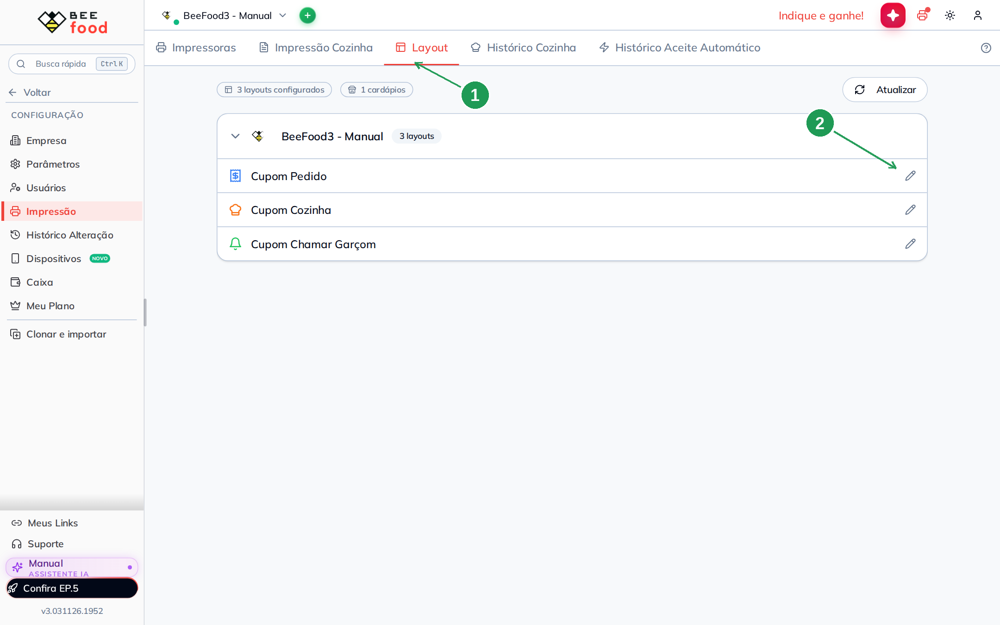
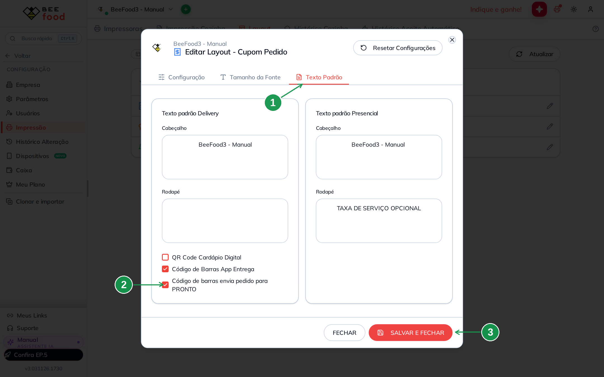
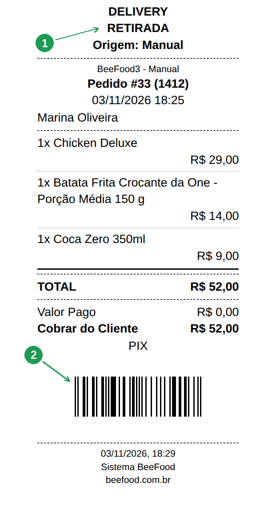
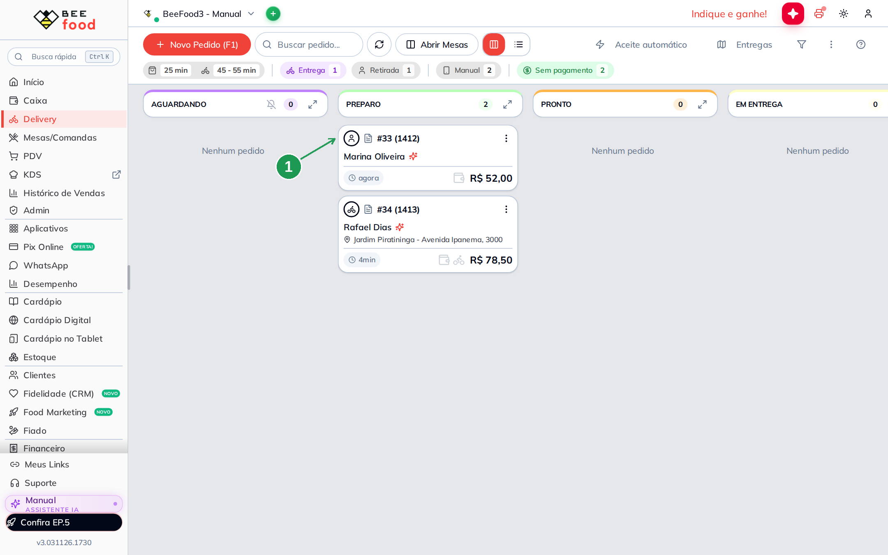
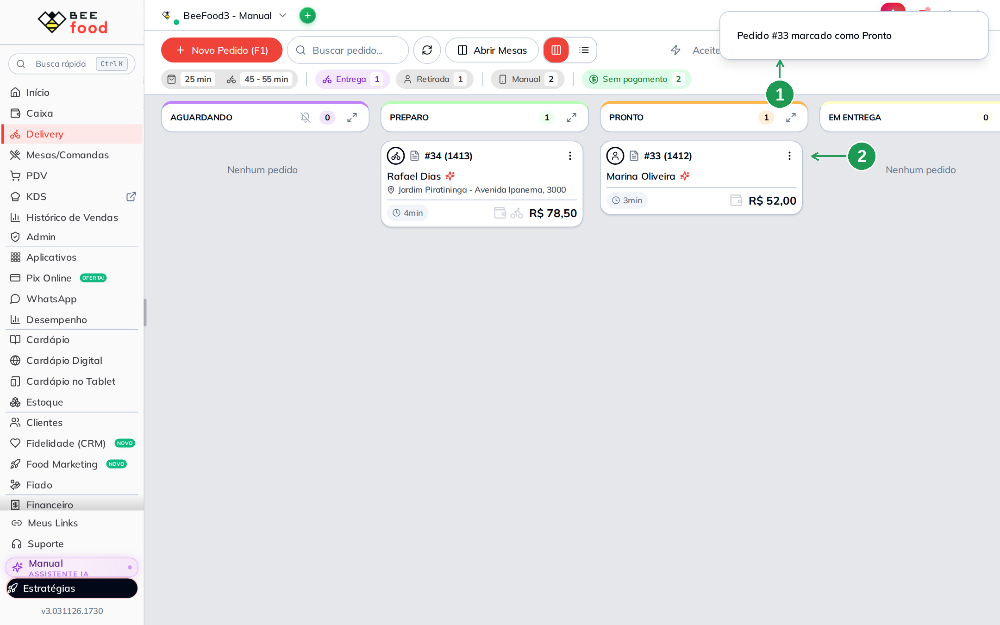

# Código de barras no cupom para marcar o pedido como Pronto (Delivery)

Quem monta o pedido na cozinha costuma ter as duas mãos ocupadas e o cupom do pedido na
frente. Com esta configuração ligada, o **cupom do pedido sai com um código de barras**, e
**bipar esse código na tela Delivery** passa o pedido de *Aguardando* ou *Em preparo* direto
para **Pronto** — sem procurar o cartão na fila e sem arrastar nada com o mouse.

Serve para **qualquer pedido do módulo Delivery**: entrega, retirada no balcão, pedido do
cardápio digital ou vindo de um marketplace. É uma caixinha para marcar no layout do *Cupom
Pedido* e nada mais: o leitor da tela Delivery já vem ligado e não precisa de configuração.

> As imagens têm **marcações em verde** (setas e números) indicando onde clicar ou o que
> observar em cada tela.

---

## Antes de começar

1. Conta **BeeFood** com acesso ao grupo **Configuração** no menu.
2. Um **leitor de código de barras** comum, de teclado (USB ou Bluetooth) — o mesmo tipo que
   se usa no caixa. Ele não precisa de instalação nem de configuração no BeeFood.
3. A **tela Delivery aberta** no computador em que o leitor está ligado.
4. O **cupom do pedido impresso**. Se você ainda não imprime o cupom na cozinha, veja a aba
   *Impressoras* da mesma tela de **Impressão**.

---

## Passo 1. Abrir o layout do Cupom Pedido

No menu, abra **Configuração → Impressão** e clique na aba **Layout** (1). Ela lista os
layouts de cupom da filial. Clique na linha **Cupom Pedido** — ou no lápis à direita dela (2).

| Nº | O que é |
|----|---------|
| 1 | A aba **Layout**, dentro de *Configuração → Impressão*. |
| 2 | A linha do **Cupom Pedido** — o cupom que a cozinha recebe. A linha inteira abre a janela de edição. |

## Passo 2. Marcar a caixinha e salvar

Na janela que abre, vá para a aba **Texto Padrão** (1). No quadro **Texto padrão Delivery**,
marque **Código de barras envia pedido para PRONTO** (2) e clique em **SALVAR E FECHAR** (3).

| Nº | O que é |
|----|---------|
| 1 | A aba **Texto Padrão** da janela *Editar Layout - Cupom Pedido*. |
| 2 | **Código de barras envia pedido para PRONTO** — a caixinha deste manual. Vale para todos os pedidos do Delivery. |
| 3 | **SALVAR E FECHAR**. Enquanto você não clica aqui, nada muda nos cupons. |

> **Esta caixinha não é a de cima.** Logo acima dela existe a **Código de Barras App
> Entrega**, que é de outro recurso. A diferença entre as duas está na seção *As duas
> caixinhas de código de barras*, no fim do manual.

## Passo 3. O cupom passa a sair com o código de barras

Pronto: do próximo cupom em diante, o código de barras aparece **no pé do cupom**, logo
antes do rodapé. Na imagem, um pedido de **retirada** (1) — ou seja, sem entrega nenhuma —
com o código já impresso (2).

| Nº | O que é |
|----|---------|
| 1 | O cupom é de **retirada**. A caixinha vale para entrega, retirada e consumo no local — qualquer pedido do Delivery. |
| 2 | O **código de barras**, no pé do cupom. Ele guarda o número interno do pedido; não há nada para ler ou digitar à mão ali. |

> **O código não tem número embaixo das barras**, e isso é de propósito: ele não é para ser
> lido por gente, é para ser bipado. O pedido continua identificado pelo **Pedido #N** no alto
> do cupom.

## Passo 4. Deixar a tela Delivery aberta

No computador em que o leitor está ligado, abra o menu **Delivery**. O pedido que você vai
marcar aparece na coluna **AGUARDANDO** ou **PREPARO** (1) — são as duas situações em que o
código funciona.

| Nº | O que é |
|----|---------|
| 1 | O cartão do pedido na coluna **PREPARO**. Também funciona com um pedido em **AGUARDANDO**. |

> **Clique numa área vazia da tela antes de bipar.** Se o cursor estiver dentro de um campo de
> texto — a busca de pedidos, por exemplo — ou se houver uma janela aberta na frente, a leitura
> vai para o campo e não para a fila.

## Passo 5. Bipar o código

Aponte o leitor para o código de barras do cupom e bipe. O painel avisa **Pedido #N marcado
como Pronto** (1) e o cartão muda de coluna na hora: ele passa para **PRONTO** (2).

| Nº | O que é |
|----|---------|
| 1 | O aviso **Pedido #N marcado como Pronto**. É o mesmo efeito de arrastar o cartão para a coluna *Pronto*. |
| 2 | O cartão do pedido, agora na coluna **PRONTO**. Daqui ele segue o caminho normal: sair para entrega ou ser retirado no balcão. |

---

## As duas caixinhas de código de barras

As duas moram uma embaixo da outra, na mesma aba, e fazem coisas diferentes. Pode deixar as duas
ligadas: o cupom imprime **um** código de barras, e ele serve para os dois usos.

| | **Código de barras envia pedido para PRONTO** | **Código de Barras App Entrega** |
|---|---|---|
| Para que serve | A cozinha bipa na **tela Delivery** e o pedido vai para *Pronto*. | O entregador bipa no **app do entregador** e o pedido sai para *Em entrega*. |
| Em quais pedidos imprime | **Todos** os do Delivery: entrega, retirada, consumo no local. | Só pedidos **de entrega**, com endereço. |
| Depende do plano | Não. | Sim — precisa do módulo de entregas contratado. |
| Onde se bipa | No computador com a tela **Delivery** aberta. | No celular do entregador, pelo aplicativo. |

Em resumo: a de cima é para a **saída** do pedido, esta é para a **cozinha**. Uma loja que só
trabalha com retirada no balcão nunca viu o código de barras no cupom até agora — é
exatamente o caso que esta caixinha resolve.

---

## Quando algo não funciona

| Sintoma | O que verificar |
|---------|-----------------|
| **O cupom sai sem o código de barras** | Confira se a caixinha está marcada no layout **Cupom Pedido** e se você clicou em *SALVAR E FECHAR*. Cupons impressos **antes** de salvar não têm o código: imprima o pedido de novo. |
| **O cupom do navegador tem o código, mas o da impressora não** | O código de barras na impressora depende do **BeeImpressão** atualizado — ele entrou na versão **1.0.5.7** do servidor de impressão. Atualize pelo botão *Download Servidor Impressão*, na aba **Impressoras**. |
| **Bipei e nada aconteceu** | Quase sempre é foco: clique numa **área vazia** da tela Delivery, sem nenhuma janela aberta na frente, e bipe de novo. Confira também se a tela aberta é a **Delivery**, e não outra. |
| **Bipei e o código foi para a caixa de busca** | O cursor estava dentro do campo. Limpe o campo, clique fora dele e bipe de novo. |
| **Diz "Pedido não encontrado no Delivery"** | O código lido não corresponde a nenhum pedido **da lista atual** da tela Delivery. Normalmente é cupom de outro dia, cupom de outra filial ou um código de barras de produto que foi bipado por engano. |
| **Diz "Pedido #N já está em Pronto"** | O pedido já passou dessa etapa. O código só adianta pedido que está em *Aguardando* ou *Em preparo*; depois disso ele não mexe em mais nada, de propósito. |
| **Digitei os números à mão e não funcionou** | O leitor manda os dígitos muito rápido, e é isso que o painel reconhece. Digitação à mão é lenta demais. Para mover o pedido sem leitor, arraste o cartão ou use o botão *PEDIDO PRONTO* dentro do pedido. |
| **O pedido foi para Pronto sem eu querer** | Alguém bipou um cupom com a tela Delivery aberta e o cursor fora dos campos. Arraste o cartão de volta para a coluna anterior. |
| **Quero o código no cupom da cozinha, não no do pedido** | A caixinha existe só no layout **Cupom Pedido**. O *Cupom Cozinha* não imprime código de barras. |

---

## Perguntas frequentes

**Como marcar o pedido como pronto bipando o código de barras do cupom?**
Ligue **Configuração → Impressão → aba Layout → Cupom Pedido → aba Texto Padrão → Código de
barras envia pedido para PRONTO**. Depois, com a tela **Delivery** aberta, bipe o código do
cupom: o pedido vai para *Pronto*.

**Onde fica a opção de código de barras no cupom do pedido?**
Em **Configuração → Impressão**, aba **Layout**, linha **Cupom Pedido**, aba **Texto Padrão**,
no quadro *Texto padrão Delivery*.

**Como imprimir código de barras no cupom do Delivery?**
É a mesma caixinha: **Código de barras envia pedido para PRONTO**. Marque, salve e o próximo
cupom já sai com o código.

**Preciso configurar o leitor de código de barras no BeeFood?**
Não. O leitor comum, de teclado, já funciona. O BeeFood escuta a leitura sozinho na tela
Delivery, sem nenhuma configuração.

**Preciso ligar alguma coisa na tela Delivery?**
Não. O leitor da tela Delivery **fica sempre ligado**. A única configuração é a caixinha do
cupom, que faz o código de barras ser impresso.

**Funciona em pedido de retirada no balcão?**
Sim — é a principal diferença em relação ao código de barras do app do entregador. Esta
caixinha imprime o código em **todos** os pedidos do Delivery, inclusive retirada e consumo
no local.

**Funciona com pedido de iFood e dos outros marketplaces?**
Sim. O que vale é o pedido estar no módulo **Delivery**, não a origem dele.

**De que situação para qual situação o pedido vai?**
De **Aguardando** ou **Em preparo** para **Pronto**. Pedido que já está em *Pronto*, *Em
entrega*, *Entregue* ou *Cancelado* não é movido.

**Bipei duas vezes o mesmo cupom. Dá problema?**
Não. Na segunda vez o painel avisa *Pedido #N já está em Pronto* e não mexe em nada.

**O código de barras serve para o entregador também?**
A leitura no **app do entregador** é outro recurso, com a caixinha de cima (*Código de Barras
App Entrega*). Pode deixar as duas ligadas: o cupom imprime um código de barras só, e ele
serve para os dois usos.

**Qual a diferença entre as duas caixinhas de código de barras?**
A de cima manda o pedido para **Em entrega** quando o entregador bipa no aplicativo, e só
imprime em pedido de entrega. Esta manda para **Pronto** quando alguém bipa no computador, e
imprime em qualquer pedido do Delivery.

**O que o código de barras guarda?**
O **número interno do pedido** no BeeFood, num código EAN-13. Não é o *Pedido #N* que aparece
no cupom nem o telefone do cliente.

**Por que o código não tem números impressos embaixo das barras?**
Porque ele não é para ser lido nem digitado por ninguém — só bipado. A identificação visível
do pedido continua sendo o **Pedido #N** no alto do cupom.

**Posso digitar o código no teclado em vez de bipar?**
Na prática não: o painel reconhece a rajada de dígitos do leitor, que é muito mais rápida que
a digitação à mão. Sem leitor, arraste o cartão na fila ou use o botão *PEDIDO PRONTO*.

**Dá para usar o leitor do celular?**
Qualquer leitor que se comporte como teclado serve, inclusive um aplicativo de leitura que
digite o código e dê *Enter* no computador. Leitura pela câmera dentro do painel não existe.

**O código vale para qualquer filial?**
Cada cupom vale no Delivery **da filial que o emitiu**. Bipar um cupom de outra filial dá
*Pedido não encontrado no Delivery*.

**Bipei um cupom de ontem e não funcionou. Por quê?**
A tela Delivery trabalha com os pedidos recentes. Se o pedido não está na lista da tela, o
código não acha nada.

**A configuração vale para todos os computadores da loja?**
Sim. Ela é da **filial**, salva no layout do cupom. Qualquer computador com a tela Delivery
aberta e um leitor ligado passa a funcionar.

**Como desligar?**
No mesmo lugar: desmarque **Código de barras envia pedido para PRONTO** e clique em *SALVAR E
FECHAR*. Os cupons voltam a sair sem o código. Cupons já impressos continuam funcionando ao
ser bipados, porque o leitor da tela Delivery não depende da caixinha.

---

## Precisa de ajuda?

Fale com o **suporte BeeFood** informando: nome da loja e **filial**, se a caixinha
*Código de barras envia pedido para PRONTO* está marcada no layout **Cupom Pedido**, se o
código aparece no cupom impresso, o **número do pedido** que você tentou marcar e o aviso que
o painel mostrou ao bipar.

---

## Onde continuar

- **Destaque na impressão** — como fazer item e observação saírem em destaque no mesmo cupom.
- **App do entregador: receber e entregar um pedido** — o outro lado, com a leitura que manda
  o pedido para *Em entrega*.
- **Taxa de serviço opcional no cupom** — outras opções do mesmo layout de impressão.

---

*Última atualização: novembro/2026 — BeeFood · Delivery · Impressão · código de barras ·
marcar pedido como Pronto*
