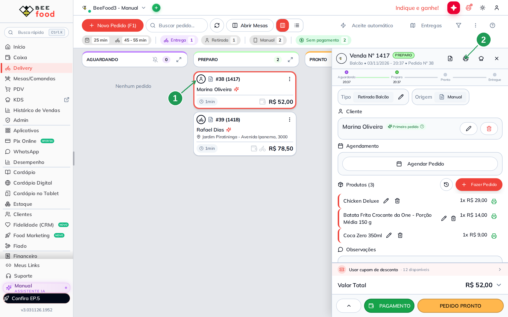
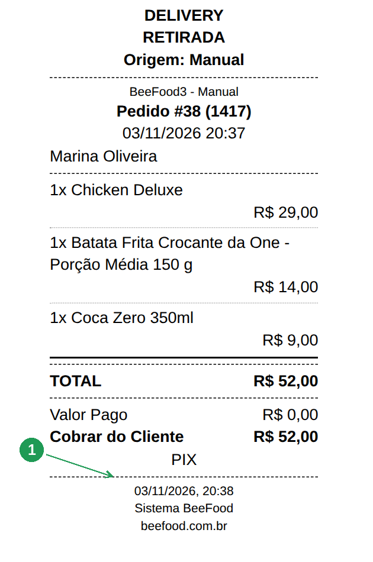
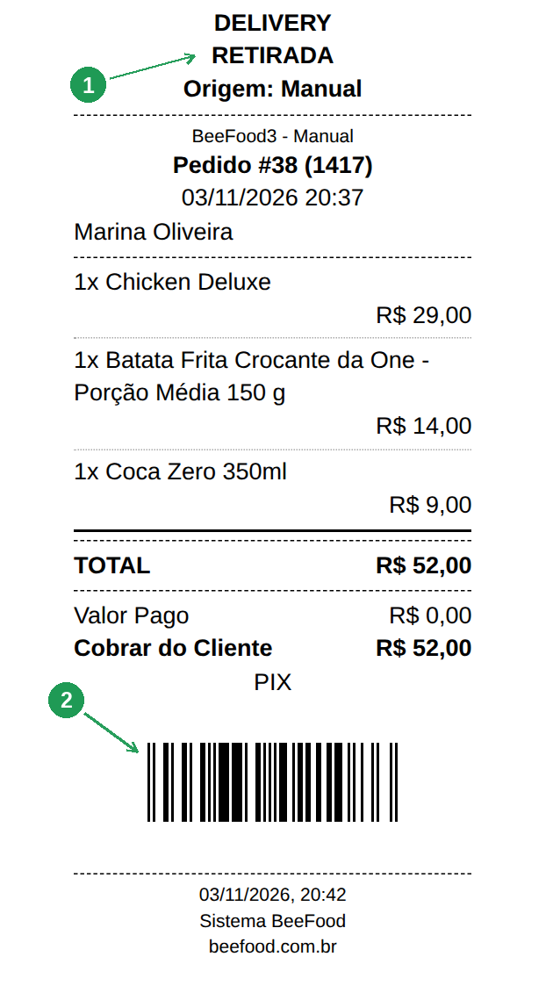
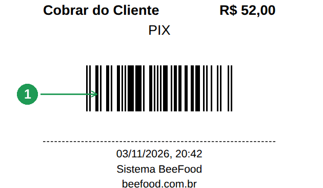
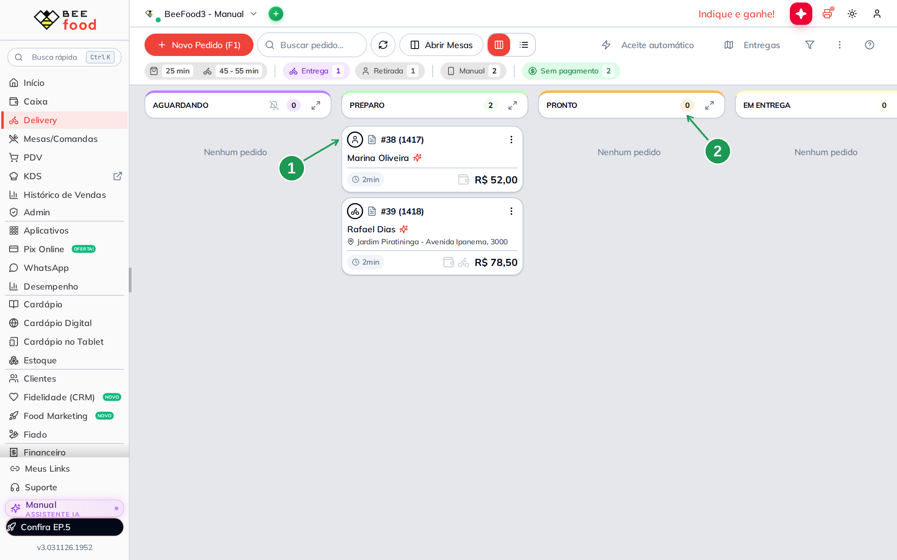
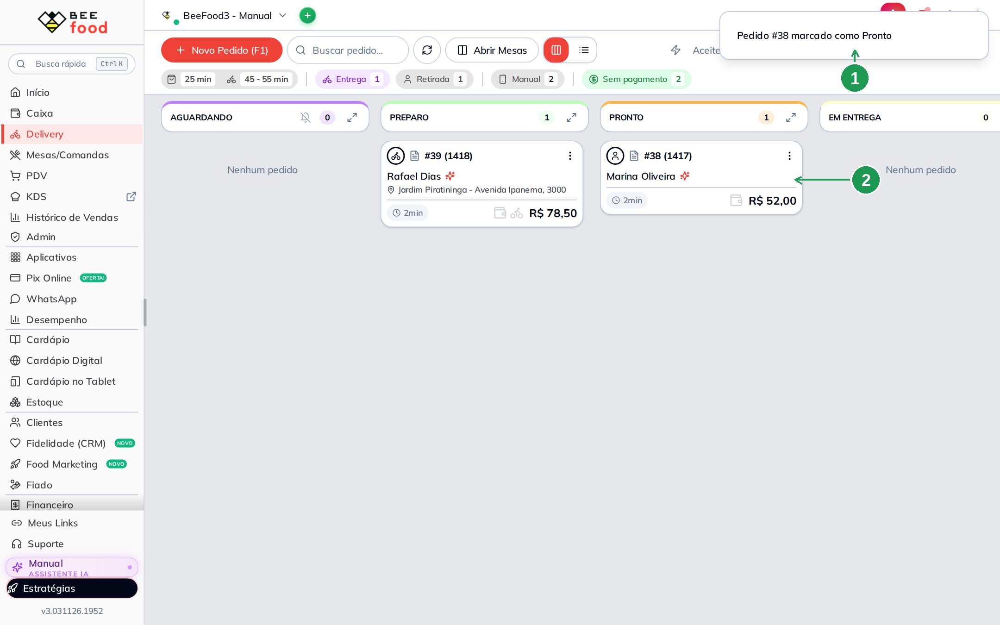
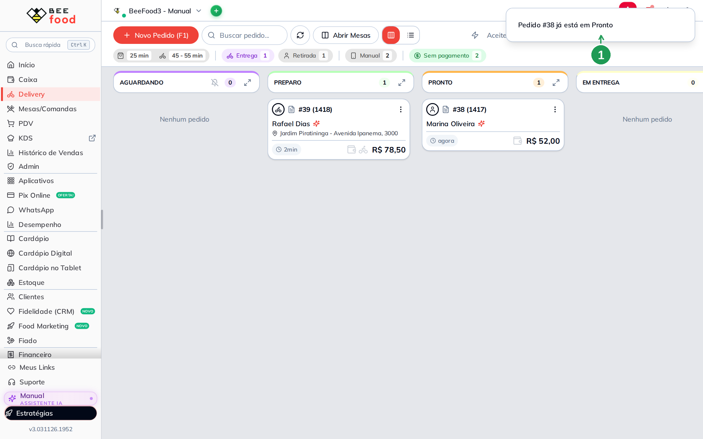
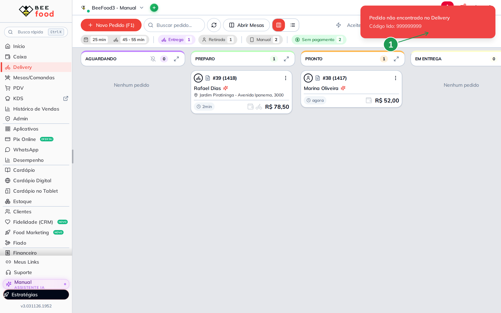

# Código de barras no cupom para marcar o pedido como Pronto (Delivery)

Com esta configuração ligada, o **cupom do pedido sai com um código de barras**. Bipar esse
código na tela **Delivery** passa o pedido de *Aguardando* ou *Em preparo* direto para
**Pronto**, sem procurar o cartão na fila.

Vale para **qualquer pedido do Delivery** — entrega, retirada, cardápio digital, marketplace.
É uma caixinha para marcar, e nada mais: o leitor da tela Delivery já vem ligado.

> As imagens têm **marcações em verde** (setas e números) indicando onde clicar ou o que
> observar em cada tela.

---

## Antes de começar

- Acesso ao grupo **Configuração** no menu.
- Um **leitor de código de barras** comum, de teclado (USB ou Bluetooth) — o mesmo do caixa.
  Ele não precisa de instalação.
- A **tela Delivery aberta** no computador em que o leitor está ligado.

---

## Passo 1. Abrir o layout do Cupom Pedido

No menu, **Configuração → Impressão**, aba **Layout** (1). Clique na linha **Cupom Pedido** —
ou no lápis à direita dela (2).

## Passo 2. Marcar a caixinha e salvar

Na janela, vá para a aba **Texto Padrão** (1). No quadro **Texto padrão Delivery**, marque
**Código de barras envia pedido para PRONTO** (2) e clique em **SALVAR E FECHAR** (3).

> **Esta caixinha não é a de cima.** Logo acima existe a **Código de Barras App Entrega**, de
> outro recurso. As duas são comparadas no fim do manual.

## Passo 3. Imprimir o cupom do pedido

Do próximo cupom em diante o código já sai. Na cozinha, com o **BeeImpressão** ligado, o cupom
sai sozinho quando o pedido entra. Para imprimir na hora, clique no cartão do pedido na tela
**Delivery** (1) e depois no ícone de impressora do painel (2).

## Passo 4. O que muda no impresso

Antes, o cupom ia do pagamento direto para o rodapé (1):

Agora o mesmo pedido — que é de **retirada** (1) — sai com o código de barras no pé (2):

De perto, é isto que o leitor mira: o código fica **depois do total e antes do rodapé** (1).

> **O código não tem número embaixo das barras**, de propósito: ele é para ser bipado, não
> lido. O pedido continua identificado pelo **Pedido #N** no alto do cupom.

## Passo 5. Bipar na tela Delivery

Na tela **Delivery**, o pedido precisa estar em **AGUARDANDO** ou **PREPARO** (1) — a coluna
**PRONTO** ainda está em zero (2). Antes de bipar, clique numa **área vazia** da tela: se o
cursor estiver num campo de texto, ou houver uma janela aberta na frente, a leitura não chega
na fila.

Aponte o leitor para o código e bipe. O painel avisa **Pedido #N marcado como Pronto** (1) e o
cartão muda de coluna na hora (2).

---

## Quando o bipe não move o pedido

Bipou o mesmo cupom duas vezes? O painel avisa **Pedido #N já está em Pronto** (1) e não mexe
em nada. O código só adianta pedido em *Aguardando* ou *Em preparo* — depois disso, de
propósito, ele não faz nada.

Se o código não for de nenhum pedido da lista, vem a tarja vermelha **Pedido não encontrado no
Delivery**, com o código que foi lido (1). Em geral é cupom de outro dia, de outra filial, ou
um código de barras de produto bipado por engano.

---

## As duas caixinhas de código de barras

Elas ficam uma embaixo da outra e fazem coisas diferentes. Pode deixar as duas ligadas: o
cupom imprime **um** código, e ele serve para os dois usos.

| | **Código de barras envia pedido para PRONTO** | **Código de Barras App Entrega** |
|---|---|---|
| Para que serve | A cozinha bipa na **tela Delivery** e o pedido vai para *Pronto*. | O entregador bipa no **app do entregador** e o pedido sai para *Em entrega*. |
| Em quais pedidos imprime | **Todos** os do Delivery: entrega, retirada, consumo no local. | Só pedidos **de entrega**, com endereço. |
| Depende do plano | Não. | Sim — precisa do módulo de entregas contratado. |
| Onde se bipa | No computador com a tela **Delivery** aberta. | No celular do entregador. |

A de cima é para a **saída** do pedido; esta é para a **cozinha**. Quem só trabalha com
retirada no balcão nunca viu código de barras no cupom até agora — é o caso que esta caixinha
resolve.

---

## Quando algo não funciona

| Sintoma | O que verificar |
|---------|-----------------|
| **O cupom sai sem o código** | Confira se a caixinha está marcada no layout **Cupom Pedido** e se você clicou em *SALVAR E FECHAR*. Cupom impresso **antes** de salvar não tem o código: imprima o pedido de novo. |
| **O cupom do navegador tem o código, o da impressora não** | O código na impressora depende do **BeeImpressão** na versão **1.0.5.7** ou mais nova. Atualize pelo botão *Download Servidor Impressão*, na aba **Impressoras**. |
| **Bipei e nada aconteceu** | Quase sempre é foco: clique numa **área vazia** da tela Delivery, sem janela aberta na frente, e bipe de novo. Confira também se a tela aberta é a **Delivery**. |
| **O código foi para a caixa de busca** | O cursor estava dentro do campo. Limpe o campo, clique fora dele e bipe de novo. |
| **Digitei os números à mão e não funcionou** | O painel reconhece a rajada rápida de dígitos do leitor; digitação à mão é lenta demais. Sem leitor, arraste o cartão ou use o botão *PEDIDO PRONTO*. |
| **O pedido foi para Pronto sem eu querer** | Alguém bipou um cupom com a tela Delivery aberta e o cursor fora dos campos. Arraste o cartão de volta. |
| **Quero o código no Cupom Cozinha** | A caixinha existe só no layout **Cupom Pedido**. |

---

## Perguntas frequentes

**Como marcar o pedido como pronto bipando o código de barras do cupom?**
Ligue **Configuração → Impressão → Layout → Cupom Pedido → Texto Padrão → Código de barras
envia pedido para PRONTO**. Depois, com a tela **Delivery** aberta, bipe o código do cupom.

**Onde fica a opção de código de barras no cupom do pedido?**
Em **Configuração → Impressão**, aba **Layout**, linha **Cupom Pedido**, aba **Texto Padrão**,
no quadro *Texto padrão Delivery*. É a mesma caixinha que faz o código ser impresso.

**Preciso configurar o leitor, ou ligar algo na tela Delivery?**
Não. Leitor comum de teclado já funciona, e o leitor da tela Delivery fica sempre ligado.

**Funciona em pedido de retirada no balcão?**
Sim — é a principal diferença em relação ao código do app do entregador. Imprime em **todos**
os pedidos do Delivery, inclusive retirada e consumo no local.

**Funciona com pedido de iFood e dos outros marketplaces?**
Sim. O que vale é o pedido estar no módulo **Delivery**, não a origem dele.

**De que situação para qual situação o pedido vai?**
De **Aguardando** ou **Em preparo** para **Pronto**. Pedido em *Pronto*, *Em entrega*,
*Entregue* ou *Cancelado* não é movido.

**Bipei duas vezes o mesmo cupom. Dá problema?**
Não. Na segunda vez o painel avisa *Pedido #N já está em Pronto* e não mexe em nada.

**O mesmo código serve para o entregador?**
Serve. A leitura no app do entregador é o outro recurso (*Código de Barras App Entrega*), e o
cupom imprime um código só para os dois usos.

**O que o código guarda?**
O **número interno do pedido** no BeeFood, num EAN-13. Não é o *Pedido #N* do cupom nem o
telefone do cliente — e é por isso que não tem dígitos impressos embaixo das barras.

**Posso digitar o código em vez de bipar?**
Na prática não: o painel reconhece a rajada de dígitos do leitor. Sem leitor, arraste o cartão
ou use o botão *PEDIDO PRONTO*.

**Dá para usar o leitor do celular?**
Qualquer leitor que se comporte como teclado serve, inclusive um aplicativo que digite o
código e dê *Enter* no computador. Leitura pela câmera dentro do painel não existe.

**Bipei um cupom de ontem, ou de outra filial, e não funcionou. Por quê?**
A tela trabalha com os pedidos recentes **da filial que emitiu o cupom**. Fora disso, vem
*Pedido não encontrado no Delivery*.

**A configuração vale para todos os computadores da loja?**
Sim. Ela é da **filial**, salva no layout do cupom.

**Como desligar?**
Desmarque a caixinha e clique em *SALVAR E FECHAR*. Os cupons voltam a sair sem o código; os
já impressos continuam funcionando ao ser bipados.

---

## Precisa de ajuda?

Fale com o **suporte BeeFood** informando: nome da loja e **filial**, se a caixinha *Código de
barras envia pedido para PRONTO* está marcada no layout **Cupom Pedido**, se o código aparece
no cupom impresso, o **número do pedido** que você tentou marcar e o aviso que o painel
mostrou ao bipar.

---

## Onde continuar

- **Destaque na impressão** — como fazer item e observação saírem em destaque no mesmo cupom.
- **App do entregador: receber e entregar um pedido** — o outro lado, com a leitura que manda
  o pedido para *Em entrega*.
- **Taxa de serviço opcional no cupom** — outras opções do mesmo layout de impressão.

---

*Última atualização: novembro/2026 — BeeFood · Delivery · Impressão · código de barras ·
marcar pedido como Pronto*
