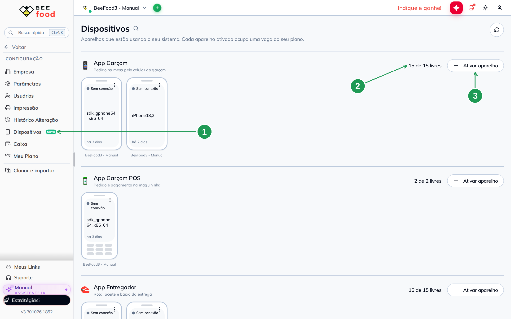
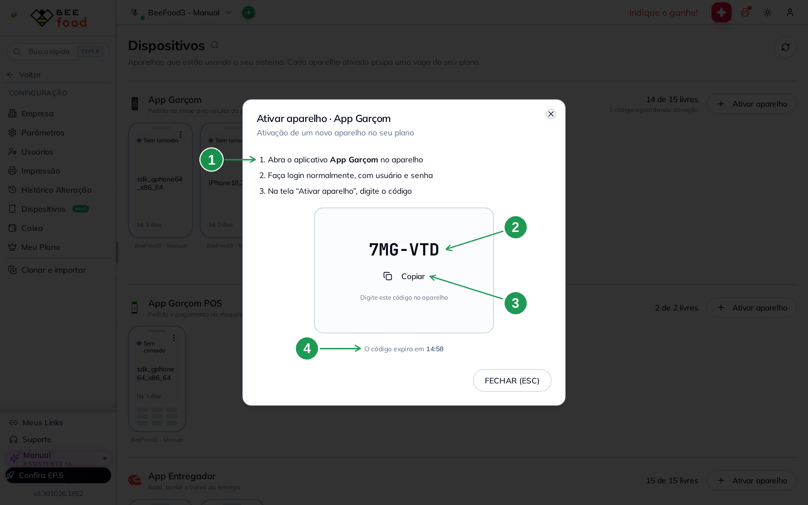
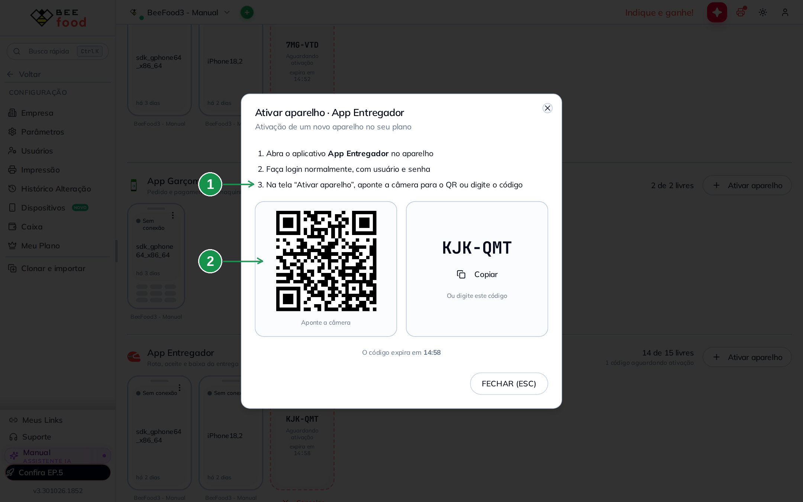
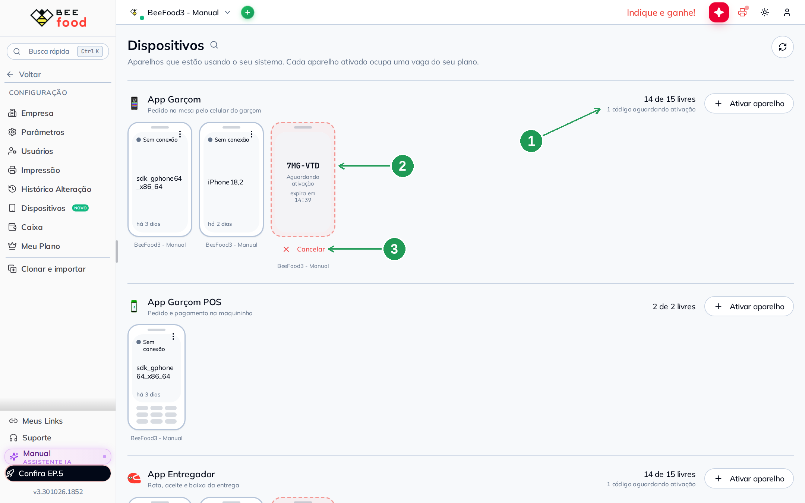
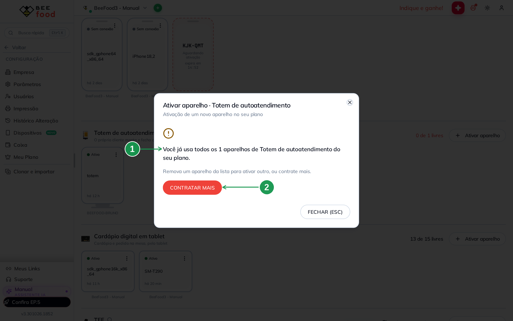

# Código de ativação de aparelho (Configuração → Dispositivos)

Para o **App Garçom**, o **App Entregador**, o **totem** ou o **cardápio em tablet**
funcionarem, o aparelho precisa ser ativado uma vez no seu plano. A ativação é feita com um
**código de seis caracteres** gerado aqui no painel — algo como `7MG-VTD` — que você digita
no aparelho. Nos aparelhos com câmera, em vez de digitar, dá para apontar a câmera para um
**QR**.

Este manual mostra só isso: **onde gerar o código de ativação e o que fazer com ele**. A
quantidade de aparelhos que o seu plano permite está na página de **planos e preços**, e a
própria tela mostra quantas vagas você tem livres.

> As imagens têm **marcações em verde** (setas e números) indicando onde clicar ou o que
> observar em cada tela.

---

## Antes de começar

1. Conta **BeeFood** com acesso ao grupo **Configuração** no menu.
2. O **aplicativo já instalado** no aparelho que você vai ativar (celular do garçom,
   maquininha, celular do entregador, totem ou tablet).
3. **Uma vaga livre** do tipo de aparelho que você quer ativar. A tela mostra isso em
   *X de Y livres*.
4. O aparelho e você **por perto um do outro**: o código vale por **quinze minutos**.

---

## Passo 1. Abrir Configuração → Dispositivos

No menu, abra **Configuração** e clique em **Dispositivos** (1). A tela lista os aparelhos
em uso, separados por tipo. Em cada tipo você vê quantas vagas sobraram (2) e o botão
**Ativar aparelho** (3), que é o que gera o código.

| Nº | O que é |
|----|---------|
| 1 | **Dispositivos**, dentro do grupo *Configuração* do menu. |
| 2 | **X de Y livres** — vagas livres daquele tipo de aparelho. Em vermelho quando não sobra nenhuma. |
| 3 | **Ativar aparelho** — o botão que gera o código. Cada tipo tem o seu, na própria faixa. |

> **O código é por tipo de aparelho.** O código do *App Garçom* não ativa um *App
> Entregador*. Clique no **Ativar aparelho** da faixa do aparelho que você tem na mão.

## Passo 2. Clicar em Ativar aparelho e ler o código

O código **já aparece gerado** quando a janela abre — não existe outro botão para apertar.
A janela traz os três passos a fazer no aparelho (1), o código em letras grandes (2), o botão
**Copiar** (3) e a contagem do tempo que falta (4).

| Nº | O que é |
|----|---------|
| 1 | Os **três passos no aparelho**: abrir o aplicativo, fazer login com usuário e senha e informar o código na tela *Ativar aparelho*. |
| 2 | O **código de ativação**. O painel mostra os seis caracteres com um traço no meio (`XXX-XXX`) só para facilitar a leitura: é o mesmo código sem o traço. |
| 3 | **Copiar** — útil quando você vai mandar o código por mensagem para quem está com o aparelho. |
| 4 | **O código expira em M:SS** — a contagem começa em **15:00**. Depois disso o código não serve mais e você gera outro. |

> **O código já reservou uma vaga.** Enquanto ele estiver vivo, conta como um aparelho do
> seu plano. Se você não vai usá-lo, cancele (Passo 4) em vez de deixar expirar.

## Passo 3. Informar o código no aparelho

No aparelho, abra o aplicativo, faça login com **usuário e senha** normais e toque em
**Ativar este aparelho**. Nos aparelhos com câmera — **App Entregador** e **cardápio digital
em tablet** — a janela do painel mostra também um **QR** (2), e o terceiro passo passa a
oferecer as duas saídas (1): apontar a câmera ou digitar o código.

| Nº | O que é |
|----|---------|
| 1 | O terceiro passo muda: *aponte a câmera para o QR **ou** digite o código*. |
| 2 | O **QR** para a câmera do aparelho. Ele vale o mesmo que o código ao lado — use o que for mais prático. |

Quando o aparelho aceita, a janela do painel avisa **Aparelho ativado**, mostra o nome dele e
se fecha sozinha. O aparelho aparece na lista em seguida, e a vaga passa de reservada a usada.

## Passo 4. Acompanhar (e cancelar) o código na lista

Não é preciso ficar com a janela aberta. Depois de fechá-la, o código continua na lista, na
faixa do tipo de aparelho: a linha **N código(s) aguardando ativação** (1) e um cartão
tracejado com o código e a contagem (2). Quem desistiu usa o **Cancelar** (3) para devolver a
vaga na hora.

| Nº | O que é |
|----|---------|
| 1 | **N código(s) aguardando ativação** — quantos códigos daquele tipo estão abertos. Cada um segura uma vaga. |
| 2 | O cartão do código, com o **tempo restante**. Passado o prazo, ele vira *Expirado* e a vaga volta. |
| 3 | **Cancelar** — encerra o código agora e libera a vaga. Não desativa aparelho nenhum: só joga fora um código que ninguém usou. |

---

## Quando não há vaga livre

Se o tipo de aparelho já usa todas as vagas do plano, a janela **não gera código**: ela
explica o limite (1) e oferece **CONTRATAR MAIS** (2).

| Nº | O que é |
|----|---------|
| 1 | O aviso de limite, com a quantidade que o seu plano permite daquele tipo. Se houver código aguardando ativação, ele também é contado aqui. |
| 2 | **CONTRATAR MAIS** — abre a contratação de aparelhos adicionais. |

Duas saídas sem mexer no plano: **cancelar um código** que ninguém usou (Passo 4) ou
**remover um aparelho** que você não usa mais, pelos três pontinhos do cartão dele. Nos dois
casos a vaga fica livre na hora.

---

## Quando algo não funciona

| Sintoma | O que verificar |
|---------|-----------------|
| **Não encontro Dispositivos no menu** | O item fica no grupo **Configuração**, entre *Histórico Alteração* e *Caixa*. Se o grupo inteiro não aparece, o seu usuário não tem acesso a ele — peça ao administrador da loja ou ao **suporte BeeFood**. |
| **O botão Ativar aparelho não aparece na faixa** | Dois casos: o tipo está marcado **Gestão em breve** (é o caso do *PDV Mobile Offline*, que ainda não ativa por código), ou a faixa é a do **TEF**, que tem cadastro próprio e não usa código. |
| **A janela abriu escrito "Não foi possível gerar o código"** | Foi falha de comunicação com o servidor. Clique em **Tentar novamente** na própria janela. |
| **O código expirou antes de eu usar** | Clique em **Gerar outro código**, na mesma janela. O código vale quinze minutos, contados da hora em que a janela abriu. |
| **Digitei o código e o aparelho recusou** | Confira o tipo de aparelho: o código do *App Garçom* não ativa um *App Entregador*. Confira também se o código ainda está dentro dos quinze minutos e se nenhum caractere foi trocado — o traço do meio é só leitura. |
| **O aparelho ativou, mas não apareceu na lista** | Clique no ícone de **atualizar**, no canto superior direito da tela. |
| **Diz que já uso todos os aparelhos, mas tenho aparelho sobrando** | Códigos abertos também ocupam vaga. Veja a linha *N código(s) aguardando ativação* e cancele os que ninguém vai usar. |
| **Removi um aparelho e ele continua funcionando** | A vaga fica livre na hora, mas o aparelho só sai do sistema **em até uma hora**, no próximo contato dele com o servidor. |
| **Preciso trocar o celular do garçom** | Remova o aparelho antigo pelos três pontinhos do cartão e ative o novo com um código novo. |

---

## Perguntas frequentes

**Como gerar o código de ativação de um aparelho no BeeFood?**
Menu **Configuração → Dispositivos**, botão **Ativar aparelho** na faixa do tipo de aparelho.
O código aparece pronto na janela que abre.

**Onde fica o código de ativação do App Garçom / App Entregador?**
Na mesma tela: **Configuração → Dispositivos**. Cada tipo de aparelho tem a sua faixa, com o
seu próprio botão **Ativar aparelho**.

**Como ativar o App Garçom no celular?**
Gere o código em *Dispositivos*, abra o App Garçom no celular, faça login com usuário e senha
e informe o código na tela **Ativar aparelho** do aplicativo.

**Como ativar o App Entregador?**
Igual, com uma facilidade a mais: o App Entregador tem câmera, então a janela do painel
mostra um **QR** ao lado do código. Aponte a câmera e pronto.

**Preciso apertar algum botão para gerar o código?**
Não. O código é gerado **ao abrir a janela** *Ativar aparelho*. O único botão ali é o
**Copiar**.

**Quanto tempo o código de ativação vale?**
**Quinze minutos**, com a contagem à vista na janela e no cartão da lista. Depois disso é só
gerar outro.

**O código expirou. E agora?**
Clique em **Gerar outro código** na mesma janela, ou feche e clique de novo em *Ativar
aparelho*.

**Posso fechar a janela e ativar o aparelho depois?**
Sim, dentro dos quinze minutos. O código continua na lista, no cartão tracejado da faixa
daquele tipo de aparelho.

**Dá para gerar vários códigos de uma vez?**
Sim — por exemplo, um para cada garçom. Lembre que **cada código aberto ocupa uma vaga** do
plano enquanto não for usado, cancelado ou expirado.

**Posso mandar o código por WhatsApp para quem está com o aparelho?**
Sim. É para isso que serve o **Copiar**. O código só funciona uma vez e vale quinze minutos.

**Como cancelar um código que eu gerei por engano?**
Na lista, no cartão tracejado do código, clique em **Cancelar**. A vaga volta a ficar livre
na hora e nenhum aparelho é desativado.

**O que significa "código aguardando ativação"?**
É um código que você gerou e ninguém usou ainda. Ele reserva uma vaga do plano até ser usado,
cancelado ou expirar.

**O que significa "15 de 15 livres"?**
Vagas daquele tipo de aparelho: quantas estão livres, de quantas o seu plano tem. Quando não
sobra nenhuma, o número fica vermelho.

**Diz que eu já uso todos os aparelhos do plano. O que faço?**
Três caminhos: **cancelar** um código aguardando ativação, **remover** um aparelho que não é
mais usado (os três pontinhos do cartão dele) ou **CONTRATAR MAIS** na própria janela.

**Como aumentar a quantidade de aparelhos?**
Pelo botão **CONTRATAR MAIS** da janela, ou em **Meu Plano**. A quantidade que cada plano já
inclui está na página de **planos e preços** do site da BeeFood.

**Como ativar o totem de autoatendimento?**
Mesma receita, na faixa **Totem de autoatendimento**. O totem não usa QR: digite o código
nele.

**Como ativar o cardápio digital em tablet?**
Na faixa **Cardápio digital em tablet**. Esse tem câmera, então vale o QR ou o código.

**E o PDV Mobile Offline?**
A faixa dele aparece marcada **Gestão em breve** e ainda não ativa por código.

**E a maquininha com TEF?**
O **TEF** tem a sua própria faixa na tela, com cadastro próprio — não usa código de ativação.

**Como remover um aparelho ativado?**
No cartão do aparelho, clique nos três pontinhos e em **Remover**. A vaga fica livre na hora;
o aparelho sai do sistema em até uma hora, no próximo contato dele com o servidor.

**Como dar um nome para o aparelho?**
Nos três pontinhos do cartão, em **Renomear** — até 60 caracteres. Ajuda a saber qual
aparelho é qual na lista.

**Como achar um aparelho ou um código na lista?**
Pela **lupa** ao lado do título *Dispositivos*. Ela procura por nome, modelo, usuário e
também pelo próprio código.

---

## Precisa de ajuda?

Fale com o **suporte BeeFood** informando: nome da loja e **filial**, o **tipo de aparelho**
(App Garçom, App Entregador, totem, tablet…), quantas vagas a tela mostra como livres e, se
você já gerou o código, o que o aparelho respondeu ao recebê-lo.

---

## Onde continuar

- **App do entregador: instalar, entrar e ficar disponível** — o outro lado da ativação, no
  celular do entregador.
- **Totem de Autoatendimento: como pôr o totem no ar e configurar** — o que fazer no totem
  depois de ele estar ativado.
- **Modo Kiosk: travar o tablet no cardápio** — o passo seguinte do cardápio em tablet.
- **TEF PayGo** e **TEF Stone** — a faixa de TEF da tela, que tem cadastro próprio.

---

*Última atualização: outubro/2026 — BeeFood · Configuração · Dispositivos · código de ativação*
