# Natural Bot — ligar o seu robô de atendimento à loja no BeeFood

Ligue a **Natural Bot** ao **BeeFood** e o pedido que o cliente faz no robô cai direto na sua
loja: você cria uma credencial no BeeFood, cola no painel da Natural Bot, escolhe o cardápio e
importa os produtos. Feito isso, o pedido entra sem redigitar e o **status volta sozinho**.

**Este manual é só da ativação** — credencial, conexão e cardápio. **Dúvida de uso da Natural
Bot** (como o robô atende, como o pedido aparece no quadro, campanha, cupom) **é com a Natural
Bot**: é o painel dela, e só o suporte dela responde.

> As imagens têm **marcações em verde** (setas e números) indicando onde clicar ou o que
> observar. As imagens 1 a 4 são do **BeeFood**; as imagens 5 a 12 são do **painel da Natural
> Bot**.

---

## O que a integração faz

- **O pedido da Natural Bot entra na sua loja do BeeFood**, sem redigitar.
- **O status volta sozinho**, enquanto o aviso de status estiver ativo. Quem cadastra esse aviso
  é a Natural Bot, e você confere no Passo 9.
- **O cardápio é importado da BeeFood** — produtos, categorias, variações e opções. A importação
  é manual: rode de novo quando o cardápio mudar.
- **As formas de pagamento são casadas uma a uma** com as que existem na sua loja.

---

## Antes de começar

1. Conta **BeeFood** ativa, com permissão para abrir o menu **Aplicativos**.
2. O card **API Aberta** visível em Aplicativos. Ele está em liberação por etapas: se não
   aparecer, fale com o **suporte BeeFood**.
3. Acesso ao **painel da Natural Bot**, na filial que vai receber os pedidos.
4. Saber **qual cardápio** a Natural Bot vai usar e **quais formas de pagamento** ela recebe.

> **A credencial se cria no painel do BeeFood.** A tela da Natural Bot manda criar no portal de
> desenvolvedor (`developer.beefood.com.br`); você não precisa. Em **Aplicativos → API Aberta**
> são três cliques, e não existe a escolha de ambiente que faz o lojista criar a credencial em
> *Sandbox* e ficar esperando pedido que nunca chega. O que o painel cria é sempre de produção.
> O **Client Secret** é a senha da sua loja na API: nunca mande em grupo de mensagem.

---

## Parte 1 — No BeeFood: a credencial da Natural Bot

### Passo 1. Abrir Aplicativos → API Aberta

No menu lateral, clique em **Aplicativos** (1). Na seção **API e MCP**, clique no card
**API Aberta** (2).

| Nº | O que fazer |
|----|-------------|
| 1 | **Aplicativos**, no menu lateral. |
| 2 | Card **API Aberta** — *Integre seu sistema ao BeeFood via API REST*. |

### Passo 2. Criar uma credencial nova

O painel abre na aba **Credencial** (1). Role até o fim do cartão: passe longe do **RECICLAR**
(2) e clique em **CRIAR CREDENCIAL** (3).

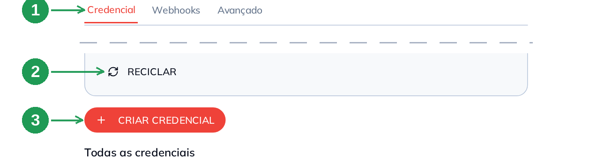

| Nº | Campo | O que fazer |
|----|-------|-------------|
| 1 | Aba **Credencial** | Onde ficam as credenciais da loja. A **Credencial principal**, no meio da tela, é a mesma que o portal `docs.beefood.app` exibe: não se mexe nela. |
| 2 | **RECICLAR** | ⚠️ **Não clique.** Ele troca o Client ID e o Client Secret da credencial principal, e toda integração que a use para na hora. |
| 3 | **CRIAR CREDENCIAL** | Cria uma credencial só para a Natural Bot. Ela aparece em **Todas as credenciais**, logo abaixo, e pode ser desligada ou excluída depois sem derrubar nenhuma outra integração. |

### Passo 3. Deixar ligados só os seis acessos

Abre o diálogo **Nova credencial adicional**, e ele **nasce com tudo ligado**. Desligue o
*Consultar* de **Clientes**, **Cupons**, **Avaliações**, **Estoque**, **Entregadores**,
**Garçons**, **Caixa** e **Usuários**, e o *Alterar* de **Catálogo** e de **Loja**. Tem de sobrar
exatamente o que está na foto: **Pedidos** inteiro (1), **Catálogo** só *Consultar* (2), **Loja**
só *Consultar* (3) e **Webhooks** inteiro (4). Confira pelos nomes em cinza, que são os acessos
que a Natural Bot pede, e clique em **CRIAR (F2)** (5).

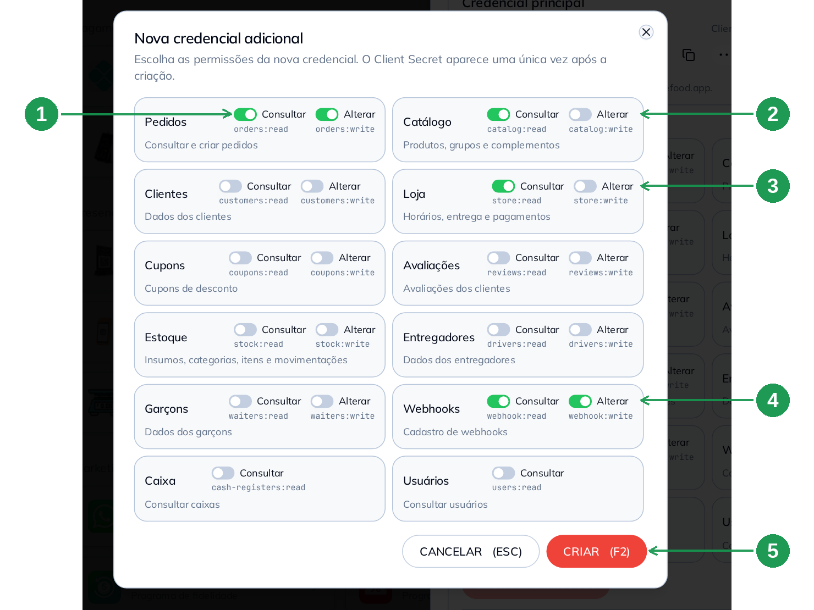

| Nº | Campo | Acesso | Para que a Natural Bot usa |
|----|-------|--------|----------------------------|
| 1 | **Pedidos** | `orders:write` e `orders:read` | enviar o pedido para a sua loja, e conferir um pedido que a BeeFood não confirmou. |
| 2 | **Catálogo** | `catalog:read` | importar o cardápio (Parte 3). |
| 3 | **Loja** | `store:read` | listar os cardápios e as formas de pagamento da loja (Passo 7). |
| 4 | **Webhooks** | `webhook:read` e `webhook:write` | cadastrar e conferir o aviso que traz o status do pedido de volta. |
| 5 | **CRIAR (F2)** | — | grava a credencial. **CANCELAR (ESC)** desiste sem criar. |

> **Dois detalhes que poupam uma segunda credencial.** Desligar o *Consultar* desliga o *Alterar*
> junto, e não existe o contrário: ligar *Alterar* liga o *Consultar* e o trava. E os dois de
> **Webhooks** são os que mais faltam — sem eles a conexão funciona, mas o status não volta, e o
> pedido continua sendo movido à mão no painel da Natural Bot.

### Passo 4. Copiar o Client ID e o Client Secret

Abre o diálogo **Credencial criada**, com os dois valores que vão para a Natural Bot. Copie o
**clientId** (1) e o **clientSecret** (2) — cada um tem o seu botão de copiar — e só então
clique em **FECHAR (ESC)** (3).

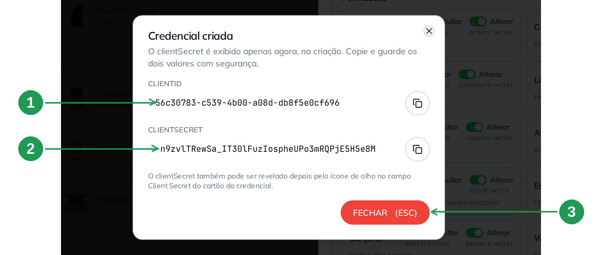

| Nº | Campo | O que fazer |
|----|-------|-------------|
| 1 | **CLIENTID** | Copie. É o *Client ID* que a Natural Bot pede. |
| 2 | **CLIENTSECRET** | Copie e guarde em lugar seguro. É a senha da sua loja na API. |
| 3 | **FECHAR (ESC)** | A credencial nova fica na lista **Todas as credenciais**, como **Ativa**. |

> **Perdeu o secret?** Não precisa criar outra credencial: ele pode ser revelado depois pelo
> **ícone de olho** no campo *Client Secret* do cartão da credencial, em **Todas as
> credenciais**.

---

## Parte 2 — No painel da Natural Bot: ligar a BeeFood

> Daqui para frente as telas são **da Natural Bot**. Confira, no alto à direita, que a **filial
> selecionada** é a que vai receber os pedidos: a integração é por filial.

### Passo 5. Abrir Configurações → Integrações e o card da BeeFood

No menu lateral, clique em **Configurações** e escolha a aba **Integrações** (1). Leia o aviso de
**Gestores de PDV** (2). Role até o card **BeeFood** — ele fica no meio da lista de gestores, e a
foto mostra só ele. O card tem uma chave liga/desliga (3) e um botão (4): **CONFIGURAR**, se a
filial nunca foi conectada, ou **EDITAR**, se já existe credencial salva. Clique nele.

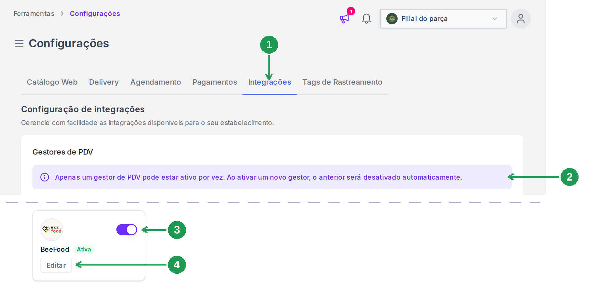

| Nº | Campo | O que observar |
|----|-------|----------------|
| 1 | Aba **Integrações** | Dentro de **Configurações**. É onde ficam os gestores de PDV, as integrações de entrega e as de pagamento. |
| 2 | *Apenas um gestor de PDV pode estar ativo por vez* | ⚠️ A BeeFood entra como gestor de PDV. Se a sua filial já usa outro, **ativar a BeeFood desativa o anterior automaticamente**. |
| 3 | A chave do card | Liga e desliga a integração. Na foto ela já está ligada, com o selo **Ativa**; na primeira vez aparece desligada. |
| 4 | **CONFIGURAR** / **EDITAR** | Abre o diálogo da integração. É o mesmo nos dois casos. |

### Passo 6. Colar a credencial e conectar

O diálogo começa listando os **seis acessos** (1) — a mesma lista do Passo 3 — e avisando o que
acontece se faltarem os dois de webhook (2). Cole o **Client ID** (3) e o **Client secret** (4)
do Passo 4 e clique em **Conectar** (5).

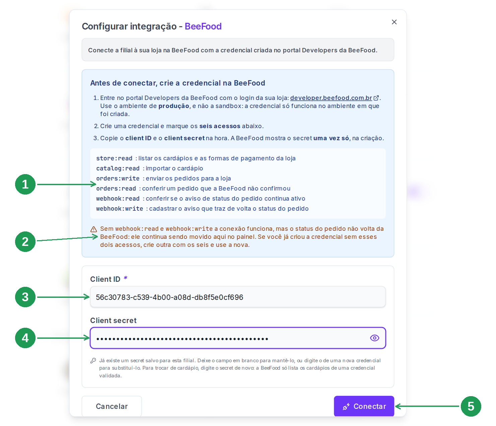

| Nº | Campo | O que fazer |
|----|-------|-------------|
| 1 | A lista dos seis acessos | Confira contra o que você criou no Passo 3. São os mesmos nomes. |
| 2 | O aviso de `webhook:read` e `webhook:write` | Se a sua credencial não tem os dois, volte ao Passo 2 e crie outra com os seis. |
| 3 | **Client ID** | Cole o `clientId`. Campo obrigatório. |
| 4 | **Client secret** | Cole o `clientSecret`. Se já existe um salvo nesta filial, deixar em branco mantém o antigo — e para **trocar de cardápio** é preciso digitá-lo de novo. |
| 5 | **Conectar** | A Natural Bot valida a credencial na BeeFood e passa para a etapa seguinte. |

> **Se der *A BeeFood recusou o client ID ou o client secret*,** quase sempre é ambiente: a
> credencial foi criada no portal, em *Sandbox*. A do painel (Passo 3) é sempre de produção.

### Passo 7. Escolher o cardápio e casar as formas de pagamento

Escolha o **Cardápio** (1) da sua loja do BeeFood. Para cada forma de pagamento que a Natural Bot
recebe online, escolha a correspondente no BeeFood (2) — ela sugere o par, e a sugestão só vale
depois de salvar. Deixe **Ligar a integração ao salvar** (3) ligado e clique em **Salvar** (4).

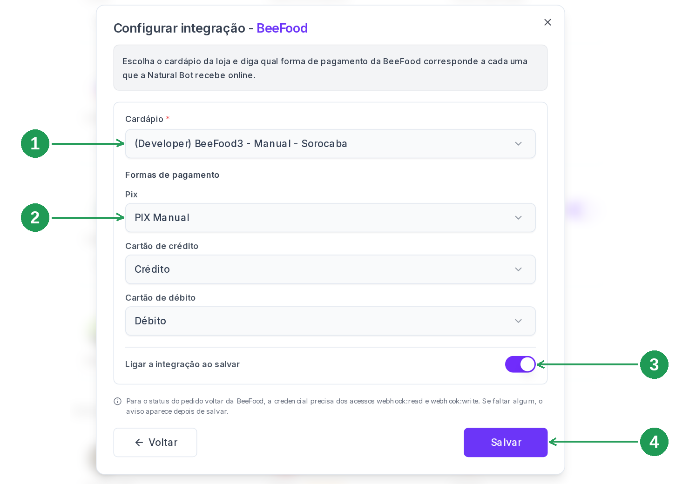

| Nº | Campo | O que fazer |
|----|-------|-------------|
| 1 | **Cardápio** | A lista vem da sua loja do BeeFood. Trocar de cardápio depois **apaga o de-para de pagamentos** do anterior. |
| 2 | **Formas de pagamento** | Pix, cartão de crédito e cartão de débito, cada um apontando para uma forma do BeeFood. |
| 3 | **Ligar a integração ao salvar** | Já vem ligado. É o que faz os pedidos começarem a ir para a BeeFood. |
| 4 | **Salvar** | Grava a integração e roda a verificação do Passo 8. |

### Passo 8. Ler o resultado da verificação

A Natural Bot consulta a BeeFood e mostra o que achou. A linha verde (1) é a que importa:
*Integração com a BeeFood configurada com sucesso*. Avisos amarelos (2) não impedem a integração,
mas valem leitura. Clique em **Concluir** (3).

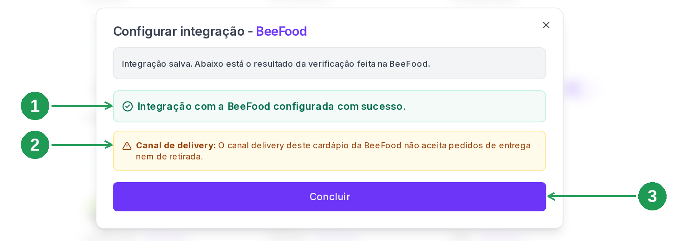

| Nº | Campo | O que observar |
|----|-------|----------------|
| 1 | *configurada com sucesso* | A credencial foi aceita e a integração está salva. |
| 2 | Aviso amarelo | Na foto, *o canal delivery deste cardápio da BeeFood não aceita pedidos de entrega nem de retirada*. É configuração do cardápio no BeeFood, não da credencial. |
| 3 | **Concluir** | Fecha o diálogo. |

### Passo 9. Conferir a integração ligada e o aviso de status

Abra o card da BeeFood de novo: agora o diálogo abre em resumo, **Integração já configurada**.
Confira o Client ID mascarado, o cardápio e o de-para (1). O **Editar Integração** (2) é o
caminho para trocar qualquer um deles. A chave **Integração ligada** (3) tem de estar ligada, e
logo abaixo está a linha que fecha a Parte 2: **Webhook de status: ativo** (4). O botão **Ir para
Produtos** (5) leva direto à Parte 3.

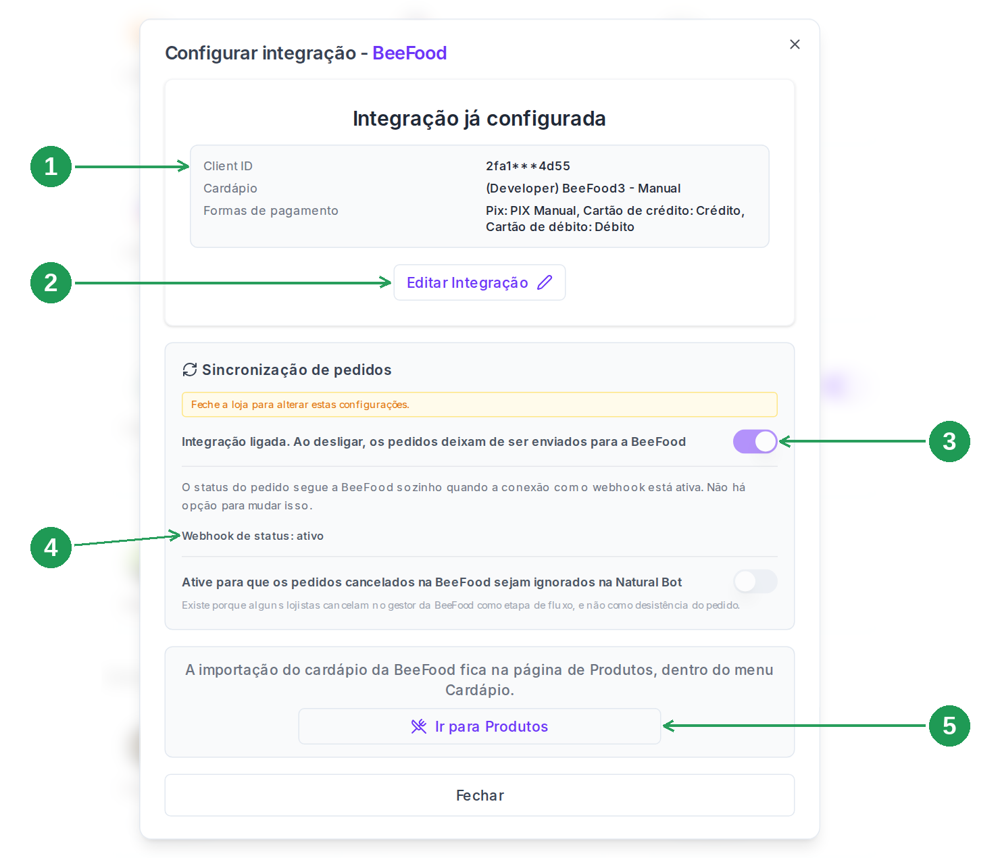

| Nº | Campo | O que observar |
|----|-------|----------------|
| 1 | **Client ID**, **Cardápio**, **Formas de pagamento** | O resumo do que foi salvo. O Client ID aparece mascarado, e o secret não aparece. |
| 2 | **Editar Integração** | Volta ao formulário do Passo 6. Para trocar de cardápio, digite o secret de novo. |
| 3 | **Integração ligada** | Desligar aqui faz os pedidos deixarem de ser enviados. ⚠️ Para mexer nesta chave e na de baixo é preciso **fechar a loja** antes — é o que diz o aviso amarelo acima delas. |
| 4 | **Webhook de status: ativo** | É o aviso que traz o status do pedido de volta. **Quem cadastra é a Natural Bot**, com o acesso `webhook:write`; você não precisa criar webhook nenhum no BeeFood. |
| 5 | **Ir para Produtos** | Atalho para a importação do cardápio. |

> **Já integrou Entregas Expressas ou Route Delivery?** Nessas duas havia uma terceira parte, de
> volta no BeeFood, para cadastrar o webhook à mão. **Aqui não tem.**

---

## Parte 3 — Sincronizar o cardápio

### Passo 10. Cardápio → Produtos → Sinc. BeeFood

No menu lateral da Natural Bot, abra **Cardápio** e clique em **Produtos** (1). Na barra de cima,
clique em **Sinc. BeeFood** (2).

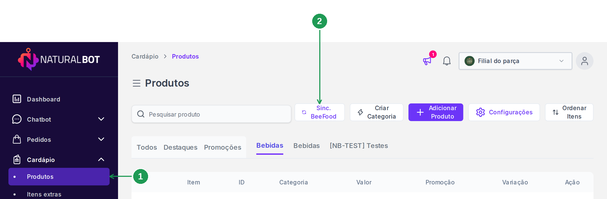

| Nº | Campo | O que fazer |
|----|-------|-------------|
| 1 | **Produtos** | Dentro do menu **Cardápio**. |
| 2 | **Sinc. BeeFood** | Abre o diálogo da importação. Só aparece com a integração configurada. |

### Passo 11. Rodar a importação

O diálogo avisa que a importação é **processada em fila** (1) e oferece três opções, todas
**desmarcadas** (2). Na primeira vez, deixe as três como estão: assim a importação só **traz** o
cardápio, sem apagar nem desfazer nada do que existe no painel da Natural Bot. Clique em
**Importar** (3).

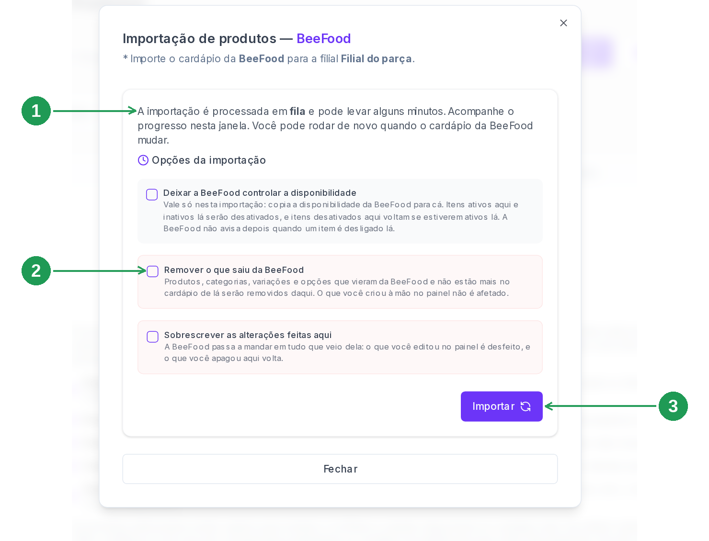

| Nº | Campo | O que fazer |
|----|-------|-------------|
| 1 | *processada em fila* | Pode levar alguns minutos. Acompanhe nesta mesma janela. |
| 2 | As três opções | Deixe desmarcadas na primeira vez. O que cada uma faz está na tabela abaixo. |
| 3 | **Importar** | Começa a importação. |

| Opção | O que ela faz | Quando marcar |
|-------|---------------|---------------|
| **Deixar a BeeFood controlar a disponibilidade** | Copia o ligado/desligado da BeeFood para a Natural Bot, **só nesta rodada**. | Quando a disponibilidade de lá tem de valer aqui agora. |
| **Remover o que saiu da BeeFood** | Apaga da Natural Bot o que veio da BeeFood e não está mais no cardápio de lá. O que você criou à mão não é afetado. | Depois de tirar itens do cardápio no BeeFood. |
| **Sobrescrever as alterações feitas aqui** | A BeeFood passa a mandar em tudo que veio dela: o que você editou no painel é desfeito, e o que você apagou volta. | Quando o cardápio do BeeFood tem de ser a verdade, sem exceção. |

### Passo 12. Ver o que entrou

No fim aparece **Importação concluída** (1), com a conta de categorias, produtos, variações e
opções (2). Clique em **Fechar** (3) e confira a lista de **Produtos** na aba **Todos** — ela
abre na primeira categoria, que pode estar vazia.

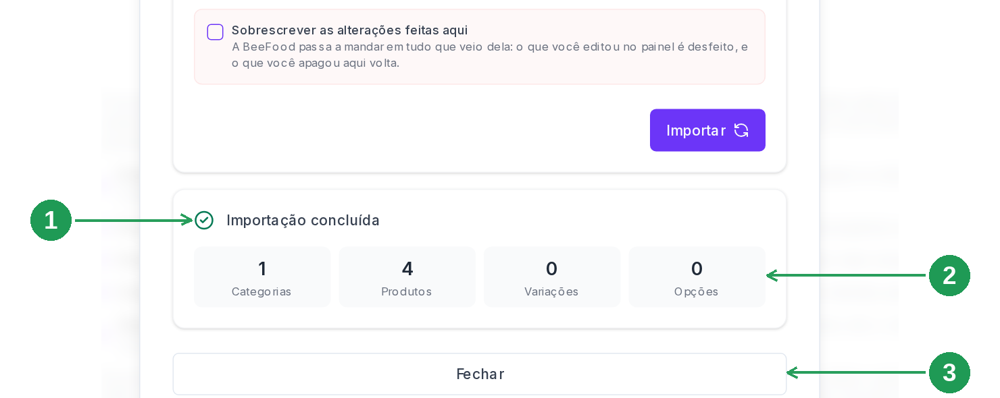

| Nº | Campo | O que observar |
|----|-------|----------------|
| 1 | **Importação concluída** | A importação terminou. Se der erro, a mensagem aparece aqui. |
| 2 | Categorias, Produtos, Variações, Opções | Quantos itens de cada tipo a importação criou ou atualizou. |
| 3 | **Fechar** | Você pode rodar de novo quando o cardápio do BeeFood mudar. |

---

## Como fica o dia a dia

- **A Natural Bot manda o pedido para a sua loja**, e o BeeFood devolve o status pelo aviso do
  Passo 9. A tela dela diz que isso não tem opção para mudar.
- **Mudou o cardápio no BeeFood?** Rode a importação de novo (Passo 10). Nada é automático.
- **Mudou de cardápio ou de credencial?** **Editar Integração**, no Passo 9 — e, para trocar de
  cardápio, digite o secret outra vez.
- **Quer parar de enviar pedidos?** Desligue a chave **Integração ligada** com a loja fechada, ou
  a chave do próprio card. Para cortar o acesso de vez, exclua no BeeFood a credencial do Passo
  3.

> **Dúvida de uso é com a Natural Bot.** Como o robô atende, como o pedido aparece no quadro,
> impressão, campanha, cupom, fidelidade — tudo isso é painel dela.

---

## Quando algo não funciona

| Sintoma | O que conferir |
|---------|----------------|
| *A BeeFood recusou o client ID ou o client secret* | A credencial é de **produção**? A criada no portal com *Sandbox* marcado não serve. A do painel (Passo 3) é sempre de produção. Confira também se não ficou espaço sobrando ao colar. |
| Conectou, mas o **status não volta** | A credencial tem `webhook:read` **e** `webhook:write`? No Passo 9, a linha **Webhook de status** tem de dizer **ativo**. Se faltar um dos dois, crie outra credencial com os seis e troque em **Editar Integração**. |
| A lista de **cardápios vem vazia** no Passo 7 | Falta `store:read`, ou o secret não foi digitado nesta rodada — a Natural Bot só lista cardápios de uma credencial validada. |
| **Nenhum produto** entrou na importação | Falta `catalog:read`, ou o cardápio escolhido no Passo 7 não é o que tem os produtos. |
| *O canal delivery deste cardápio não aceita pedidos de entrega nem de retirada* | É o cardápio no BeeFood: o canal **Delivery** dele não está aceitando entrega nem retirada. Ajuste no BeeFood e salve a integração de novo. |
| **Duas categorias com o mesmo nome** na Natural Bot | A importação cria as categorias com o nome que elas têm no BeeFood; a que você criou à mão continua lá, vazia. Apague ou renomeie uma das duas. |
| A chave **Integração ligada** não deixa mexer | *Feche a loja para alterar estas configurações* — feche a loja na Natural Bot, mexa na chave e abra de novo. |
| **Outro gestor de PDV** parou de funcionar | Só um fica ativo por vez na Natural Bot. Ativar a BeeFood desativa o anterior. |
| O card **API Aberta** não aparece em Aplicativos | O recurso está em liberação por etapas. Fale com o suporte BeeFood. |

---

## Perguntas frequentes

**Preciso do portal de desenvolvedor do BeeFood para integrar a Natural Bot?**

Não. A tela da Natural Bot menciona o portal, mas a credencial que ela pede é a mesma que você
cria em **Aplicativos → API Aberta**, e pelo painel ela já sai de produção.

**Posso usar a credencial principal em vez de criar uma?**

Pode. Mas criar uma só para a Natural Bot é mais seguro: o dia em que você quiser cortar o
acesso, basta excluir essa credencial, e nenhuma outra integração sente.

**Perdi o Client Secret. Preciso criar outra credencial?**

Não. Ele pode ser revelado pelo **ícone de olho** no cartão da credencial, em **Todas as
credenciais**. Só não use **RECICLAR** para isso — ele troca os valores e derruba quem já estiver
usando.

**Por que a Natural Bot pede acesso a Webhooks?**

Porque é ela que cadastra, na sua loja, o aviso que traz o status do pedido de volta — com
`webhook:write` — e confere depois se ele continua de pé, com `webhook:read`. Você não precisa
criar webhook nenhum no BeeFood.

**Preciso importar o cardápio toda vez que mudo um preço no BeeFood?**

Sim, a importação é manual: **Cardápio → Produtos → Sinc. BeeFood**. Para que o preço editado no
painel da Natural Bot não vença o do BeeFood, marque *Sobrescrever as alterações feitas aqui*.

**A integração vale para todas as minhas filiais?**

Não. Ela é **por filial** na Natural Bot: cada uma aponta para um cardápio e tem a sua conexão.
Troque a filial no alto à direita e repita a Parte 2.

---

## Precisa de ajuda?

- **Credencial, permissões, API Aberta, webhook do lado BeeFood:** suporte **BeeFood**.
- **Painel da Natural Bot, robô, pedidos, cardápio de lá, campanhas:** suporte **Natural Bot**.

---

## Onde continuar

- [Entregas Expressas — o pedido de entrega sai sozinho para o aplicativo](../integracao-entregas-expressas/integracao-entregas-expressas.md)
- [Route Delivery — o pedido de entrega vira corrida sozinho](../integracao-route-delivery/integracao-route-delivery.md)

---

*Última atualização: novembro/2026 — BeeFood · Aplicativos · API Aberta · Natural Bot*
