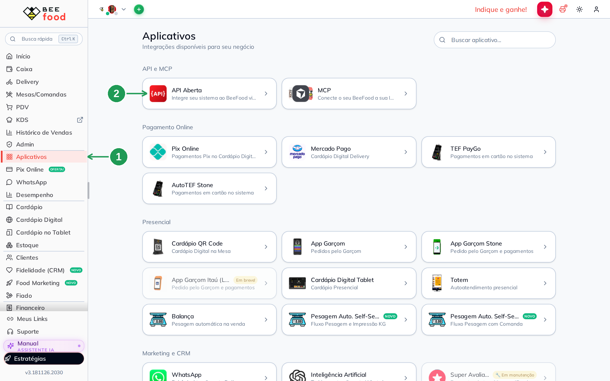
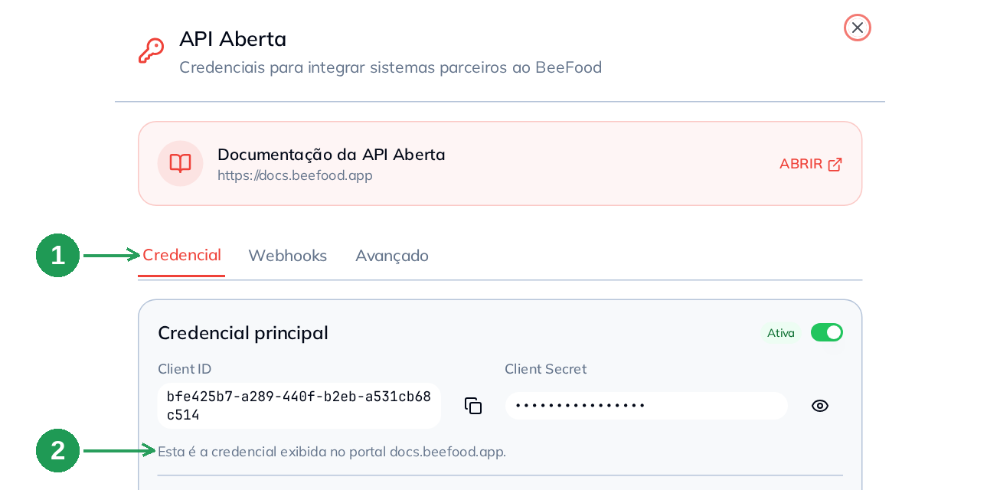
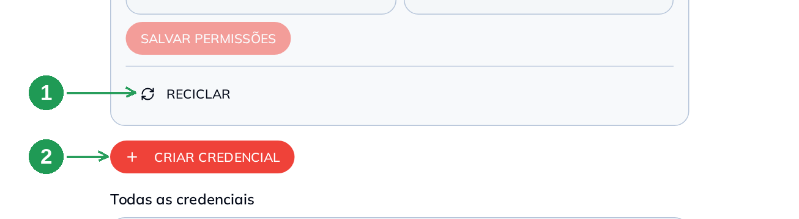
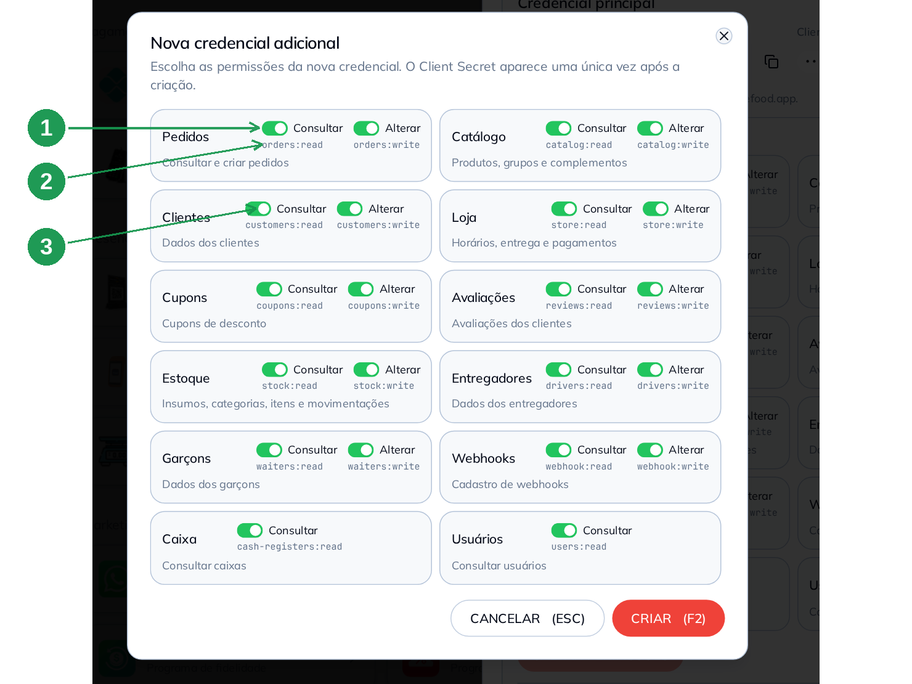
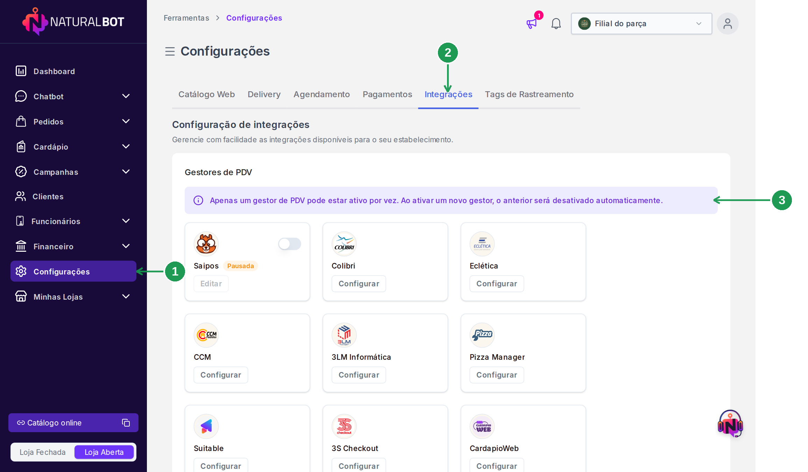
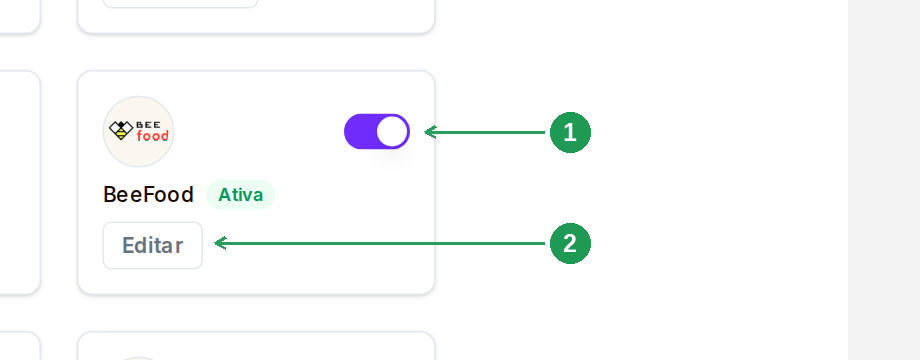
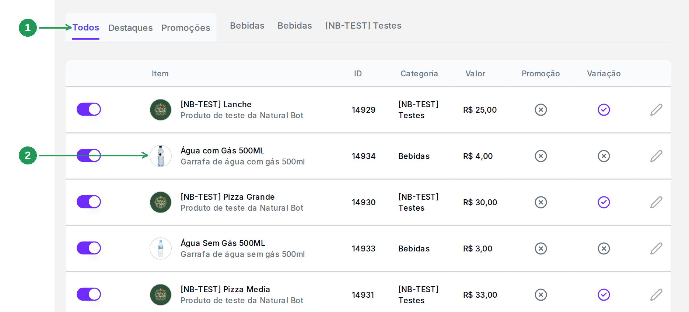

# Natural Bot — ligar o seu robô de atendimento à loja no BeeFood

Ligue a **Natural Bot** ao **BeeFood** e o pedido que o cliente faz no robô de atendimento cai
direto na sua loja: você cria uma credencial no BeeFood, cola no painel da Natural Bot, escolhe
o cardápio e importa os produtos. Feito isso, o pedido entra no BeeFood sem redigitar, e o
**status volta sozinho** da BeeFood para a Natural Bot.

**Este manual é só da ativação.** Ele mostra como as duas partes se ligam uma à outra —
credencial, conexão e cardápio — e para aí. **Dúvida de uso da Natural Bot** (como o robô
atende, como o pedido aparece no quadro, campanha, cupom, mensagem) **é com a Natural Bot**: é o
painel dela, e só o suporte dela responde.

> As imagens têm **marcações em verde** (setas e números) indicando onde clicar ou o que
> observar em cada tela. As imagens 1 a 6 são do **BeeFood**; as imagens 7 a 16 são do **painel
> da Natural Bot**.

---

## O que a integração faz

- **O pedido da Natural Bot entra na sua loja do BeeFood**, sem redigitar.
- **O status volta sozinho.** Quando o pedido anda no BeeFood, a Natural Bot acompanha. Isso
  vale enquanto o aviso de status estiver ativo — a Natural Bot cadastra esse aviso sozinha, e
  você confere no Passo 12.
- **O cardápio é importado da BeeFood.** Produtos, categorias, variações e opções vêm de cá;
  você manda rodar a importação quando o cardápio do BeeFood mudar.
- **As formas de pagamento são casadas uma a uma.** Pix, cartão de crédito e cartão de débito da
  Natural Bot apontam para as formas que existem na sua loja do BeeFood.

---

## Antes de começar

1. Conta **BeeFood** ativa, e permissão para abrir o menu **Aplicativos**.
2. O card **API Aberta** visível em Aplicativos. Ele está em liberação por etapas: se não
   aparecer na sua conta, fale com o **suporte BeeFood** antes de seguir.
3. Acesso ao **painel da Natural Bot**, na filial que vai receber os pedidos.
4. Saber **qual cardápio** da sua loja a Natural Bot vai usar, e **quais formas de pagamento**
   ela recebe online.
5. Um lugar seguro para guardar a credencial. O **Client Secret** é a senha da sua loja na API
   do BeeFood: nunca mande em grupo de mensagem.

> **A credencial se cria no painel do BeeFood.** A tela da Natural Bot manda criar a credencial
> no portal de desenvolvedor (`developer.beefood.com.br`). Você **não precisa**: ela se cria em
> **Aplicativos → API Aberta**, dentro do BeeFood, e é esse o caminho deste manual. Além de ser
> mais curto, ele evita o erro mais comum do portal — criar a credencial no ambiente de testes
> (*Sandbox*) e ficar esperando pedido que nunca chega. Pelo painel essa escolha não existe: o
> que ele cria é sempre de produção.

---

## Parte 1 — No BeeFood: a credencial da Natural Bot

### Passo 1. Abrir Aplicativos → API Aberta

No menu lateral, clique em **Aplicativos** (1). Na seção **API e MCP**, clique no card
**API Aberta** (2).

| Nº | O que fazer |
|----|-------------|
| 1 | **Aplicativos**, no menu lateral. |
| 2 | Card **API Aberta** — *Integre seu sistema ao BeeFood via API REST*. |

### Passo 2. Reconhecer a credencial principal (e deixá-la quieta)

O painel abre na aba **Credencial** (1), e a sua loja **já tem uma credencial**: a **Credencial
principal**. O texto abaixo dela avisa que é justamente essa que o portal `docs.beefood.app`
exibe (2).

Ela funciona, e dá para usá-la. Mas no Passo 3 vamos **criar uma credencial só para a Natural
Bot**, e deixar a principal como está.

| Nº | Campo | O que observar |
|----|-------|----------------|
| 1 | Aba **Credencial** | É onde ficam o Client ID e o Client Secret, as permissões e o botão de criar credencial. |
| 2 | *Esta é a credencial exibida no portal docs.beefood.app* | Confirma que a credencial do portal e a do painel são a mesma coisa. Não há nada para sincronizar. |

> **Por que uma credencial só para a Natural Bot?** Porque ela é descartável. Se um dia você
> quiser cortar o acesso, desligar ou excluir **essa** credencial não derruba nenhuma outra
> integração — e a credencial principal continua intacta.

### Passo 3. Clicar em CRIAR CREDENCIAL

Role o painel até o fim do cartão da credencial principal. Passe longe do **RECICLAR** (1) e
clique em **CRIAR CREDENCIAL** (2).

| Nº | Campo | O que fazer |
|----|-------|-------------|
| 1 | **RECICLAR** | ⚠️ **Não clique.** Ele troca o Client ID e o Client Secret **da credencial principal**, e toda integração que a use para na hora. |
| 2 | **CRIAR CREDENCIAL** | É por aqui que você cria a credencial da Natural Bot. Ela vai aparecer em **Todas as credenciais**, logo abaixo do botão. |

### Passo 4. Desligar o que a Natural Bot não precisa

Abre o diálogo **Nova credencial adicional**, e ele **nasce com tudo ligado**. Cada recurso tem
dois interruptores, *Consultar* e *Alterar* (1), e embaixo de cada um está o **nome do acesso**
(2) — é por esse nome que a Natural Bot pede. O seu trabalho aqui é **desligar**: clique no
*Consultar* (3) de **Clientes**, **Cupons**, **Avaliações**, **Estoque**, **Entregadores**,
**Garçons**, **Caixa** e **Usuários**, e no *Alterar* de **Catálogo** e de **Loja**.

| Nº | Campo | O que fazer |
|----|-------|-------------|
| 1 | *Consultar* e *Alterar* | Os dois interruptores de cada recurso. *Consultar* é ler; *Alterar* é criar e mudar. |
| 2 | O nome embaixo do interruptor | É o acesso de verdade: `orders:read`, `orders:write`, e assim por diante. Use-o para conferir a lista da Natural Bot. |
| 3 | *Consultar* de um recurso que sai | Desligar o *Consultar* desliga o *Alterar* junto. Oito recursos saem inteiros assim. |

> **Quem altera também consulta.** O caminho de volta não existe: ligar *Alterar* liga o
> *Consultar* do mesmo recurso e o trava. Por isso, para tirar um recurso inteiro, desligue o
> *Consultar* — o outro cai sozinho.

### Passo 5. Conferir os seis acessos e criar

Tem de sobrar exatamente isto: **Pedidos** com *Consultar* e *Alterar* (1), **Catálogo** só com
*Consultar* (2), **Loja** só com *Consultar* (3) e **Webhooks** com *Consultar* e *Alterar* (4).
Todo o resto desligado. Confira pelos nomes em mono e clique em **CRIAR (F2)** (5).

| Nº | Campo | Acesso | Para que a Natural Bot usa |
|----|-------|--------|----------------------------|
| 1 | **Pedidos** | `orders:write` e `orders:read` | enviar o pedido para a sua loja, e conferir um pedido que a BeeFood não confirmou. |
| 2 | **Catálogo** | `catalog:read` | importar o cardápio (Parte 3). |
| 3 | **Loja** | `store:read` | listar os cardápios e as formas de pagamento da loja (Passo 10). |
| 4 | **Webhooks** | `webhook:read` e `webhook:write` | cadastrar e conferir o aviso que traz o status do pedido de volta. |
| 5 | **CRIAR (F2)** | — | grava a credencial. **CANCELAR (ESC)** desiste sem criar. |

> **Os dois de Webhooks são os que mais faltam.** Sem `webhook:read` e `webhook:write` a conexão
> funciona, e é fácil não notar: o que se perde é o status voltando da BeeFood — o pedido
> continua sendo movido à mão no painel da Natural Bot. A própria tela dela avisa isso, e a saída
> é criar outra credencial com os seis e usar a nova.

### Passo 6. Copiar o Client ID e o Client Secret

Abre o diálogo **Credencial criada**, com os dois valores que vão para a Natural Bot: o
**clientId** (1) e o **clientSecret** (2). Copie os dois — cada um tem o seu botão de copiar, à
direita — e só então clique em **FECHAR (ESC)** (3).

| Nº | Campo | O que fazer |
|----|-------|-------------|
| 1 | **CLIENTID** | Copie. É o *Client ID* que a Natural Bot pede. |
| 2 | **CLIENTSECRET** | Copie e guarde em lugar seguro. É a senha da sua loja na API. |
| 3 | **FECHAR (ESC)** | Fecha o diálogo. A credencial nova fica na lista **Todas as credenciais**, como **Ativa**. |

> **Perdeu o secret?** Não precisa criar outra credencial: o próprio diálogo explica que ele
> pode ser revelado depois, pelo **ícone de olho** no campo *Client Secret* do cartão da
> credencial, em **Todas as credenciais**.

---

## Parte 2 — No painel da Natural Bot: ligar a BeeFood

> Daqui para frente as telas são **da Natural Bot**. Confira, no alto à direita, que a **filial
> selecionada** é a que vai receber os pedidos: a integração é por filial.

### Passo 7. Abrir Configurações → Integrações

No menu lateral, clique em **Configurações** (1). Na página que abre, escolha a aba
**Integrações** (2). Leia o aviso de **Gestores de PDV** (3) antes de ligar qualquer coisa.

| Nº | Campo | O que observar |
|----|-------|----------------|
| 1 | **Configurações** | No menu lateral da Natural Bot. |
| 2 | Aba **Integrações** | É onde ficam os gestores de PDV, as integrações de entrega e as de pagamento. |
| 3 | *Apenas um gestor de PDV pode estar ativo por vez* | ⚠️ A BeeFood entra como gestor de PDV. Se a sua filial já usa outro, **ativar a BeeFood desativa o anterior automaticamente**. |

### Passo 8. Abrir o card da BeeFood

Role até achar o card **BeeFood**, entre os gestores de PDV. Ele tem uma chave liga/desliga (1)
e um botão (2): **CONFIGURAR**, se a filial nunca foi conectada, ou **EDITAR**, se já existe uma
credencial salva. Clique nele.

| Nº | Campo | O que observar |
|----|-------|----------------|
| 1 | A chave do card | Liga e desliga a integração. Na imagem ela já está ligada, com o selo **Ativa**; na primeira vez ela aparece desligada. |
| 2 | **CONFIGURAR** / **EDITAR** | Abre o diálogo da integração. É o mesmo diálogo nos dois casos. |

### Passo 9. Colar a credencial e conectar

O diálogo **Configurar integração - BeeFood** começa listando os **seis acessos** (1) — é a
mesma lista do Passo 5 — e avisando o que acontece se faltarem os dois de webhook (2). Cole o
**Client ID** (3) e o **Client secret** (4) do Passo 6 e clique em **Conectar** (5).

| Nº | Campo | O que fazer |
|----|-------|-------------|
| 1 | A lista dos seis acessos | Confira contra o que você criou no Passo 5. São os mesmos nomes. |
| 2 | O aviso de `webhook:read` e `webhook:write` | Se a sua credencial não tem os dois, volte ao Passo 3 e crie outra com os seis. |
| 3 | **Client ID** | Cole o `clientId`. Campo obrigatório. |
| 4 | **Client secret** | Cole o `clientSecret`. Se já existe um salvo nesta filial, deixar em branco mantém o antigo — e para **trocar de cardápio** é preciso digitá-lo de novo. |
| 5 | **Conectar** | A Natural Bot valida a credencial na BeeFood e passa para a etapa seguinte. |

> **Se der *A BeeFood recusou o client ID ou o client secret*,** quase sempre é ambiente: a
> credencial foi criada no portal, em *Sandbox*. Credencial criada pelo painel (Passo 5) é
> sempre de produção.

### Passo 10. Escolher o cardápio e casar as formas de pagamento

Escolha o **Cardápio** (1) da sua loja do BeeFood que a Natural Bot vai usar. Depois, para cada
forma de pagamento que ela recebe online, escolha a forma correspondente no BeeFood (2) — ela
sugere o par, e a sugestão só vale depois de salvar. Deixe **Ligar a integração ao salvar** (3)
ligado e clique em **Salvar** (4).

| Nº | Campo | O que fazer |
|----|-------|-------------|
| 1 | **Cardápio** | A lista vem da sua loja do BeeFood. Trocar de cardápio depois **apaga o de-para de pagamentos** do cardápio anterior. |
| 2 | **Formas de pagamento** | Pix, cartão de crédito e cartão de débito, cada um apontando para uma forma do BeeFood. |
| 3 | **Ligar a integração ao salvar** | Já vem ligado. É o que faz os pedidos começarem a ir para a BeeFood. |
| 4 | **Salvar** | Grava a integração e roda a verificação do Passo 11. |

### Passo 11. Ler o resultado da verificação

A Natural Bot consulta a BeeFood e mostra o que achou. A linha verde (1) é a que importa:
*Integração com a BeeFood configurada com sucesso*. Podem aparecer avisos amarelos (2) — eles
não impedem a integração, mas valem leitura. Clique em **Concluir** (3).

| Nº | Campo | O que observar |
|----|-------|----------------|
| 1 | *Integração com a BeeFood configurada com sucesso* | A credencial foi aceita e a integração está salva. |
| 2 | Aviso amarelo | Na imagem, *o canal delivery deste cardápio da BeeFood não aceita pedidos de entrega nem de retirada*. É configuração do cardápio no BeeFood, não da credencial. |
| 3 | **Concluir** | Fecha o diálogo. |

### Passo 12. Conferir a integração ligada e o aviso de status

Abra o card da BeeFood de novo (Passo 8): agora o diálogo abre em resumo, **Integração já
configurada**. Confira o **Client ID** mascarado, o cardápio e o de-para (1). O **Editar
Integração** (2) é o caminho para trocar qualquer um deles. A chave **Integração ligada** (3)
tem de estar ligada, e logo abaixo dela está a linha que fecha a Parte 2: **Webhook de status:
ativo** (4). O botão **Ir para Produtos** (5) leva direto à Parte 3.

| Nº | Campo | O que observar |
|----|-------|----------------|
| 1 | **Client ID**, **Cardápio**, **Formas de pagamento** | O resumo do que foi salvo. O Client ID aparece mascarado, e o secret não aparece. |
| 2 | **Editar Integração** | Volta ao formulário do Passo 9. Para trocar de cardápio, digite o secret de novo. |
| 3 | **Integração ligada** | Desligar aqui faz os pedidos deixarem de ser enviados para a BeeFood. ⚠️ Para mexer nesta chave e na de baixo é preciso **fechar a loja** antes — o aviso amarelo acima delas diz isso. |
| 4 | **Webhook de status: ativo** | É o aviso que traz o status do pedido de volta da BeeFood. **Quem cadastra é a Natural Bot**, com o acesso `webhook:write`; você não precisa criar webhook nenhum no BeeFood. |
| 5 | **Ir para Produtos** | Atalho para a importação do cardápio. |

> **Já integrou Entregas Expressas ou Route Delivery?** Nessas duas havia uma terceira parte, de
> volta no BeeFood, para cadastrar o webhook à mão e devolver o *Secret do webhook* ao parceiro.
> **Aqui não tem.** A Natural Bot cadastra o aviso sozinha quando você salva, e é por isso que a
> credencial precisa de `webhook:write`.

---

## Parte 3 — Sincronizar o cardápio

### Passo 13. Cardápio → Produtos → Sinc. BeeFood

No menu lateral da Natural Bot, abra **Cardápio** e clique em **Produtos** (1). Na barra de cima
da página, clique em **Sinc. BeeFood** (2).

| Nº | Campo | O que fazer |
|----|-------|-------------|
| 1 | **Produtos** | Dentro do menu **Cardápio**. |
| 2 | **Sinc. BeeFood** | Abre o diálogo da importação. Ele só aparece com a integração configurada. |

### Passo 14. Rodar a importação

O diálogo **Importação de produtos — BeeFood** avisa que a importação é **processada em fila**
(1) e oferece três opções, todas **desmarcadas** (2). Na primeira vez, deixe as três como estão:
assim a importação só **traz** o cardápio, sem apagar nem desfazer nada do que existe no painel
da Natural Bot. Clique em **Importar** (3).

| Nº | Campo | O que fazer |
|----|-------|-------------|
| 1 | *processada em fila* | Pode levar alguns minutos. Acompanhe nesta mesma janela. |
| 2 | As três opções | Deixe desmarcadas na primeira vez. O que cada uma faz está na tabela abaixo. |
| 3 | **Importar** | Começa a importação. |

| Opção | O que ela faz | Quando marcar |
|-------|---------------|---------------|
| **Deixar a BeeFood controlar a disponibilidade** | Copia o ligado/desligado da BeeFood para a Natural Bot, **só nesta rodada**. | Quando você quer que a disponibilidade de lá valha aqui agora. |
| **Remover o que saiu da BeeFood** | Apaga da Natural Bot o que veio da BeeFood e não está mais no cardápio de lá. O que você criou à mão no painel não é afetado. | Depois de tirar itens do cardápio no BeeFood. |
| **Sobrescrever as alterações feitas aqui** | A BeeFood passa a mandar em tudo que veio dela: o que você editou no painel é desfeito, e o que você apagou volta. | Quando o cardápio do BeeFood tem de ser a verdade, sem exceção. |

### Passo 15. Ver o que entrou

No fim aparece **Importação concluída** (1), com a conta do que entrou: categorias, produtos,
variações e opções (2). Clique em **Fechar** (3).

| Nº | Campo | O que observar |
|----|-------|----------------|
| 1 | **Importação concluída** | A importação terminou. Se der erro, o diálogo mostra a mensagem aqui. |
| 2 | Categorias, Produtos, Variações, Opções | Quantos itens de cada tipo a importação criou ou atualizou. |
| 3 | **Fechar** | Fecha o diálogo. Você pode rodar de novo quando o cardápio do BeeFood mudar. |

### Passo 16. Conferir o cardápio na lista

A página de Produtos abre na **primeira** categoria, que pode estar vazia. Clique na aba
**Todos** (1) para ver o cardápio inteiro: os itens que vieram da BeeFood (2) aparecem com nome,
descrição, categoria e preço de lá.

| Nº | Campo | O que observar |
|----|-------|----------------|
| 1 | Aba **Todos** | Mostra todas as categorias juntas. As outras abas filtram por categoria. |
| 2 | Um item importado | Veio da BeeFood com nome, descrição, categoria e preço. O que você já tinha criado à mão continua na lista. |

---

## Como fica o dia a dia

- **A Natural Bot manda o pedido para a sua loja do BeeFood**, e o BeeFood devolve o status pelo
  aviso do Passo 12. A tela da Natural Bot diz isso com todas as letras: *o status do pedido
  segue a BeeFood sozinho quando a conexão com o webhook está ativa, e não há opção para mudar
  isso*.
- **Mudou o cardápio no BeeFood?** Rode a importação de novo (Passo 13). Nada é automático aqui.
- **Mudou de cardápio ou de credencial?** **Editar Integração**, no Passo 12 — e, para trocar de
  cardápio, digite o secret outra vez.
- **Quer parar de enviar pedidos?** Desligue a chave **Integração ligada** (Passo 12) com a loja
  fechada, ou a chave do próprio card (Passo 8). Para cortar o acesso de vez, exclua no BeeFood a
  credencial que você criou no Passo 5.

> **Dúvida de uso é com a Natural Bot.** Como o robô atende, como o pedido aparece no quadro de
> pedidos, impressão, campanha, cupom, fidelidade — tudo isso é painel dela. Este manual cobre a
> ativação, e só.

---

## Quando algo não funciona

| Sintoma | O que conferir |
|---------|----------------|
| *A BeeFood recusou o client ID ou o client secret* | A credencial é de **produção**? Credencial criada no portal com *Sandbox* marcado não serve. A do painel (Passo 5) é sempre de produção. Confira também se não ficou espaço sobrando ao colar. |
| Conectou, mas o **status não volta** da BeeFood | A credencial tem `webhook:read` **e** `webhook:write`? No Passo 12, a linha **Webhook de status** tem de dizer **ativo**. Se faltar um dos dois acessos, crie outra credencial com os seis (Passo 3) e troque em **Editar Integração**. |
| A lista de **cardápios vem vazia** no Passo 10 | Falta `store:read` na credencial, ou o secret não foi digitado nesta rodada — a Natural Bot só lista cardápios de uma credencial validada. |
| **Nenhum produto** entrou na importação | Falta `catalog:read` na credencial, ou o cardápio escolhido no Passo 10 não é o que tem os produtos. |
| O aviso *o canal delivery deste cardápio não aceita pedidos de entrega nem de retirada* | É o cardápio no BeeFood: o canal **Delivery** dele não está aceitando entrega nem retirada. Ajuste no BeeFood e salve a integração de novo. |
| **Ficaram duas categorias com o mesmo nome** na Natural Bot | A importação cria as categorias com o nome que elas têm no BeeFood; a que você criou à mão continua lá, vazia. Apague a sua no painel da Natural Bot, ou renomeie uma das duas. |
| A chave **Integração ligada** não deixa mexer | *Feche a loja para alterar estas configurações* — feche a loja na Natural Bot (botão **Loja Fechada**, no pé do menu), mexa na chave e abra de novo. |
| **Outro gestor de PDV** parou de funcionar | Só um gestor de PDV fica ativo por vez na Natural Bot. Ativar a BeeFood desativa o anterior. |
| O card **API Aberta** não aparece em Aplicativos | O recurso está em liberação por etapas. Fale com o suporte BeeFood. |
| O painel mostra **Ambiente de testes** em vez da credencial | A sua empresa está em ambiente de testes. Nesse caso as credenciais ficam em `docs.beefood.app`. |

---

## Perguntas frequentes

**Preciso do portal de desenvolvedor do BeeFood para integrar a Natural Bot?**

Não. A tela da Natural Bot menciona o portal, mas a credencial que ela pede é a mesma que você
cria em **Aplicativos → API Aberta**, e pelo painel ela já sai de produção.

**Posso usar a credencial principal em vez de criar uma?**

Pode. Mas criar uma só para a Natural Bot é mais seguro: o dia em que você quiser cortar o
acesso, basta excluir essa credencial, e nenhuma outra integração sente.

**Perdi o Client Secret. Preciso criar outra credencial?**

Não. Ele pode ser revelado depois pelo **ícone de olho** no campo *Client Secret* do cartão da
credencial, em **Todas as credenciais**. Só não use **RECICLAR** para isso — ele troca os
valores e derruba quem já estiver usando.

**Por que a Natural Bot pede acesso a Webhooks?**

Porque é ela que cadastra, na sua loja, o aviso que traz o status do pedido de volta — com
`webhook:write` — e confere depois se ele continua de pé, com `webhook:read`. Você não precisa
criar webhook nenhum no BeeFood.

**Preciso importar o cardápio toda vez que mudo um preço no BeeFood?**

Sim, a importação é manual: **Cardápio → Produtos → Sinc. BeeFood**. Para que o preço editado no
painel da Natural Bot não vença o do BeeFood, marque *Sobrescrever as alterações feitas aqui*.

**A integração vale para todas as minhas filiais?**

Não. Ela é **por filial** na Natural Bot: cada uma aponta para um cardápio e tem a sua conexão.
Troque a filial no alto à direita e repita a Parte 2.

**O robô vai responder diferente depois da integração?**

Essa pergunta é da Natural Bot. O que este manual garante é o encanamento: credencial, conexão,
cardápio e status de volta.

---

## Precisa de ajuda?

- **Credencial, permissões, API Aberta, webhook do lado BeeFood:** suporte **BeeFood**.
- **Painel da Natural Bot, robô, pedidos, cardápio de lá, campanhas:** suporte **Natural Bot**.

---

## Onde continuar

- [Entregas Expressas — o pedido de entrega sai sozinho para o aplicativo](../integracao-entregas-expressas/integracao-entregas-expressas.md)
- [Route Delivery — o pedido de entrega vira corrida sozinho](../integracao-route-delivery/integracao-route-delivery.md)

---

*Última atualização: novembro/2026 — BeeFood · Aplicativos · API Aberta · Natural Bot*
