# Route Delivery — o pedido de entrega vira corrida sozinho

Ligue o **BeeFood** ao **Route Delivery** e pare de redigitar pedido: cada pedido de entrega da
sua loja — cardápio digital, PDV, WhatsApp, pedido manual e, se você quiser, marketplaces —
entra sozinho no Route Delivery e chama os entregadores. Quando o entregador sai para a entrega,
o pedido vira **despachado** no BeeFood; quando ele finaliza, vira **entregue**.

**Quem faz cada parte.** Aqui a parte do meio não é sua: **você cria a credencial no BeeFood** e
entrega os dois valores à **equipe Route Delivery**, que **vincula a sua loja** no painel
administrativo dela. Depois ela devolve o endereço do webhook, e **você volta ao BeeFood para
cadastrar o webhook** e manda o secret de volta para ela.

> **A credencial se cria no painel do BeeFood.** O artigo do Route Delivery manda ir ao portal
> de desenvolvedor (`docs.beefood.app`) para criar a credencial e o webhook. Você **não
> precisa**: os dois se cadastram em **Aplicativos → API Aberta**, dentro do BeeFood, e é esse o
> caminho deste manual. Além de ser mais curto, ele evita o erro mais comum do portal — criar a
> credencial no ambiente de testes (*Sandbox*) e ficar esperando pedido que nunca chega. Pelo
> painel essa escolha não existe.

> As imagens têm **marcações em verde** (setas e números) indicando onde clicar ou o que
> observar em cada tela. As imagens 1 a 5, 12, 13 e 14 são do **BeeFood**; as imagens 6 a 11 são
> do **Route Delivery**, e estão aqui para você reconhecer o que a equipe dele vai fazer e saber
> o que pedir a ela.

---

## O que a integração faz

- **Todo pedido de entrega** aceito no BeeFood vira uma corrida no Route Delivery, com cliente,
  telefone, endereço, posição no mapa e o canal de venda.
- **O status volta sozinho:** o entregador sai = pedido **despachado** no BeeFood; o entregador
  finaliza = **entregue**.
- **O entregador sabe o que cobrar.** O pedido mostra, por exemplo, *Cobrar do cliente: Dinheiro
  R$ 52,50 — levar troco para R$ 100,00*, ou *Pago (BeeFood) — nada a cobrar*.
- **Cancelou no BeeFood?** A corrida é cancelada no Route Delivery, desde que a entrega ainda
  não tenha sido concluída.
- **Pedido de retirada, balcão ou mesa não entra.** Só pedido de entrega vira corrida.
- **Por padrão o entregador é chamado quando você marca o pedido como *Pronto***. Dá para
  antecipar, e isso é escolha da equipe Route Delivery (Passo 9).

---

## Antes de começar

1. Conta **BeeFood** ativa, e permissão para abrir o menu **Aplicativos**.
2. A sua loja já cadastrada como **comércio** no Route Delivery, com o **endereço completo** —
   é de lá que saem a distância e o valor de cada entrega.
3. O card **API Aberta** visível em Aplicativos. Ele está em liberação por etapas: se não
   aparecer na sua conta, fale com o **suporte BeeFood** antes de seguir.
4. Um canal combinado com a equipe Route Delivery para enviar a credencial. O **Client Secret**
   é a senha da sua loja no BeeFood: nunca mande em grupo de mensagem.

---

## Parte 1 — No BeeFood: a credencial do Route Delivery

### Passo 1. Abrir Aplicativos → API Aberta

No menu lateral, clique em **Aplicativos** (1). Na seção **API e MCP**, clique no card
**API Aberta** (2).

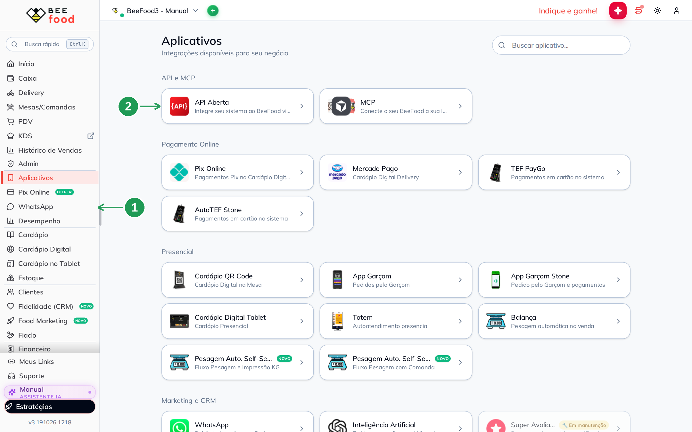

| Nº | O que fazer |
|----|-------------|
| 1 | **Aplicativos**, no menu lateral. |
| 2 | Card **API Aberta** — *Integre seu sistema ao BeeFood via API REST*. |

### Passo 2. Reconhecer a credencial principal (e deixá-la quieta)

O painel abre na aba **Credencial** (1), e a sua loja **já tem uma credencial**: a **Credencial
principal**. O texto abaixo dela avisa que é justamente essa que o portal `docs.beefood.app`
exibe (2) — ou seja, a credencial que o artigo do Route Delivery manda criar já existe aqui.

Ela funciona, e dá para usá-la. Mas no Passo 3 vamos **criar uma credencial só para o Route
Delivery**, e deixar a principal como está.

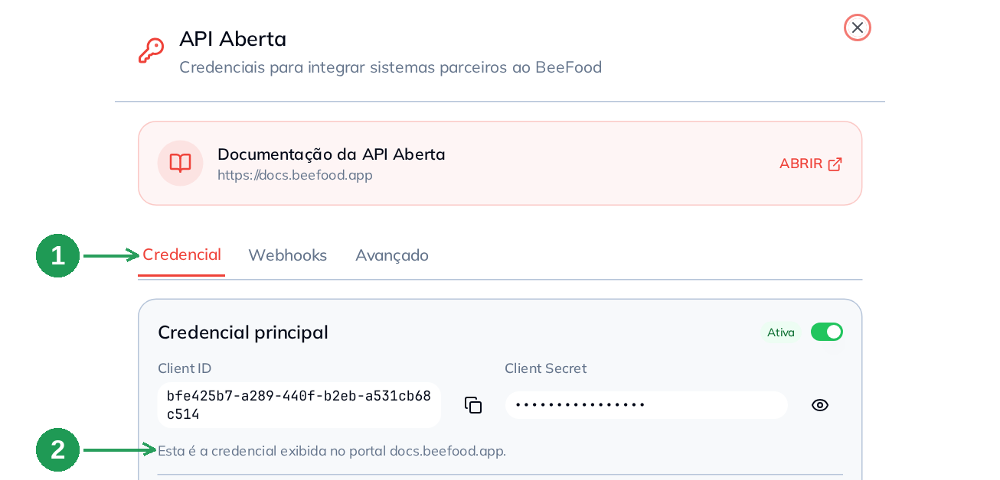

| Nº | Campo | O que observar |
|----|-------|----------------|
| 1 | Aba **Credencial** | É onde ficam o Client ID e o Client Secret, as permissões e o botão de criar credencial. |
| 2 | *Esta é a credencial exibida no portal docs.beefood.app* | Confirma que a credencial do portal e a do painel são a mesma coisa. Não há nada para sincronizar. |

> **Por que uma credencial só para o parceiro?** Porque ela é descartável. Se um dia você quiser
> cortar o acesso do Route Delivery, desligar ou excluir **essa** credencial não derruba nenhuma
> outra integração — e a credencial principal, que é a que o portal mostra, continua intacta.

### Passo 3. Conferir as permissões e clicar em CRIAR CREDENCIAL

Role o painel até **Permissões**. O Route Delivery precisa de dois recursos: **Pedidos** (1),
com *Consultar* e *Alterar*, e **Loja** (2), com *Consultar*. Os dois já vêm ligados — você está
só conferindo. Passe longe do **RECICLAR** (3), que é da credencial principal, e clique em
**CRIAR CREDENCIAL** (4).

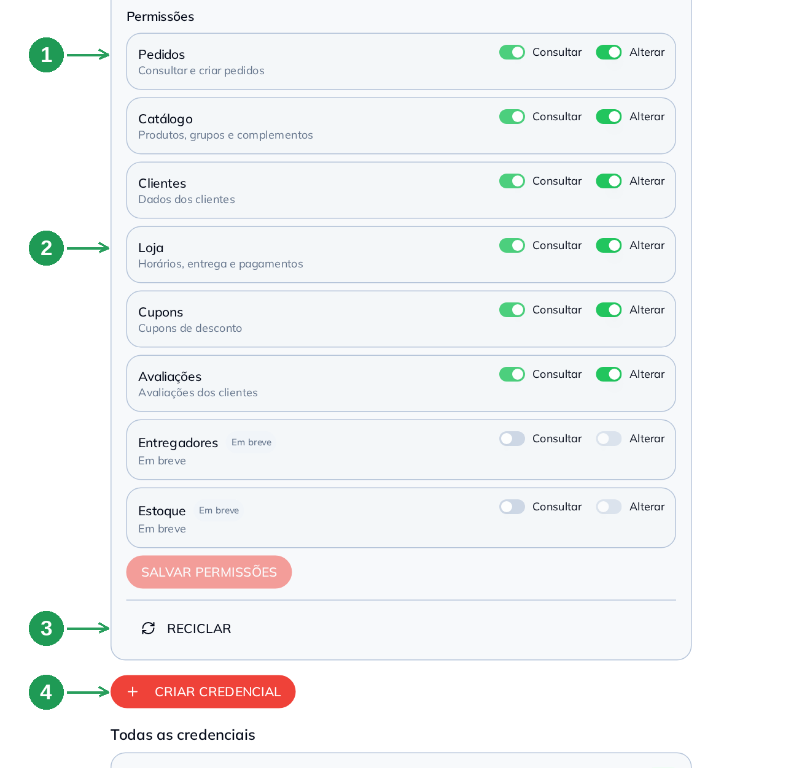

| Nº | Campo | O que fazer |
|----|-------|-------------|
| 1 | **Pedidos** | *Consultar* e *Alterar* ligados. É o que permite ler o pedido e marcar **despachado** e **entregue**. |
| 2 | **Loja** | *Consultar* ligado — é o que permite ler o nome da loja, horários, entrega e formas de pagamento. *Alterar* vem ligado também, e não atrapalha. |
| 3 | **RECICLAR** | ⚠️ **Não clique.** Ele troca o Client ID e o Client Secret **da credencial principal**, e toda integração que a use para na hora. |
| 4 | **CRIAR CREDENCIAL** | É por aqui que você cria a credencial do Route Delivery. Ela vai aparecer em **Todas as credenciais**, logo abaixo do botão. |

> **Quem altera também consulta.** Ao ligar *Alterar*, o *Consultar* do mesmo recurso liga
> sozinho e fica travado. Não é defeito: é a regra da API.

### Passo 4. Confirmar as permissões da nova credencial

Abre o diálogo **Nova credencial adicional**. Ele já nasce com **todos os recursos liberados**,
então os dois que o Route Delivery pede — **Pedidos** (1) e **Loja** (2) — já estão prontos.
Clique em **CRIAR (F2)** (3).

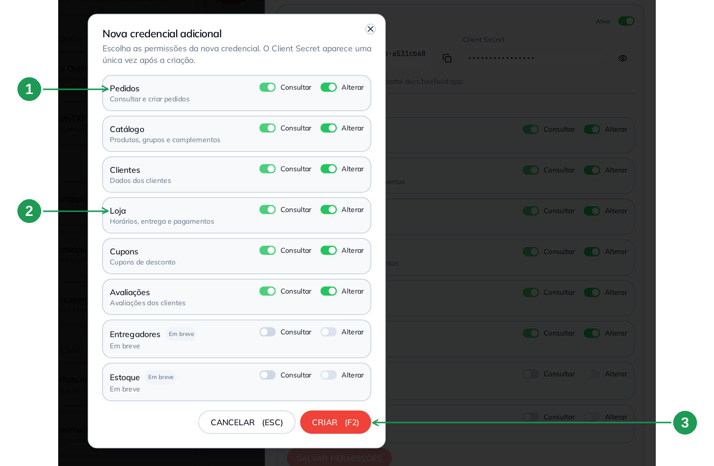

| Nº | Campo | O que fazer |
|----|-------|-------------|
| 1 | **Pedidos** | Já vem com *Consultar* e *Alterar*. Deixe assim. |
| 2 | **Loja** | Já vem com *Consultar* e *Alterar*. Deixe assim. |
| 3 | **CRIAR (F2)** | Grava a credencial. **CANCELAR (ESC)** desiste sem criar. |

> Se você quiser deixar a credencial mais fechada, desligue aqui os recursos que o Route
> Delivery não usa (*Catálogo*, *Clientes*, *Cupons*, *Avaliações*). Deixar tudo ligado também
> funciona, e é o que a tela sugere.

### Passo 5. Copiar o Client ID e o Client Secret

A tela **Credencial criada** aparece **uma vez**, logo depois de criar. Copie o **clientId** (1)
e o **clientSecret** (2) com os botões ao lado de cada campo, e clique em **FECHAR (ESC)** (3).

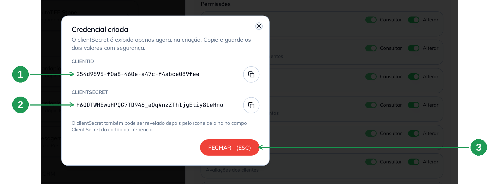

| Nº | Campo | O que fazer |
|----|-------|-------------|
| 1 | **clientId** | Copie. É o valor público da credencial. |
| 2 | **clientSecret** | Copie. É a senha da credencial — trate como senha. |
| 3 | **FECHAR (ESC)** | Fecha o aviso. Só feche depois de copiar os dois. |

> **Esqueceu de copiar o secret?** Não precisa criar outra. A própria tela avisa: o clientSecret
> também pode ser revelado depois pelo **ícone de olho** no campo *Client Secret* do cartão da
> credencial, em **Todas as credenciais**, no fim da aba. Isso vale no painel — no portal de
> desenvolvedor o segredo aparece só na criação.

**Agora mande os dois valores para a equipe Route Delivery**, pelo canal que vocês combinaram.
Diga também o **nome da loja** como ele está no BeeFood, para ela conferir o vínculo.

---

## Parte 2 — No Route Delivery: a equipe vincula a sua loja

Esta parte é da **equipe Route Delivery**, e as telas abaixo são do painel administrativo dela.
Elas estão aqui para você reconhecer o que foi feito, saber o que perguntar e combinar as
escolhas do Passo 9 — não para você executar.

### Passo 6. O cartão BeeFood nas Integrações

No painel administrativo, em **Integrações**, a equipe abre o cartão **BeeFood**, na seção
*Gestão de pedidos*. O selo (1) diz se a integração está **Ativa**, e o rodapé do cartão (2)
mostra quantas lojas estão vinculadas, quantos eventos chegaram em 24 h e quantos erros houve.

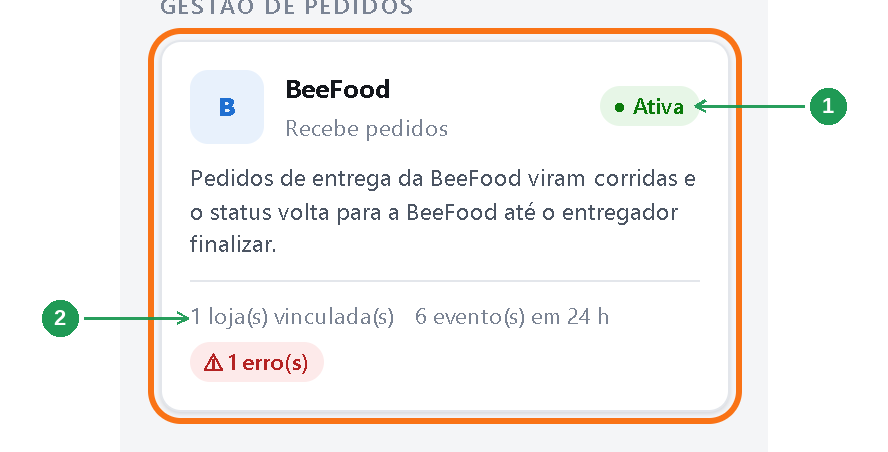

| Nº | O que observar |
|----|----------------|
| 1 | Selo **Ativa** — integração ligada. Se estiver desligada, nenhum pedido entra. |
| 2 | **Lojas vinculadas, eventos em 24 h e erros** — é o primeiro lugar a olhar quando um pedido não chega. |

### Passo 7. Vincular loja: colar a credencial e testar

No quadro **Lojas BeeFood**, em **Vincular loja**, a equipe escolhe o **Comércio no sistema**
(1), cola o **Client ID** (2) e o **Client Secret** (3) que você mandou, deixa **Credencial do
sandbox** desmarcado (4) e clica em **Testar credencial e vincular** (5). O teste responde com o
**nome da sua loja no BeeFood** — é assim que os dois lados sabem que a credencial é a certa.

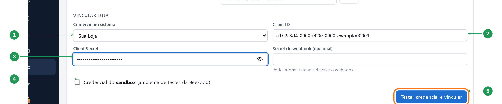

| Nº | Campo | O que observar |
|----|-------|----------------|
| 1 | **Comércio no sistema** | A sua loja como ela está cadastrada no Route Delivery. |
| 2 | **Client ID** | O valor da seta 1 do Passo 5. |
| 3 | **Client Secret** | O valor da seta 2 do Passo 5. |
| 4 | **Credencial do sandbox** | ⚠️ Fica **desmarcado**. Credencial criada em **Aplicativos → API Aberta** nunca é de teste — marcar isso faz o Route Delivery procurar os seus pedidos no ambiente errado. |
| 5 | **Testar credencial e vincular** | Confirma que o BeeFood aceitou e cria o vínculo. A resposta traz o nome da loja. |

> O campo **Secret do webhook (opcional)**, ao lado, fica em branco por enquanto: esse valor só
> nasce quando você cadastrar o webhook, nos Passos 11 e 12. A própria tela avisa — *pode
> informar depois de criar o webhook*.

**Tem mais de uma loja?** Repita a Parte 1 para cada uma: **cada loja tem a própria credencial**
e o próprio endereço de webhook. Se as suas filiais compartilham a mesma conta do BeeFood, vale
conversar com a equipe Route Delivery antes — hoje os pedidos de todas as filiais daquela
credencial vão para o comércio escolhido no vínculo.

### Passo 8. Ativar a integração

Na primeira loja, a equipe clica em **Ativar integração**, no topo da tela. Com a integração
ligada, aparece o selo **Ativa** (1) e o botão passa a ser **Pausar integração** (2).

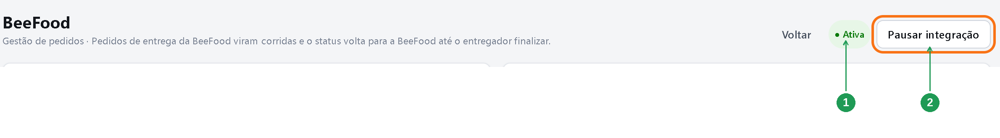

| Nº | O que observar |
|----|----------------|
| 1 | Selo **Ativa** — a integração está recebendo pedidos. |
| 2 | **Pausar integração** — para tudo, de todas as lojas. Para parar só uma, existe o **Pausar** na linha dela. |

### Passo 9. Combinar quando o entregador é chamado

Duas escolhas mudam o seu dia a dia, e vale combiná-las com a equipe antes de ligar a
integração.

**Quando o entregador é chamado.** Por padrão — e é o recomendado — o pedido entra como *Criado*
e os entregadores são chamados quando você marca o pedido como **Pronto** no BeeFood. Se a sua
loja prefere chamar na hora, a equipe marca **Liberar o pedido para os entregadores assim que
chegar** (1), no quadro *Credenciais*, e a etapa *Em preparo* é pulada.

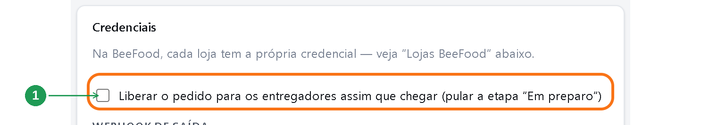

| Nº | Campo | O que observar |
|----|-------|----------------|
| 1 | **Liberar o pedido para os entregadores assim que chegar** | Desmarcado = os entregadores são chamados quando você marca **Pronto**. Marcado = são chamados na hora em que o pedido entra. |

**Pedidos de marketplace.** iFood, 99Food, Keeta e aiqfome **só entram** se o canal estiver
marcado em **Trazer também os pedidos destes canais** (1). Deixe desmarcado se a sua loja já usa
a integração direta daquele canal com o Route Delivery — senão o pedido chega duas vezes. O
botão **Buscar pedidos agora** (2) força uma busca imediata, útil para testar o vínculo.

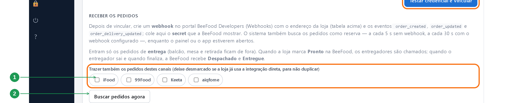

| Nº | Campo | O que observar |
|----|-------|----------------|
| 1 | **Trazer também os pedidos destes canais** | iFood, 99Food, Keeta e aiqfome. Vem **desmarcado**. Marque só o que a sua loja mesma entrega. |
| 2 | **Buscar pedidos agora** | Busca imediata, sem esperar o webhook nem a busca de reserva. |

> **O texto dessa tela manda criar o webhook no portal BeeFood Developers.** É o mesmo recado do
> artigo, e o endereço e os eventos continuam valendo — só o caminho muda: você cadastra o
> webhook em **Aplicativos → API Aberta**, como mostra a Parte 3.

---

## Parte 3 — De volta ao BeeFood: o webhook

O webhook é o aviso que o BeeFood manda ao Route Delivery a cada pedido: com ele o pedido chega
em **1 a 2 segundos**. **Sem ele a integração funciona, mas de forma pior:** o Route Delivery
passa a buscar os pedidos a cada 5 segundos e **só enquanto algum painel ou o app de algum
entregador estiver aberto**. Loja fechada no painel, pedido parado. Cadastre o webhook.

### Passo 10. Copiar o endereço do webhook no Route Delivery

A equipe Route Delivery copia o endereço na linha da sua loja, em **Integrações › BeeFood** — é
a coluna **Webhook (cadastre na BeeFood)** (1), com o botão **Copiar** (2) ao lado — e manda
para você. O endereço é **único da sua loja** e tem este formato:

```
https://routedelivery.vercel.app/api/beefood/webhook/…
```

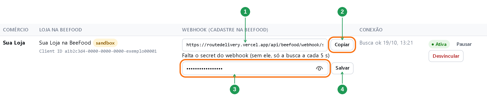

| Nº | Campo | Quando se usa |
|----|-------|---------------|
| 1 | **Endereço do webhook da loja** | Agora: é o que você vai colar no BeeFood, no Passo 11. |
| 2 | **Copiar** | Copia o endereço inteiro. Ele é longo — copiar à mão convida a erro. |
| 3 | **Campo do secret do webhook** | Depois: é onde a equipe cola o *Secret do webhook* que o BeeFood vai mostrar a você no Passo 12. |
| 4 | **Salvar** | Grava o secret. A linha passa a mostrar *✓ Secret do webhook salvo*. |

> Enquanto o secret não é salvo, a linha avisa: *Falta o secret do webhook (sem ele, só a busca a
> cada 5 s)*. A coluna **Conexão**, à direita, mostra a hora da última busca e avisa se o
> BeeFood recusar a credencial.

> **A etiqueta `sandbox` ao lado do nome da loja, nessa imagem, é do exemplo do parceiro.** Ela
> aparece quando a credencial foi criada no ambiente de testes. Seguindo este manual ela **não**
> deve aparecer — se aparecer, veja a tabela *Quando algo não funciona*.

### Passo 11. Cadastrar o webhook em Aplicativos → API Aberta

Volte ao painel da **API Aberta** e clique na aba **Webhooks**. Depois clique em **NOVO
WEBHOOK** (1).

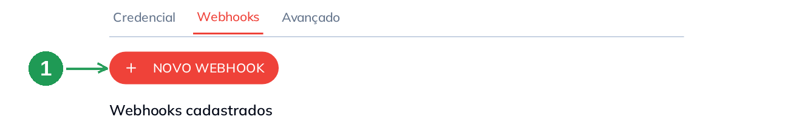

| Nº | O que fazer |
|----|-------------|
| 1 | **NOVO WEBHOOK** — abre o formulário. Os webhooks já cadastrados ficam logo abaixo, em **Webhooks cadastrados**. |

No formulário, cole a **URL (https)** (1) que a equipe mandou no Passo 10. Em **Eventos**, ligue
exatamente três: **Pedido criado**, **Pedido atualizado** e **Entrega atualizada** (2) — e
**desligue** *Pagamento criado* e *Pagamento atualizado*, que o Route Delivery não usa. Preencha
o **E-mail de contato** (3). Deixe a **Autenticação Basic em branco** (4). Clique em **SALVAR
(F2)** (5).

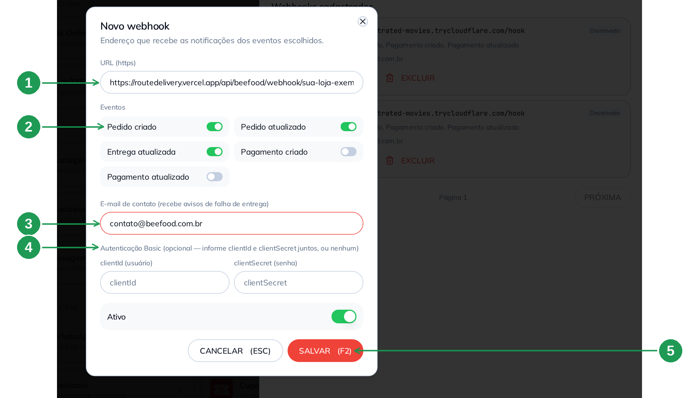

| Nº | Campo | O que fazer |
|----|-------|-------------|
| 1 | **URL (https)** | Cole o endereço da seta 1 do Passo 10. Tem de começar com `https://`. |
| 2 | **Eventos** | Ligue **Pedido criado**, **Pedido atualizado** e **Entrega atualizada** (`order_created`, `order_updated`, `order_delivery_updated`). Deixe os dois de pagamento desligados. |
| 3 | **E-mail de contato** | Seu e-mail. Recebe o aviso se a entrega do webhook falhar — não deixe em branco. |
| 4 | **Autenticação Basic** | **Em branco**, os dois campos. O Route Delivery não usa usuário e senha aqui: ele confere o aviso pelo *Secret do webhook*. |
| 5 | **SALVAR (F2)** | Grava o webhook. **CANCELAR (ESC)** desiste. |

> **Não há ambiente para escolher.** O portal de desenvolvedor pede *Sandbox* ou *Produção* e vem
> com Sandbox marcado; pelo painel, o webhook já nasce de produção.

### Passo 12. Guardar o secret, conferir a linha e devolvê-lo ao parceiro

Depois de salvar, o BeeFood mostra o **Secret do webhook** (1) **uma única vez**. Copie, e só
então clique em **JÁ GUARDEI** (2) para fechar o aviso. Confira que a linha do webhook aparece
com o selo **Ativo** (3).

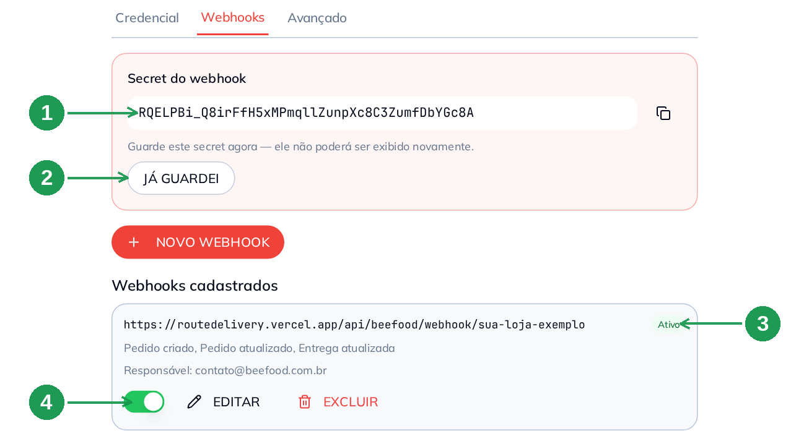

| Nº | Campo | O que fazer |
|----|-------|-------------|
| 1 | **Secret do webhook** | Copie **agora**: ele não é exibido de novo. É com ele que o Route Delivery confere que o aviso veio mesmo do BeeFood. |
| 2 | **JÁ GUARDEI** | Fecha o aviso do secret. Só clique depois de copiar. |
| 3 | Selo **Ativo** | Webhook desativado não envia nada. |
| 4 | **Chave, EDITAR e EXCLUIR** | A chave **desativa sem apagar** (útil para pausar). **EDITAR** muda URL e eventos. **EXCLUIR** é definitivo, e as notificações param na hora. |

**Mande o secret para a equipe Route Delivery.** Ela cola no campo da linha da sua loja, que é a
seta 3 do Passo 10, e clica em **Salvar**, a seta 4 do Passo 10: a linha passa a mostrar *✓
Secret do webhook salvo*, e a integração está completa.

> **Perdeu o secret antes de mandar?** Ele não volta. O caminho certo é **EXCLUIR** a linha e
> repetir o Passo 11 com a mesma URL: o cadastro novo gera um secret novo, que a equipe salva no
> lugar do antigo. Combine antes com ela, porque entre excluir e cadastrar de novo nenhum aviso
> é enviado.

---

## Parte 4 — Pronto: acompanhando os pedidos

Daqui para frente não há mais nada a configurar. No Route Delivery, os pedidos aparecem em
**Operação** como **BeeFood #número** — o mesmo número que você vê no BeeFood — com cliente,
telefone, endereço, posição no mapa e o canal de venda na observação. O que o entregador cobra
vem escrito no pedido.

Em **Integrações › BeeFood**, a lista **Últimos eventos** registra cada pedido recebido e cada
status enviado. É o lugar de olhar quando a dúvida é *"chegou?"*.

---

## Como funciona no dia a dia

1. O pedido de **entrega** entra no BeeFood (cardápio digital, PDV, WhatsApp, pedido manual ou
   marketplace liberado).
2. O webhook avisa o Route Delivery **na hora** — 1 a 2 segundos.
3. Você marca o pedido como **Pronto** no BeeFood e os entregadores são chamados. (Com a opção
   do Passo 9 marcada, eles são chamados assim que o pedido chega.)
4. O entregador **sai para a entrega** → o pedido vira **despachado** no BeeFood.
5. O entregador **finaliza** → o pedido vira **entregue** no BeeFood.

Pedido cancelado no BeeFood cancela a corrida, desde que ela ainda não tenha sido entregue. Se
já havia um entregador com o pedido, o painel do Route Delivery recebe um aviso para a equipe
combinar a devolução com ele.

**Ligou a integração agora?** Na primeira busca entram os pedidos de entrega das **últimas 2
horas** que ainda não foram despachados, entregues ou cancelados. Mais antigos que isso não
entram.

---

## Quando algo não funciona

| Sintoma | O que verificar |
|---------|-----------------|
| Não encontro o card **API Aberta** | Ele está em liberação por etapas. Confirme com o suporte BeeFood se a sua conta já tem, e se o seu usuário tem permissão no menu **Aplicativos**. |
| O painel mostra **Ambiente de testes** em vez da credencial | Sua empresa está em ambiente de testes. Nesse caso as credenciais ficam em `docs.beefood.app`. |
| **A credencial foi recusada** | Confira se o selo da credencial diz **Ativa**, se o **Client Secret** foi enviado inteiro (revele com o ícone de olho e copie pelo botão) e se **Pedidos** e **Loja** estão ligados (Passo 3). |
| O Route Delivery mostra **`sandbox`** ao lado do nome da loja | A credencial colada veio do portal, criada em *Sandbox*, ou a caixa **Credencial do sandbox** ficou marcada no vínculo, a seta 4 do Passo 7. Mande a credencial do painel (Passo 5) e peça para vincular de novo. |
| Sem a permissão de **Loja**, o vínculo funciona mas não mostra o nome da loja | É esperado. Ligue *Consultar* em **Loja** e peça para testar a credencial de novo. |
| A linha da loja diz **Falta o secret do webhook** | O secret do Passo 12 não chegou à equipe, ou não foi salvo. Mande o secret; se você já o perdeu, cadastre o webhook de novo e mande o novo. |
| O pedido entrou no BeeFood e **não virou corrida**: *Pedido sem cliente e endereço de entrega* | O pedido foi lançado sem cliente ou sem endereço. No pedido de entrega, escolha ou cadastre o cliente com o endereço completo (rua, número, bairro e cidade). |
| Os pedidos chegam **com atraso** | Provavelmente o webhook não está cadastrado, ou está *Desativado*. Sem webhook, o Route Delivery só busca enquanto um painel ou o app de um entregador está aberto. |
| **O webhook foi desativado sozinho** | O Route Delivery informa que o BeeFood desativa o webhook depois de **5 tentativas de envio sem sucesso**, e avisa o e-mail cadastrado. Volte à aba **Webhooks** e religue pela chave. Enquanto isso a busca de reserva continua trazendo os pedidos. |
| Os pedidos pararam de uma hora para outra | Confira se a credencial do Route Delivery está **Ativa** em *Todas as credenciais*, se o webhook está **Ativo**, e se a integração não foi pausada do lado do parceiro (Passo 8). |
| Pedido de **retirada**, **balcão** ou **mesa** não virou corrida | É o comportamento esperado: só pedido de entrega vira corrida. |
| Pedido de **iFood** não entrou | Só entra se o canal estiver marcado em **Trazer também os pedidos destes canais** (Passo 9). |
| **Pedidos antigos** não entraram | Só entram os das últimas **2 horas** na primeira busca. |

---

## Perguntas frequentes

**Preciso do portal de desenvolvedor do BeeFood para integrar o Route Delivery?**
Não. A credencial e o webhook se cadastram em **Aplicativos → API Aberta**, dentro do painel do
BeeFood. O portal continua existindo e mostra a mesma credencial principal.

**Onde fica a API Aberta no BeeFood?**
Menu **Aplicativos**, seção **API e MCP**, card **API Aberta**. O painel abre à direita com as
abas **Credencial**, **Webhooks** e **Avançado**.

**Como crio a credencial do Route Delivery?**
Em **Aplicativos → API Aberta**, aba **Credencial**, botão **CRIAR CREDENCIAL** (Passo 3). O
diálogo já vem com as permissões ligadas: basta **CRIAR (F2)**.

**Posso usar a credencial principal em vez de criar uma?**
Pode, e funciona. Criar uma só para o Route Delivery é melhor porque dá para desligá-la ou
excluí-la depois sem afetar nenhuma outra integração.

**Quantas credenciais posso criar?**
Quantas fizerem sentido — uma por parceiro é um bom critério. Todas ficam listadas em **Todas as
credenciais**, no fim da aba **Credencial**.

**Quais permissões o Route Delivery precisa?**
**Pedidos** com *Consultar* e *Alterar*, e **Loja** com *Consultar* (os scopes `orders:read`,
`orders:write` e `store:read`). Toda credencial nova já nasce com tudo ligado.

**Perdi o Client Secret. Preciso criar outra credencial?**
Não. Clique no **ícone de olho** no campo *Client Secret* do cartão da credencial, em **Todas as
credenciais**, e ele é exibido de novo.

**Preciso escolher o ambiente Produção?**
Pelo painel, não existe essa escolha: credencial e webhook criados em **Aplicativos → API
Aberta** já são de produção. A escolha de ambiente só aparece no portal de desenvolvedor, e é lá
que mora o erro de criar tudo em *Sandbox*.

**O que o botão RECICLAR faz?**
Troca o Client ID e o Client Secret da credencial. **Todas as integrações que a usam param na
hora** e precisam dos valores novos. Não clique por curiosidade.

**Quem vincula a loja: eu ou o Route Delivery?**
A **equipe Route Delivery**, no painel administrativo dela. Você cria a credencial no BeeFood e
manda o Client ID e o Client Secret para ela.

**Como mando a credencial com segurança?**
Pelo canal combinado com a equipe, e só no momento do cadastro. O **Client Secret** é a senha da
sua loja no BeeFood: nunca em grupo de mensagem.

**O webhook é obrigatório?**
Não, mas sem ele a integração fica pior: o Route Delivery passa a buscar os pedidos a cada 5
segundos e **só enquanto um painel ou o app de um entregador estiver aberto**. Com o webhook, o
pedido chega em 1 a 2 segundos, e a busca de reserva cai para uma a cada 30 segundos.

**Quais eventos devo ligar no webhook?**
Três: **Pedido criado**, **Pedido atualizado** e **Entrega atualizada**. Os de pagamento ficam
desligados — o Route Delivery não os usa.

**No webhook, o que vai em clientId (usuário) e clientSecret (senha)?**
**Nada.** A autenticação Basic fica em branco para o Route Delivery. Se você preencher um dos
dois, o BeeFood exige o outro — e o parceiro não espera nenhum dos dois.

**Para que serve o Secret do webhook?**
É o valor com que o Route Delivery confere que o aviso veio mesmo do BeeFood. A equipe cola esse
secret na linha da sua loja, no painel dela (Passo 12). O BeeFood o mostra **uma única vez**.

**Onde pego o endereço do webhook?**
Com a equipe Route Delivery: ele está na coluna **Webhook** da linha da sua loja, em *Integrações
› BeeFood*, e é **único de cada loja**.

**Posso pausar o envio sem apagar o webhook?**
Sim. Use a **chave** na linha do webhook: ele fica *Desativado* e para de enviar, mantendo URL e
eventos.

**Como corto o acesso do Route Delivery?**
Desligue (ou exclua) a credencial que você criou para ele, em **Todas as credenciais**, e
desative o webhook. A credencial principal e as outras integrações seguem funcionando.

**Tenho mais de uma loja. Uso a mesma credencial?**
Não. Crie **uma credencial por loja** e peça o vínculo de cada uma: o endereço do webhook também
é um por loja.

**Pedido de retirada, balcão ou mesa vira corrida?**
Não. Só pedido de entrega.

**Quando o entregador é chamado?**
Por padrão, quando você marca o pedido como **Pronto** no BeeFood. A equipe pode mudar para
*assim que o pedido chega* (Passo 9).

**O pedido vira despachado e entregue sozinho no BeeFood?**
Sim. O entregador sair marca **despachado**; finalizar marca **entregue**.

**Cancelei o pedido no BeeFood. A corrida cancela?**
Sim, desde que a entrega ainda não tenha sido concluída. Se um entregador já estava com o
pedido, a equipe do Route Delivery recebe um aviso para combinar a devolução.

**Os pedidos antigos entram quando a integração é ligada?**
Só os de entrega das **últimas 2 horas** que ainda não foram despachados, entregues ou
cancelados.

---

## Precisa de ajuda?

Fale com o **suporte BeeFood** informando: nome da loja e **CNPJ**, **filial**, o **Client ID**
usado (nunca o Client Secret), se o webhook está **Ativo**, a **URL** cadastrada e o horário da
tentativa. Para o que é do lado do aplicativo — vínculo da loja, praça, valor da corrida,
entregador — fale com a **equipe Route Delivery**, pelo painel da sua loja, em **Mensagens**.

---

## Onde continuar

- **Outras entregas terceirizadas:** *Entregas Expressas*, *Let's Express*, *Foody Delivery*,
  *Pick N Go!* e *Uai Rango* têm manual próprio, e ficam em **Aplicativos → Entrega**.
- **Gestão de Entregas:** para entregador próprio, o BeeFood tem a tela de rota, despacho e
  fechamento.

---

*Última atualização: outubro/2026 — BeeFood · Aplicativos · API Aberta · Route Delivery*
